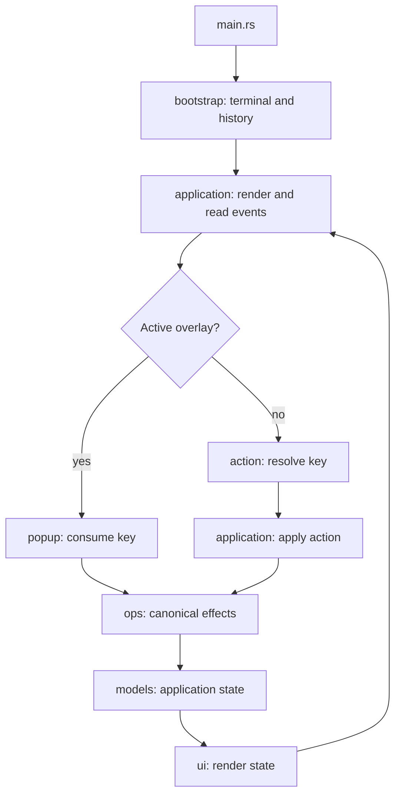
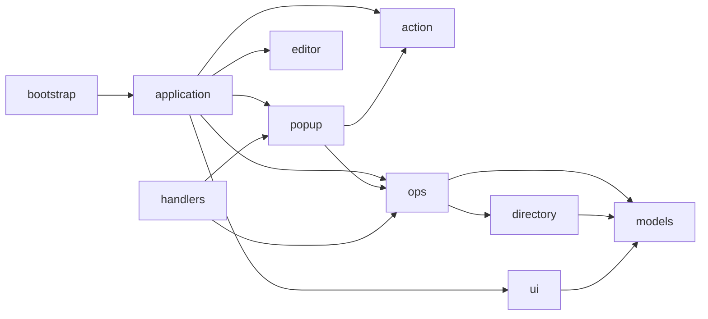

<!-- Purpose: Gives AI coding agents the repository workflow, architecture, and quality rules. -->

# Repository Guidelines for All LLMs / AI Agents

This file is the **entry point** for any LLM or AI coding agent (Claude Code, Gemini, Codex, Grok, Cursor, etc.) working on FunnyFileManager.

## How to Work Effectively (Lightweight RAG)

This project uses a structured, topic-based Retrieval-Augmented Generation system:

**Location:** `docs/knowledge-base/`

**Recommended workflow:**
1. Start by reading `docs/knowledge-base/00-index.md`.
2. When you need information on a topic, read the specific module file(s) from the knowledge base.
3. Modules are organized by theme (see the numbered directories).

### Most Important Modules

- **Rust Type System & Enums** (critical): `03-rust-best-practices/type-system.md`
- **System Architecture** (runtime, control flow, invariants): `02-architecture/system-architecture.md`
- **Module Structure**: `02-architecture/module-structure.md`
- **Testing Strategy**: `05-testing/testing-strategy.md`
- **Core Features** (file ops, S3, command line): `07-core-features/`
- **Far Manager Compatibility**: `09-far-manager-compatibility/hotkeys-and-parity.md`

Full index and usage guide: `docs/knowledge-base/00-index.md`

## Core Philosophy

This project places extremely high value on using Rust's type system effectively — particularly **enums for state** and **newtypes** for domain values — to make illegal states unrepresentable and produce robust code.

See `docs/knowledge-base/03-rust-best-practices/type-system.md` for details and current examples (`Overlay`, `Command`, `BookmarkSlot`, `VirtualPath`, etc.).

## Project Structure & Module Organization

- `src/main.rs`: Thin entry point - calls `funny_file_manager::run()`.
- `src/bootstrap.rs`: Production startup; loads history and creates the terminal session.
- `src/lib.rs`: Module declarations and stable public API re-exports.
- `src/application/`: Event loop, modal-first key/mouse dispatch, and action effects.
- `src/diagnostics.rs`: Opt-in logging and application outcome reporting.
- `src/directory.rs`: Filesystem adapter producing complete panel snapshots.
- `src/action.rs`: Pure main-view key-to-`Action` mapping.
- `src/action/keymap.rs`: Shared ordered `keymap!` DSL with explicit modifier policies.
- `src/action/editor.rs`: Pure declarative editor keymap and typed `EditorCommand` language.
- `src/action/wsl.rs`: Pure WSL manager keymap and typed `WslCommand` language.
- `src/application/wsl_jobs.rs`: Serial WSL background worker with an injected backend.
- `src/command.rs`, `src/lineedit.rs`, `src/complete.rs`: Command parsing, editing, history recall, and completion.
- `src/console.rs`, `src/status.rs`: Typed command transcript and user-facing outcomes.
- `src/models.rs`: Application/domain state (`App`, `Panel`, `DirEntry`, `Viewer`, `SortMode`); panel loading and editor saves are implemented under `ops/`.
- `src/ui.rs`: TUI rendering with ratatui.
- `src/popup.rs`: Modal input handling; depends directly on canonical operations.
- `src/ops/`: Canonical command, file, directory navigation, editor save, shell, viewer, and MCP-status operations.
- `src/handlers/mod.rs`: Backward-compatible re-exports; no operation implementation.
- `src/terminal.rs`: RAII lifecycle for the TUI session and external-editor suspension.
- `src/utils.rs`: Utility functions (`format_size`, `unique_destination`, `copy_dir_all`).
- `src/editor.rs`: Built-in F4 editor opening and external Alt+F4 integration.
- `src/s3.rs`: AWS S3 integration.
- `src/keepass.rs`: Optional KeePass backend (`--features keepass`).
- `mcp/`: Standalone `ffm-mcp` crate; exposes root-confined file and S3 tools over MCP stdio.
- `src/<owner>/tests.rs` or `src/<owner>/tests/`: Private unit tests, included only under `cfg(test)`.
- `src/test_support/`: Explicit test adapters, fixtures and coverage probes.
- `tests/`: Public integration, mutation, coverage, and hotkey tests.
- `coverage/` and `tarpaulin-report.html`: Stored coverage artifacts (update only when intentionally refreshing coverage).
- `target/`: Cargo build output (ignored by git).

If you add major features, prefer extracting modules under `src/` and keeping `main.rs` focused on wiring and startup.

## Architecture

FunnyFileManager is a state-driven TUI with a thin binary, a library-owned
event loop, and a separate MCP server process. The root crate owns the
interactive application; `mcp/` is an independent binary and does not
participate in the TUI event loop.

### Runtime Flow



Input is modal-first. An active `Overlay` consumes every key, including keys it
does not support. With no overlay, `action::resolve` is a pure key-to-`Action`
mapping; `application/dispatch.rs::apply_action` owns effect dispatch. Rendering reads `App`
after each transition and never decides which operation to run.

Editor input follows the same DSL pattern: `action/editor.rs` resolves keys to
`EditorCommand`, then `popup/editor.rs` interprets the command through model
transitions and canonical operations. Editor confirmation and search prompts
consume input before that resolution. Submitted command lines similarly parse
to `Command` before `ops/dispatch.rs` interprets them.

### State Model

- `App` is the central aggregate: two `Panel`s, the active side, view, overlay,
  lifecycle, bookmarks, status, quick search, history, and console transcript.
- `Overlay` is the single source of modal state. Its enum variants make two
  simultaneously-open dialogs unrepresentable.
- `ViewMode` (`Panels` or `Console`) is orthogonal to `Overlay`, so dialogs and
  the command line can exist over either background.
- `Lifecycle` (`Running` or `Quitting`) is the only application-exit state.
- Each `Panel` owns its selection invariant; callers use panel methods instead
  of editing the selection index directly.
- Domain newtypes and enums (`FileName`, `FileSize`, `Cells`, `ScrollTop`,
  `QuickSearch`, `Status`, and others) keep units and state transitions explicit.

### Dependency and Ownership Boundaries



- `src/ops/` is the sole implementation owner for command dispatch, file
  operations, shell execution, viewing, and MCP-status operations.
- `src/handlers/mod.rs` only re-exports stable paths. Do not add implementations
  there, and do not make `popup` depend on `handlers`.
- `action` performs no filesystem or terminal I/O. `ui` renders state but does
  not execute operations. `terminal` and `bootstrap` own host-terminal effects.
- The shared `keymap!` DSL uses ordered bindings: `has(...)` allows extra
  modifiers, `exact(...)` accepts only the named set, and `without(...)` rejects
  named modifiers. Keep editor clipboard combinations exact and text insertion
  free of Control/Alt; unsupported editor input resolves to `Ignore`.
- The command path is `CommandLine` state -> `lineedit`/`complete` ->
  `Command::parse` -> `ops::execute_command` -> built-in operation or bounded
  shell execution. Results update typed `Status` and `ConsoleLog` values.
- Optional adapters remain behind Cargo features (`s3`, `keepass`).
  `test-helpers` exposes seams and test-only visibility, never alternate runtime
  behavior.
- `mcp/` uses its own path-validation and filesystem-operation modules. It
  confines requests to its configured root and shares only the canonical MCP
  tool-name list with the TUI status view.

### Where Changes Belong

| Change | Primary owner |
|--------|---------------|
| Main-view hotkey | `src/action.rs`, then effect dispatch in `src/application/dispatch.rs` |
| Editor key binding or command | `src/action/editor.rs`, then interpretation in `src/popup/editor.rs` |
| Modal/dialog key behavior | `src/popup.rs` or a focused `src/popup/` child |
| Command syntax or validation | `src/command.rs` |
| Command editing/completion/history | `src/lineedit.rs`, `src/complete.rs`, `src/history.rs` |
| File, shell, viewer, or command effect | Matching module under `src/ops/` |
| Application/domain state | `src/models.rs` or a focused `src/models/` child |
| Rendering/layout | `src/ui.rs` or a focused `src/ui/` child |
| Terminal setup/suspension/restoration | `src/bootstrap.rs`, `src/terminal.rs` |
| MCP tool or root-confined MCP filesystem behavior | `mcp/src/` |

Full module-level detail remains in
`docs/knowledge-base/02-architecture/module-structure.md`.

## Build, Test, and Development Commands

- `cargo run` (or `cargo run --bin ffm`): Run locally with fast incremental development builds.
- `cargo run --release`: Run with production optimization.
- `cargo build --release`: Build an optimized binary (output under `target/release/`).
- `cargo test`: Run the test suite.
- `cargo test --features test-helpers`: Include helper-gated integration tests.
- `cargo test -- --ignored`: Run tests marked `#[ignore]` (used for manual/interactive cases).
- `cargo fmt`: Format code with `rustfmt`.
- `cargo clippy -- -D warnings`: Lint and fail on warnings.
- `./ffm.sh lint`: Run the shared local/CI format and Clippy gate: root default,
  all features, and no-default-features with test-helpers, plus MCP and Colorer;
  Clippy checks all targets.
- `./ffm.sh lint self-test`: Verify readability rejection, acceptance, and
  equivalent behavior with compiler fixtures; requires Python.

Optional coverage (tooling may be platform-dependent): `cargo tarpaulin --out Html --output-dir coverage`.

## Rust Best Practices (Strongly Enforced)

Rules that must be followed when writing or reviewing code. This project is intentionally moving toward heavy use of enums and domain-specific types.

**Primary detailed reference**: `docs/best-practices.md` → **"Rust Type System & Modeling (Enums & Newtypes)"**

### Core Mandatory Rules

- Use `?` for error propagation. Never use `unwrap()` in library code (except tests/main).
- Prefer `&str` / `&Path` over owned types in function signatures when possible.
- **Strongly prefer enums for state** instead of multiple `bool`/`Option` fields (see the `Overlay` enum).
- Use **newtypes** instead of raw primitives for domain concepts (`BookmarkSlot`, `FileSize`, IDs, etc.).
- "Make illegal states unrepresentable" using the type system whenever feasible.
- Follow all enforced Clippy rules and run the shared gate (`./ffm.sh lint`).
- Enforce the shared `clippy.toml` complexity limits: at most 30 lines per
  function as counted by Clippy, nesting depth 4, and cognitive-complexity
  score 25. Nesting includes surrounding blocks such as `impl`; the score is
  a heuristic, not proof that code is understandable.
- Refactor violations into coherent responsibilities, including tests and
  formatting tables. Do not suppress complexity lints at function, module, or
  crate scope; do not raise thresholds or introduce accepted-warning baselines.
- Use TDD for new behavior and fixes: write the behavioral test, observe its
  relevant failure, implement the smallest complete change, then refactor while
  keeping tests green. Keep test fixtures and assertions separate from runtime code.
- Every `pub fn` in `src/` must have at least one test using `tempfile::TempDir` where appropriate.
- Use Conventional Commits and include verification steps in PRs.

### Error Handling

- One error enum per module boundary (`KeepassError`, `KdbxError`, `OpError`),
  with `Display` and `std::error::Error`; `From` impls only where the mapping
  is total. Never `Box<dyn Error>` in library code.
- Distinguish "cannot" from "not found": a locked vault is `Locked`, not
  `EntryNotFound`. Callers branch on variants, never on message text.
- Error values carry no secrets and no absolute machine paths; user-facing
  text is a fixed English sentence, the detail goes to the log.
- `expect("…")` is allowed only for invariants the type system already
  guarantees, with the reason in the message. `unwrap()` is for tests.
- Do not swallow errors: an `Err` from an operation reaches the status bar
  or the log; `let _ = …` needs a comment saying why the failure is fine.

### Ownership and Borrowing

- Take `&str`, `&Path`, `&[T]`; return owned values. Clone at the edge, not
  in the loop — a `.clone()` inside an iterator chain needs a reason.
- `impl AsRef<Path>` / `impl Into<String>` on constructors only; concrete
  types everywhere else so the signature reads as prose.
- Prefer `Cow<'_, str>` when a function usually returns its input unchanged.
- No `Rc<RefCell<_>>` or `Arc<Mutex<_>>` in single-threaded state; the `App`
  tree is owned, and mutation goes through `&mut App`.
- Lifetimes on public structs only when they are the point (`Highlighted<'a>`);
  otherwise own the data.

### Types: Enums and Newtypes

- A state with N shapes is an enum with N variants, each carrying exactly the
  data valid in that shape (`KdbxState::Locked(UnlockPrompt)` /
  `Unlocked(Vault)`). Two `Option`s that are "either both or neither" are a
  bug in the type.
- `match` is exhaustive; a `_ =>` arm on a crate-local enum is only for
  fall-through that must stay open-ended, with a comment.
- Newtypes for identity and units: `EntryId`, `Cells`, `CharColumn`,
  `FileSize`. Derive only what the concept supports — a secret derives
  neither `Debug` nor `Display` (`MasterKey`, `Secret`).
- Parse at the boundary: raw input becomes a typed value once
  (`command::parse`, `action::resolve`), and everything downstream takes the
  typed value.
- `#[must_use]` on functions whose ignored result is a bug (builders,
  "did it change" booleans).

### Modules and File Layout

**A module is a file; the directory next to it holds that module's children.**
This is the Rust 2018 form, and it is what you will see almost everywhere
here — 201 modules use it against 11 `mod.rs` files:

```
src/action/
├── editor.rs        # the module: its code, its types, its `mod` declarations
└── editor/          # NOT the module — only its children
    └── tests.rs
```

`editor.rs` owns the code and ends with `mod tests;`, which is what pulls
`editor/tests.rs` in. Both are `crate::action::editor`; the path does not
change with the layout.

If you came looking for `src/action/editor/` and found only tests, the code is
the **sibling file**, `src/action/editor.rs`. A directory holding nothing but
`tests.rs` is normal and not a missing implementation.

- **Do not add new `mod.rs` files.** The older `foo/mod.rs` form puts the code
  inside the directory, which reads more naturally in a file tree but leaves
  an editor showing ten tabs all called `mod.rs` with nothing to tell them
  apart. Naming the file after the module is why the 2018 form exists.
- The eleven existing `mod.rs` files (`ops/`, `application/`, `handlers/`,
  `test_support/`, and test aggregators under them) are deliberate: each is a
  façade whose whole job is re-exporting a subsystem, so "the directory" *is*
  the unit. Leave them.
- **Moving some module files breaks the architecture test.**
  `tests/module_boundaries_test.rs` names exact paths: `src/bootstrap.rs`,
  `src/editor.rs`, `src/lib.rs`, the canonical owners under `src/ops/`, the
  removed `src/handlers/*` files and the MCP modules. A moved file fails with
  `<path> is not in the source set` or a wrong-owner message. Renaming one of
  them is therefore a two-file change: the file and that test.
- Either form is otherwise a pure file-placement choice: `git mv foo.rs
  foo/mod.rs` changes no module path, no `use`, no public API. Because nothing
  observable changes, converting one module in isolation buys nothing and
  costs an exception the next reader trips over. Convert the whole tree or
  none of it.
- Target ≤ 300 lines per file; the guard test in
  `tests/file_line_limit_test.rs` enforces the hard cap. Split by
  responsibility into `<module>/<part>.rs` child modules, never by line count.
- Unit tests live beside the code in `<module>/tests*.rs` child modules,
  never inline `mod tests {}` blocks in a production file.
- Ownership is one-directional: `ui` and `action` never touch `std::fs`,
  `std::process`, `std::net`, `ops`, `directory`, `popup`, `editor`,
  `terminal`, `handlers` or the event loop; `models` never reaches up into
  them either. `popup` calls `ops`, never `handlers`. The full rule list and
  the checker's limits are in
  `docs/knowledge-base/02-architecture/module-structure.md` ("Architecture
  checks"). Each `Overlay` variant is wired `ops::<f>::open` →
  `popup::<f>::process` → `ui::<f>::render`.
- Every file starts with a `//! Purpose:` line saying what it owns and, when
  the answer is not obvious, why it is a separate file.
- `pub` is the exception: `pub(crate)` by default, `pub` only for what
  `lib.rs` re-exports or `tests/` exercises.

### Collections and Iterators

- Iterator chains over index loops; `for` when the body mutates two things.
- `Vec` by default; `BTreeMap` when order is observable (config, exports);
  `HashMap` only for lookup tables that are never rendered.
- `sort_unstable_by_key` unless stability is a requirement; `sort_by` with a
  comparator function that has a name.
- Pre-size with `Vec::with_capacity` only when the count is already known;
  never `collect()` just to iterate again.
- Slices and `windows`/`chunks` over manual index arithmetic; `split_at`
  over two `..` ranges.

### Naming

- Modules and files: `snake_case` nouns for state, verbs for operations
  (`models/panel.rs`, `ops/copy.rs`).
- Functions read as prose in the call site: `panel.enter()`,
  `vault.move_selection(Motion::Next, now)`. Booleans ask a question
  (`is_locked`, `has_marks`); no `get_` prefix on plain accessors except the
  legacy `get_active_panel` family.
- Tests are sentences that state the behaviour, not the method:
  `f8_deletes_the_selected_entry_and_ctrl_z_restores_it`.
- Constants name the concept, not the value: `IDLE_LOCK`, not `FIVE_MINUTES`.

### Performance

- Measure first: `cargo bench` (`benches/`), `perf`/flamegraph on a release
  build with `debug = 1`. No optimisation without a number before and after.
- Render paths allocate nothing per cell: reuse `String` buffers, take
  `&str` slices, and let ratatui's `Line`/`Span` borrow.
- Filesystem work happens in `directory::read` and `ops`, once per event,
  never inside `ui`. Blocking I/O (S3, SFTP) runs on its own runtime and
  reports back through state, never from a render.
- Hash or compare keys, not whole entries; cache derived data in the model
  (`Panel.entries` snapshots) rather than recomputing in every frame.

### Unsafe and Platform Code

- No `unsafe` outside `colorer-sys`, `windows.rs` and `terminal.rs`; each
  block carries a `// SAFETY:` comment stating the invariant.
- Platform branches are `#[cfg(windows)]` / `#[cfg(unix)]` functions with
  the same signature, chosen at the call site — not `if cfg!()` inside one
  function.
- Secrets: zeroize on drop (`MasterKey`, `Revealed`, `Secret`), 0600 files
  on Unix, never through the viewer/editor buffers, never in `{:?}` output.

### Testing

- `tempfile::TempDir` for every filesystem test; no test reads the checkout
  or the home directory. Fixtures use `/home/bob`, `/srv/x`, `example.com`
  (see `tests/private_data_lint_test.rs`).
- `App::with_panels` / `Panel::from_entries` instead of `App::new()` in
  tests — `App::new()` lists the real working directory.
- Rendering is asserted on a `TestBackend` buffer, by text and by style
  where the style is the behaviour (selection bar, masked password).
- Injection points are cfg-gated in-memory state (`FORCE_RENAME_FAILURE`),
  never environment variables.
- Run `cargo nextest run --features test-helpers`; filtersets use
  `test(~name)` and `binary(name)`.

### Clippy and Formatting

- `cargo clippy --all-targets --features test-helpers -- -D warnings` is
  the gate; `all`, `pedantic` and `nursery` are on, exceptions live only in
  `Cargo.toml [lints.clippy]` with a reason.
- `#[allow]`/`#[expect]` on an item needs a one-line justification and is
  reviewed like `unsafe`. `unfulfilled_lint_expectations` is `deny`, so a
  stale `#[expect]` fails the build.
- `rustfmt.toml`: `max_width = 100`, field-init shorthand. `cargo fmt --all`
  before every commit; CI checks it.

Full rationale and worked examples: `docs/best-practices.md` and
`docs/knowledge-base/03-rust-best-practices/type-system.md`.

Examples of good patterns already in the codebase: `Overlay`, `ViewMode`, `Command`, `EntryKind`,
`EditState`, `Recall`, `QuickSearch`, `DriveEntry`, `SortMode`, `PanelSide`, `VirtualPath`,
`BookmarkSlot`, `Bookmarks`, `FileSize`, `FileName`, `Cells`, `CharColumn`, `Caret`, `ScrollTop`,
`ScrollBack`, `RingIndex`, `ShellCommand`, `DurableLine`, `FailedEntry`, `Lifecycle`,
`Persistence`, `FileFormat`, `Bookmarks`. The full list, grouped by
what each buys, is in `docs/knowledge-base/03-rust-best-practices/type-system.md`.

## Commit & Pull Request Guidelines

- **Commit and push when a task is done.** Finishing a task means the work is in
  the repository, not sitting in a dirty working tree: run the gate
  (`cargo test`, `./ffm.sh lint`), commit, and push. Work left uncommitted is
  invisible to the next session and to anyone else working the same files — and
  this repo is worked from more than one machine, so a local-only change is one
  force-push away from gone.
- Pull before you start and again before you push; `pull.rebase` is on. When a
  rebase conflicts with a parallel change, merge the two intents rather than
  taking a side wholesale.
- History mixes simple subjects and Conventional Commit style (`feat:`, `test:`, `style:`). Prefer the prefixed style for new work.
- PRs should include: a short summary plus rationale, verification steps (`cargo test`), and a screenshot or recording for UI changes. Link related issues (for example `#12`) when applicable.

## Key Architecture Decisions

- **Canonical operations**: implementations live under `src/ops/`; `handlers` is only a compatibility facade, and `popup` never depends on it.
- **Far Manager UX**: dark blue background (RGB 0,0,128), cyan text, F-key commands.
- **Dual-panel layout**: independent left/right panels; `Tab` switches the active one, `Ctrl+U` swaps contents.
- **Overlay system**: one mutually-exclusive `Overlay` enum holds all modal state — two dialogs can never be open at once.
- **Modal-first input**: an active overlay consumes every key before `Action::resolve`; unsupported command-line keys leave its buffer unchanged.
- **Typed command DSLs**: main-view keys resolve to `Action`, editor keys to `EditorCommand`, WSL dialog keys to `WslCommand`, and submitted command text parses to `Command`. Pure translation precedes an exhaustive interpreter; editor confirmation/search and overlay routing retain priority. Keep state transitions in models and external effects in canonical operations.
- **Terminal RAII**: `TerminalSession` and `TerminalSuspension` own best-effort restoration after normal return, errors, partial transitions, and unwinding.
- **Feature-invariant runtime**: `test-helpers` exposes explicit seams and never selects alternate `run`, `main_impl`, or `handle_edit` implementations.
- **Selection preservation**: selection is kept after a panel reload.
- **Rename-with-fallback**: moves try an atomic rename, then fall back to copy+delete across filesystems.
- **Unique destinations**: never overwrites — adds a `_N` suffix (`unique_destination`).
- **Testable design**: terminal backend and event source are abstracted; injection points enable mutation testing.
- **WSL jobs**: models queue typed requests, `ops/wsl` interprets outcomes, and
  `application/wsl_jobs` runs one background worker through `WslBackend`.
  Closing the dialog does not cancel updates; request IDs prevent late results
  from reopening dialogs or navigating after close. Tests inject backends and
  must not update the host WSL installation or distribution packages.

## Testing

- `cargo test` — unit tests in separate owner-specific files (`#[cfg(test)]`) + public integration tests in `tests/`.
- `cargo test --features test-helpers` — includes helper-gated integration tests.
- Filesystem isolation via `tempfile::TempDir`.
- **Fault-injection points**: cfg-gated in-memory controls `FORCE_RENAME_FAILURE` (move fallback), `FORCE_COPY_DIR_ALL_STEP` (recursive-copy steps), and `FORCE_REFRESH_ERROR` (panel refresh). They are not environment variables.
- Logging tests pass explicit paths inside their own temporary directories; do not change process-wide `cwd` to redirect logs.
- Coverage: `cargo tarpaulin --out Html --output-dir coverage`. Mutation testing: `cargo mutants` (`.cargo-mutants.toml`).

## Dependencies

| Crate | Purpose |
|-------|---------|
| `ratatui` | TUI framework |
| `crossterm` | Terminal handling |
| `aws-sdk-s3` / `aws-config` | AWS S3 client & config (optional, `--features s3`) |
| `tokio` | Async runtime for S3 (optional) |
| `tempfile` | Test temporary directories |
| `criterion` / `cucumber` | Benchmarks / BDD tests (dev-dependencies) |

## Detailed Reference (Knowledge Base)

Deep-dive reference lives in the knowledge base — read on demand:

- **Module reference & architecture**: `docs/knowledge-base/02-architecture/module-structure.md`
- **Far Manager hotkey parity** (full key table): `docs/knowledge-base/09-far-manager-compatibility/hotkeys-and-parity.md`
- **Type-system philosophy**: `docs/knowledge-base/03-rust-best-practices/type-system.md`
- **Testing strategy**: `docs/knowledge-base/05-testing/testing-strategy.md`

## Claude Code Slash Commands

Claude-Code-specific helpers (defined under `.claude/commands/` and `.claude/skills/`); other agents can ignore these:

| Command | What it does |
|---------|--------------|
| `/build` | Build project, fix warnings |
| `/check` | Full quality gate: fmt → clippy → build → test |
| `/clippy` | Run clippy and auto-fix all warnings |
| `/commit` | Stage, commit, rebase, push |
| `/deps` | Audit and update dependencies |
| `/doc` | Build docs and run doc tests |
| `/fix <error>` | Find and fix a specific bug |
| `/fmt` | Format all code with cargo fmt |
| `/github` | Check CI pipeline and fix failures |
| `/mutate` | Run mutation testing suite |
| `/profile` | Find performance bottlenecks |
| `/refactor <file>` | Refactor code to Rust best practices |
| `/release` | Build release binary |
| `/review` | Review recent changes for quality issues |
| `/scaffold <feature>` | Scaffold a new feature |
| `/test` | Run tests and improve coverage to 100% |
