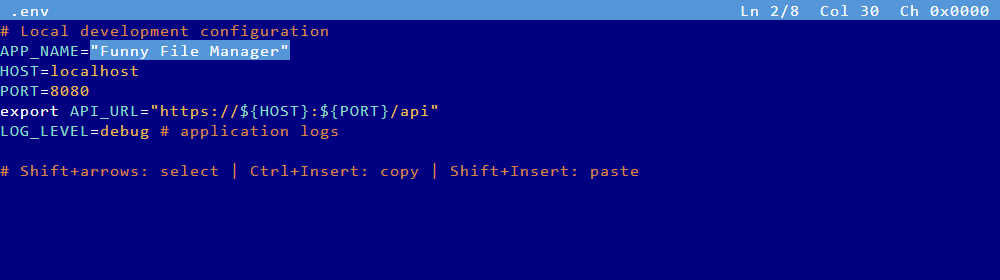
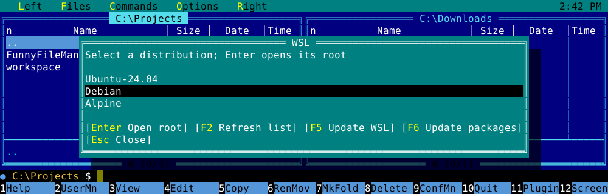
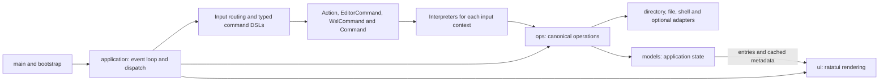

<!-- Purpose: Introduces FunnyFileManager and the main setup, build, and usage paths. -->

# 🗂️ FunnyFileManager (ffm)

Far Manager interface implementation in Rust 🦀

## 📖 Description

**ffm** is a high-performance, terminal-based file manager with a dual-panel interface inspired by classic tools like
Far Manager and Norton Commander. Built with Rust and the `ratatui` TUI library, it provides a fast, keyboard-driven
experience for file system navigation and management.

## ✨ Features

- 🪟 **Dual Panel Interface**: Classic side-by-side view for efficient file operations.
- ⚡ **Fast Navigation**: Instant directory browsing with keyboard shortcuts.
- 📋 **File Operations**: Full support for Copy, Move, Rename, Mkdir, and Delete.
- ☁️ **S3**: AWS profiles can appear in the drive menu. Bucket browsing is not in the panels yet. See [the S3 tutorial](docs/tutorials/s3.md).
- 🔍 **Quick Search**: Type to jump to files instantly (Alt+Letter).
- 🔖 **Bookmarks**: Save and jump to frequently used directories.
- 🌍 **Cross-Platform**: Seamless experience on Linux, macOS, and Windows.
- **KeePass**: F3 views `.kdbx` / `.kbdx`; F4 opens the vault for editing.
- **Editor language servers**: Background diagnostics, completion, hover and definitions; automatic installation for Java, Python and common web languages. Inspect and edit servers through F9 → Commands → Language servers (LSP). See [setup and shortcuts](docs/editor-lsp.md).
- **System tools**: F9 → Commands includes package updates, user/system PATH editors,
  and action waiting statistics. See [the guide](docs/session-tools.md).

## 📦 Installation

### 🔧 As a System Utility

To install `ffm` as a system-wide utility (adds to your PATH):

```bash
cargo install --path .
```

After installation, you can run it from anywhere using:

```bash
ffm
```

### 🏗️ From Source

```bash
git clone <repository-url>
cd FunnyFileManager
cargo build --release
./target/release/ffm
```

## 🚀 Usage

### ⌨️ Complete Hotkey Guide

| Key                     | Action                                                  |
|-------------------------|---------------------------------------------------------|
| **↑/↓**                 | Navigate up/down in active panel                        |
| **Enter**               | Open selected directory or file                         |
| **Tab**                 | Switch between left and right panels                    |
| **Insert** or **Space** | Mark/unmark file and move down                          |
| **F1**                  | Toggle Help window                                      |
| **F2**                  | Open the user command menu                              |
| **F3**                  | View file content (pager)                               |
| **F4**                  | Edit file in the built-in editor                        |
| **Alt+F4**              | Edit file with VS Code, `$EDITOR`, or `nano`            |
| **Shift+F4**            | Create new file                                         |
| **F5**                  | Copy marked or selected files to the other panel        |
| **F6**                  | Move/Rename marked or selected files to the other panel |
| **F7**                  | Create new directory                                    |
| **F8**                  | Delete marked or selected files                         |
| **F9**                  | Open the menu bar                                       |
| **F10**                 | Quit application (or type `quit`)                       |
| **F11**                 | Plugin commands: MCP status, NetBox stored sessions     |
| **F12**                 | Switch between panels and console                       |
| **Alt+F1**              | Select drive/S3 for Left panel                          |
| **Alt+F2**              | Select drive/S3 for Right panel                         |
| **Ctrl+U**              | Swap Left and Right panel paths                         |
| **Ctrl+O**              | Toggle console mode (hide/show panels)                  |
| **Ctrl+R**              | Refresh current directory                               |
| **Ctrl+\\**             | Jump to root directory                                  |
| **Alt + Letter**        | Quick search: jump to file starting with letter         |
| **:**                   | Open Command Line mode                                  |

### ✏️ Built-in Editor

Open a file with **F4**. **F2** saves; **Esc** or **F10** closes the editor and
asks about unsaved changes.

| Key                               | Action                                                 |
|-----------------------------------|--------------------------------------------------------|
| **Shift + Arrow keys**            | Start or extend text selection, including across lines |
| **Shift + Home/End**              | Extend selection to the start/end of the line          |
| **Shift + PageUp/PageDown**       | Extend selection by a page                             |
| **Ctrl + C / Ctrl + Insert**      | Copy selected text                                     |
| **Ctrl + V** / **Shift + Insert** | Paste clipboard text, replacing the selection          |

Typing or pressing Enter replaces selected text; Backspace and Delete remove
it. Moving without Shift clears the selection. Copy can fall back to the
terminal clipboard; paste reads the native clipboard and reports when it is
unavailable.

Both the **F3 viewer** and **F4 editor** highlight `.env`, `.env.local`,
`.env.production.local`, `.env.example`, and `*.env` files. Highlighting covers
assignment names, values, comments, `export` prefixes, and variable references,
including quoted values spanning several lines. It works without Colorer.



The snapshot is generated from the real renderer with
`cargo run --example editor_snapshot -- docs/screenshots/editor-dotenv-selection.svg`.

### 💻 Command Line Mode

Press `:` to enter command mode. Supported commands:

- `cd <path>`: Change directory in active panel
- `pwd`: Show the active directory
- `sort <name|size|ext|extension>`: Change panel sorting
- `bookmark set <0-9>` / `bookmark go <0-9>`: Manage bookmarks
- `mark all`: Mark all visible entries
- `unmark`: Clear all marks
- `help`, `mcp`, `winmsg`, `winperf`: Open built-in reports or help
- `sessions`, `sessions import netbox [path]`: NetBox stored sessions, and importing NetBox's `.netbox` export
- `stats`: Rank actions by accumulated waiting time in this session
- `wsl`: Open the WSL manager on Windows
- `quit` or `exit`: Close ffm

Unknown commands fall back to the platform shell in the active panel directory.
WSL calls with arguments, such as `wsl --list --verbose`, also use the shell.

## WSL management on Windows

Press **Ctrl+Alt+W**, run **`wsl`**, or choose **F9 → Commands → WSL manager**.
Select an installed distribution with the arrow keys.



| Key       | Action                                                         |
|-----------|----------------------------------------------------------------|
| **Enter** | Open the selected distribution's root in the active file panel |
| **F2**    | Refresh the distribution list                                  |
| **F5**    | Update the WSL platform                                        |
| **F6**    | Update packages in the selected distribution                   |
| **Esc**   | Close the manager                                              |

Platform updates and distribution package updates are separate operations.
The manager displays busy state and outcomes; while an operation is busy, the
list remains navigable and additional operations are disabled.
Closing the manager leaves an update running in the background; its result
appears in status when it finishes while ffm remains open. Quitting ffm ends
that reporting and does not guarantee cancellation of the update.
Package upgrades support apt-get, dnf, yum, zypper, pacman, and apk. See the
[Windows guide](docs/knowledge-base/08-platform-support/windows-behavior.md)
for execution details and limits.

## 🏛️ Architecture

The binary delegates to a thin library facade. Application coordination,
state, presentation, and filesystem effects have distinct implementation owners:



Active overlays consume keys before main-view action resolution. Panel rendering
uses snapshots gathered during loading and refresh; terminal lifecycle belongs
to RAII guards. Existing public entry points and `handlers` compatibility paths
remain available. Unit tests live in dedicated files beside their implementation
owners, with public API and workflow tests under `tests/`.

Declarative keymaps and command parsing translate input into typed `Action`,
`EditorCommand`, `WslCommand`, and `Command` values. Their interpreters apply state changes
and operations; editor confirmation and search prompts retain input priority.

See the [architecture diagrams](docs/knowledge-base/02-architecture/system-architecture.md),
[module map](docs/knowledge-base/02-architecture/module-structure.md), and
[testing strategy](docs/knowledge-base/05-testing/testing-strategy.md).

## 🛠️ Development

Plain `cargo build` and `cargo run` use an incremental development profile with
unoptimized project code and optimized dependencies for faster rebuilds. Use
`cargo build --release` for the optimized production binary. The standalone
MCP package follows the same profile split; see the
[build guide](docs/knowledge-base/04-development-workflow/build-run-test.md).

```bash
cargo test                         # Run unit and integration tests
./ffm.py lint                      # Shared local and CI format/Clippy gate
./ffm.py lint self-test            # Script unit tests, then readability limits (real compiler fixtures)
./ffm.py coverage                  # CI's coverage gate: 98% of measured root lines (scripts/coverage.py)
                                   # MCP's 75% gate is its job in .github/workflows/tests.yml
cargo mutants                      # Targeted mutation testing
cargo bench --bench utils_bench    # Run Criterion benchmarks for basic helpers/models
```

Additional repository guidance lives in [docs/best-practices.md](docs/best-practices.md), including testing conventions
and helper-gated test commands.

## 🧪 Testing

- 📘 Repository-wide testing/TDD guide: `TESTING_TDD_GUIDE.md`
- ✅ Stack checklist: `TESTING_CHECKLIST_RUST.md`

### Editor, replay and verification

See [editor encodings, selection and Python session replay](docs/editor-and-replay.md).
Performance baselines cover [autocomplete](docs/autocomplete-benchmarks.md) and
[editor cursor redraw](docs/editor-performance.md). The
[mutation report](docs/mutation-results.md) states the tested scope and results.
The [architecture](docs/knowledge-base/02-architecture/system-architecture.md)
includes Mermaid diagrams for the runtime, encoding and recording boundaries.
