<!-- Purpose: Provides a hands-on walkthrough for using FunnyFileManager. -->

# 🎮 FunnyFileManager Tutorial: The Fun Way to Manage Files

> *"Life is too short for boring file managers."* — Probably some developer at 3 AM

Welcome to **FunnyFileManager (FFM)** — a dual-panel terminal file manager that brings the legendary **Far Manager** experience to your modern terminal, powered by Rust 🦀 and the `ratatui` TUI library.

Whether you're a grizzled sysadmin who misses Norton Commander or a curious developer who thinks "TUI" sounds like a tropical drink, this guide is for you! 🍹

---

## 📖 Table of Contents

1. [What Is FFM?](#-what-is-ffm)
2. [Installation](#-installation)
3. [Architecture Overview](#-architecture-overview)
4. [Your First Launch](#-your-first-launch)
5. [Panel Navigation](#-panel-navigation)
6. [File Operations](#-file-operations)
7. [Keyboard Shortcuts](#-keyboard-shortcuts)
8. [The Command Line](#-the-command-line)
9. [Bookmarks](#-bookmarks)
10. [AWS S3 Integration](#-aws-s3-integration)
11. [Testing & BDD](#-testing--bdd)
12. [CI/CD Pipeline](#-cicd-pipeline)
13. [Troubleshooting](#-troubleshooting)
14. [FAQ](#-faq)

---

## 🤔 What Is FFM?

FFM is a **terminal-based dual-panel file manager** inspired by [Far Manager](https://farmanager.com/). Think of it as having **two file explorer windows side by side**, but cooler because it runs in your terminal and you never have to touch a mouse. 🖱️❌

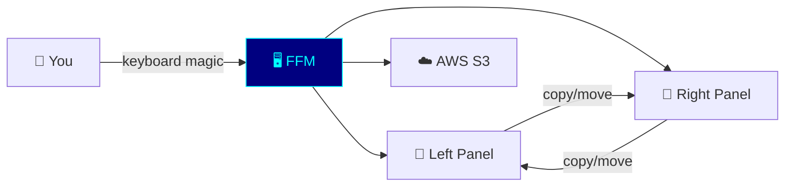

### 💡 Why FFM?

| Feature                      | GUI File Manager | FFM           |
| ---------------------------- | ---------------- | ------------- |
| Speed                        | 🐌 Loading...    | ⚡ Instant    |
| Mouse required               | ✅ Yes           | ❌ Nope       |
| Works over SSH               | ❌ LOL no        | ✅ Absolutely |
| Cool factor                  | 😐 Meh           | 😎 Maximum    |
| Makes you look like a hacker | ❌               | ✅ 100%       |

---

## 🛠️ Installation

### 📦 Prerequisites

- **Rust** 1.95+ (install via [rustup.rs](https://rustup.rs))
- A terminal that supports colors (basically any terminal made after 1995)

### 🏗️ Build from Source

```bash
# Clone the repository
git clone <repository-url>
cd FunnyFileManager

# Build it! 🏗️
cargo build

# Run it! 🚀
cargo run
```

> 💡 **Pro tip:** On machines with limited RAM, use `cargo build -j1` to avoid the compiler eating all your memory like a hungry Pac-Man. The AWS SDK crates are... enthusiastic about resources.

### 🏗️ Build with S3 Support

`s3` is not a default feature. This build adds the profile rows to the drive
menu and compiles `src/s3.rs`. It does not make a panel list a bucket.

```bash
cargo build --features s3
```

---

## 🏗️ Architecture Overview

FFM follows a clean modular architecture. Here's how the pieces fit together:

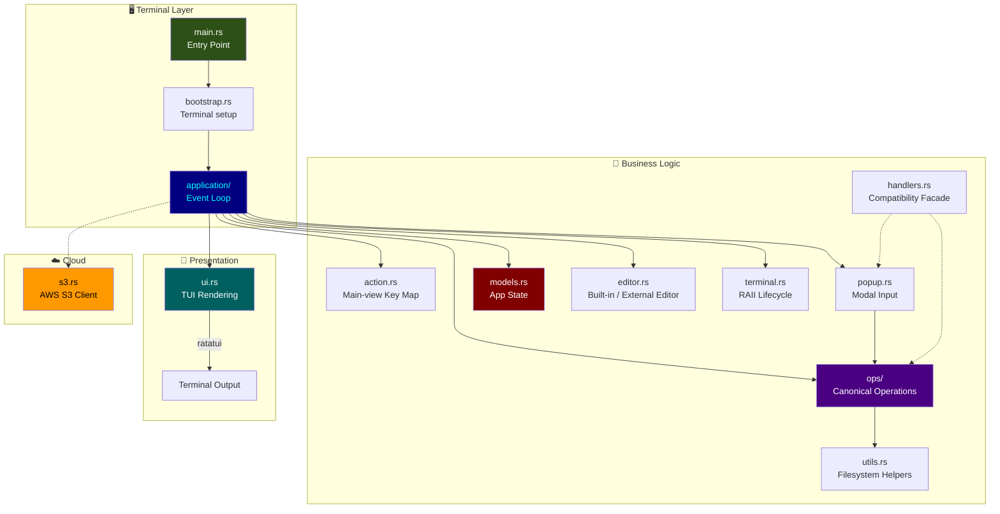

### 🏛️ Module Responsibilities

| Module         | Job                                              | Personality               |
| -------------- | ------------------------------------------------ | ------------------------- |
| `main.rs`      | Says "hello" and calls `lib::run()`              | 🚪 The doorman            |
| `lib.rs`       | Re-exports the public entry points               | 🎪 The marquee            |
| `application/` | Runs the event loop and applies actions          | 🎩 The ringmaster         |
| `action.rs`    | Maps main-view keys to typed actions             | 🎼 The score              |
| `popup.rs`     | Consumes input for the active modal overlay      | 🚦 The traffic controller |
| `ops/`         | Owns command, file, shell, and viewer operations | 🔧 The mechanic           |
| `handlers.rs`  | Preserves old operation import paths             | 🔌 The adapter            |
| `terminal.rs`  | Restores terminal state with RAII guards         | 🛟 The safety crew        |
| `models.rs`    | Holds all the data structures                    | 🗄️ The librarian           |
| `ui.rs`        | Makes everything look pretty                     | 🎨 The artist             |
| `utils.rs`     | Provides reusable filesystem helpers             | 🧰 The toolkit            |
| `editor.rs`    | Opens the built-in or external editor            | 📝 The messenger          |
| `s3.rs`        | Talks to AWS S3                                  | ☁️ The cloud whisperer     |

---

## 🚀 Your First Launch

Run FFM and you'll see this glorious layout:

```
┌──────────────────────────────────────────────┐
│  ☰ FunnyFileManager v0.1.0                   │  ← Header
├──────────────────────┬───────────────────────┤
│  📂 /home/user       │  📂 /home/user        │
│  ─────────────────── │  ──────────────────── │
│  📁 Documents/       │  📁 Documents/        │
│  📁 Downloads/       │  📁 Downloads/        │
│  📄 hello.rs         │  📄 hello.rs          │
│  📄 notes.txt        │  📄 notes.txt         │
│                      │                       │
├──────────────────────┴───────────────────────┤
│  Status: hello.rs | 1.2 KB                   │  ← Status Bar
├──────────────────────────────────────────────┤
│  F1 Help  F3 View  F5 Copy  F7 Mkdir  F10   │  ← Command Bar
└──────────────────────────────────────────────┘
```

The **active panel** has a cyan border (the cool one), and the inactive panel has a blue border (the chill one). 😎

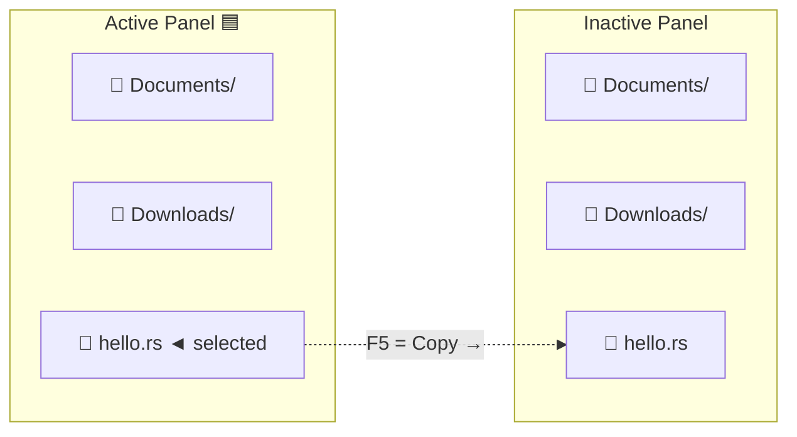

---

## 🧭 Panel Navigation

### 🧭 Moving Around

| Key          | What It Does            | Think of It As...             |
| ------------ | ----------------------- | ----------------------------- |
| `↑` / `↓`    | Move selection up/down  | 🏃 Walking through your files |
| `Home`       | Jump to first entry     | 🏠 Going home                 |
| `End`        | Jump to last entry      | 🏁 Finish line                |
| `Enter`      | Open directory / file   | 🚪 Opening the door           |
| `Tab`        | Switch active panel     | 🔄 Switching lanes            |
| `←` / `→`    | Select left/right panel | 👈 / 👉                       |
| `Ctrl+\`     | Go to root directory    | 🌳 Back to the roots          |
| `Alt+letter` | Quick search            | 🔍 Speed dating with files    |

### 🔍 Quick Search — Find Files Fast! 🔍

Press `Alt` + any letter to jump to the first file starting with that letter. It's like Ctrl+F but for people who don't have time for dialog boxes!

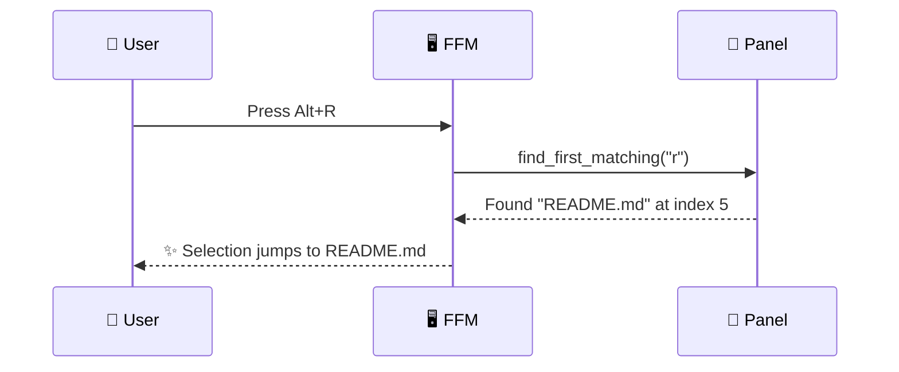

---

## 📁 File Operations

This is where the magic happens! All operations work on either the **selected file** or **marked files** (if any are marked).

### ⌨️ The F-Key Cheat Sheet

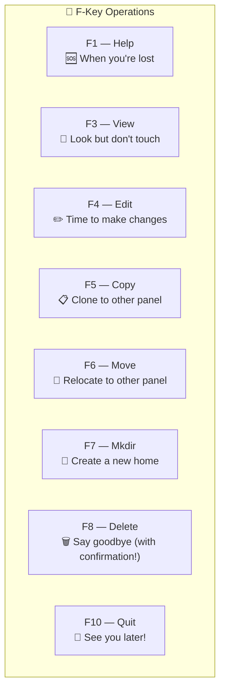

### 📋 Copying Files (F5) 📋

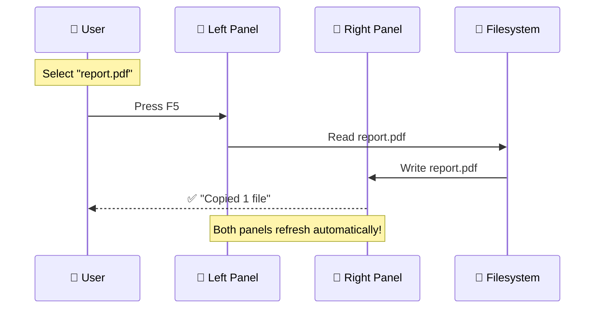

**Bonus:** If a file with the same name already exists in the destination, FFM automatically creates a unique name (`report_1.pdf`, `report_2.pdf`, etc.). No overwrites, no drama! 🎭

### Moving Files (F6) 🚚

Like copy, but the original file packs its bags and leaves. FFM tries an atomic rename first (super fast! ⚡), and falls back to copy+delete if the files are on different filesystems.

### Deleting Files (F8) 🗑️

FFM always asks for confirmation before deleting. Because we've all had that moment of "wait, NO!" 😱

```
┌─────────────────────────────┐
│  Delete "important_file"?   │
│                             │
│     [Y]es     [N]o          │
└─────────────────────────────┘
```

### 🎯 Marking Files for Batch Operations 🎯

| Key      | What It Does                              |
| -------- | ----------------------------------------- |
| `Insert` | Toggle mark on current file, move to next |
| `Space`  | Toggle mark on current file, move to next |

Mark multiple files, then press F5/F6/F8 to operate on all of them at once. It's like selecting multiple emails, but more satisfying!

---

## ⌨️ Keyboard Shortcuts

### 📝 The Complete Reference

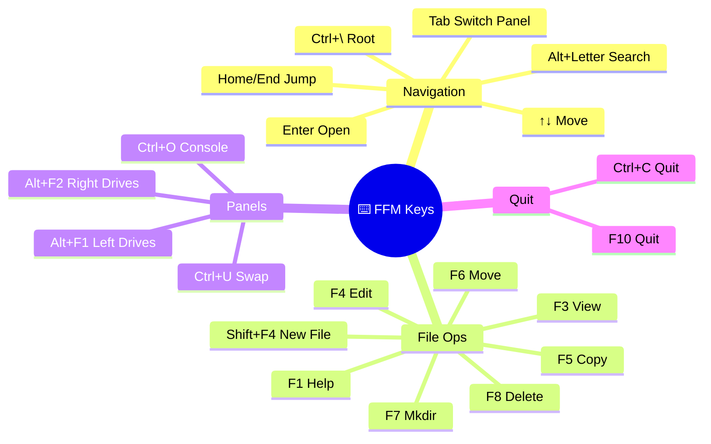

### 🧑‍💻 Far Manager Compatibility

FFM implements the most-used Far Manager hotkeys. If you have Far Manager muscle memory, you'll feel right at home! 🏠

---

## 💻 The Command Line

Press `:` to open the modal command line. `Tab` fuzzy-matches built-in commands
and paths: it accepts a sole match or opens a dropdown for multiple candidates.
With the menu open, `Tab` advances it, `Up`/`Down` move its selection, and
typing refreshes the matches. `Enter` accepts the selected candidate. `Esc`
dismisses the menu first and closes the command line when no menu is open.

FFM supports these built-in commands:

| Command            | Example                  | What It Does                                                                                |
| ------------------ | ------------------------ | ------------------------------------------------------------------------------------------- |
| `cd <path>`        | `cd /home/user/projects` | Change directory                                                                            |
| `pwd`              | `pwd`                    | Show current path                                                                           |
| `sort <mode>`      | `sort ext`               | Same modes as Ctrl+F3…Ctrl+F11: name, ext, mtime, size, unsorted, ctime, atime, desc, owner |
| `bookmark set <N>` | `bookmark set 3`         | Save current path to slot                                                                   |
| `bookmark go <N>`  | `bookmark go 3`          | Jump to saved path                                                                          |
| `mark all`         | `mark all`               | Mark all files                                                                              |
| `unmark`           | `unmark`                 | Clear all marks                                                                             |
| `help`             | `help`                   | Show help overlay                                                                           |
| `quit`             | `quit`                   | Exit FFM                                                                                    |

---

## 🔖 Bookmarks

Bookmarks let you save up to **10 directory paths** (slots 0-9) and jump back to them instantly. Think of them as teleportation waypoints! 🌀

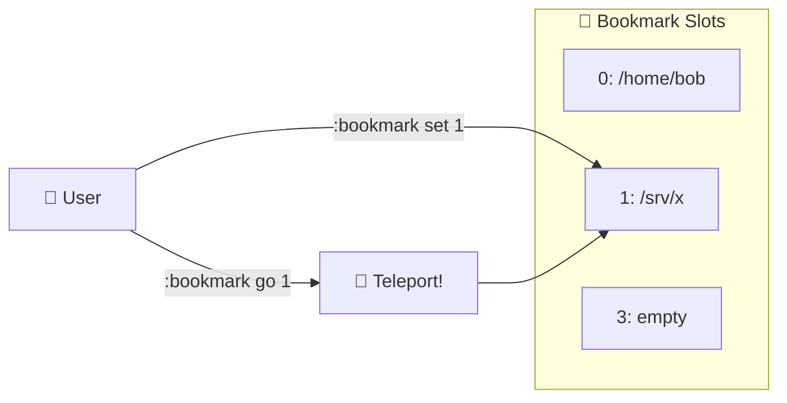

### 🚀 How to Use

1. Navigate to a directory you visit often.
2. Press `:` and run `bookmark set 1` (slots are 0 through 9).
3. Later, run `bookmark go 1`.

There is no bookmark overlay, and `Ctrl+1` is Brief view, not a bookmark. The F9 Folder shortcuts row lists the slots you have set.

---

## ☁️ AWS S3 Integration

Panels list local directories. S3 is a separate object store: the library and
the MCP server can list, upload, download, copy, and delete objects. Choosing
an S3 profile in `Alt+F1` or `Alt+F2` does not open a bucket.

The walkthrough is in three pages:

- [Local filesystems](docs/tutorials/filesystems.md)
- [AWS profiles](docs/tutorials/aws.md)
- [S3](docs/tutorials/s3.md)

---

## 🧪 Testing & BDD

FFM takes testing seriously. Unit tests live beside the code, integration tests live in `tests/`, and Cucumber scenarios describe what a person can do. Counts go stale the week after someone writes them down, so this page does not keep a scenario total. The layout is in `docs/knowledge-base/05-testing/testing-strategy.md`.

### 🧪 Testing Pyramid

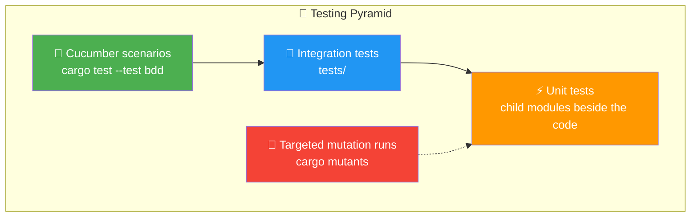

### 🧪 Running Tests

```bash
# Unit + Integration tests (the basics)
cargo test --features test-helpers

# BDD tests in English 🇬🇧
cargo test --test bdd --features test-helpers,s3

# BDD tests in Russian 🇷🇺
cargo test --test bdd_ru --features test-helpers,s3

# CI's coverage gate: every root test under llvm-cov, failing under
# 98% of the measured lines. scripts/coverage.py defines it.
./ffm.py coverage
```

### ✨ BDD Feature Example

```gherkin
Feature: End-to-end user workflows
  As a typical file manager user
  I want to perform complete workflows
  So that I can accomplish real-world tasks

  Scenario: Browse, view, and copy a file
    Given a source directory
    And a file "config.yaml" with content "key: value" in the source
    And an empty destination directory
    And the app is set up with source and destination
    And I select "config.yaml" in the left panel
    When I press F3
    Then the viewer should be open
    And the viewer should show "key: value"
    When I close the viewer
    When I select "config.yaml" in the left panel
    And I press F5
    Then "config.yaml" should exist in the destination
```

### ✏️ Cucumber Step Implementation

The BDD framework uses the Rust `cucumber` crate with a `FfmWorld` struct that manages test state:

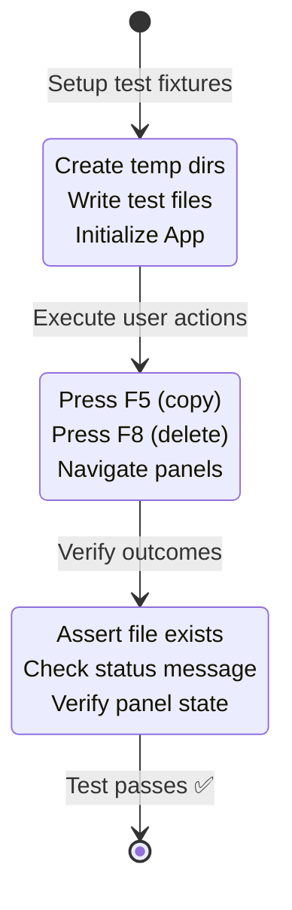

---

## 🔄 CI/CD Pipeline

FFM uses **GitHub Actions** (`.github/workflows/tests.yml`) on every push to `main`, on pull requests, once a week and on demand. One job resolves `Cargo.lock` for the run; the others use that file and run in parallel. The Rust release, the tools, the actions and Colorer are all pinned, so a red run means the code or a crate changed. Details: [the build guide](docs/knowledge-base/04-development-workflow/build-run-test.md#-continuous-integration).

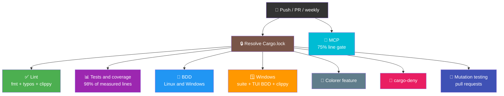

Text version: a push, pull request or weekly run starts the lockfile job and
the MCP job; the lockfile job then starts Lint, Tests and coverage, BDD,
Windows, Colorer, cargo-deny and (on pull requests) mutation testing.

### 🚦 Pipeline Jobs

| Job                    | What it does                                                                                                 |
| ---------------------- | ------------------------------------------------------------------------------------------------------------ |
| **Resolve Cargo.lock** | `cargo generate-lockfile` once, for every other job but MCP                                                  |
| **Lint**               | `./ffm.py lint` (fmt, spelling, Clippy for all crates, architecture contracts) and `./ffm.py lint self-test` |
| **Tests & Coverage**   | `./ffm.py coverage`: every root test, TUI BDD included, failing under 98% of the measured root lines         |
| **BDD**                | S3 unit tests plus `bdd` and `bdd_ru`, on Linux and Windows                                                  |
| **Windows**            | The whole root suite, keyboard scenarios through the real event loop included, then Clippy                   |
| **MCP**                | MCP tests and a 75% line gate                                                                                |
| **Colorer**            | Builds the optional C++ highlighter and runs that feature                                                    |
| **cargo-deny**         | Licences, advisories, bans and sources for all three manifests                                               |
| **Mutation testing**   | Pull requests only: mutants of the changed lines, in four shards; a surviving mutant fails                   |

---

## 🔧 Troubleshooting

### 🏗️ "Compilation eats all my RAM!" 🐏

```bash
# Limit parallel compilation jobs
cargo build -j1
```

The AWS SDK crates are large. Using `-j1` prevents your system from becoming a very expensive paperweight.

### 🎨 "The colors look wrong!" 🌈

Make sure your terminal supports 24-bit (true color) RGB. Most modern terminals do:
- ✅ Windows Terminal
- ✅ iTerm2
- ✅ Alacritty
- ✅ kitty
- ⚠️ macOS Terminal.app (limited color support)

### 📋 "I accidentally deleted something!" 😱

FFM always asks for confirmation before deleting. But if you confirmed... well, this is a learning opportunity about backups. 📚

### ☁️ "I picked an S3 profile and the panel did not change" 🐢

That is the current behavior. The drive row only records the profile. Listing,
upload, download, copy, and delete go through the library and the MCP tools
in [the S3 tutorial](docs/tutorials/s3.md). Each of those calls reads or
writes the whole object in memory, so a large object is a bad fit for them.

---

## ❓ FAQ

**Q: Why is it called "Funny" File Manager?**
A: Because file management should bring joy, not suffering! Also, it sounds better than "SeriousBusinessFileManager". 😄

**Q: Can I use this on Linux/macOS/Windows?**
A: Yes! FFM is cross-platform. It was born on Windows but travels well. 🌍

**Q: Is this a replacement for Far Manager?**
A: FFM is *inspired by* Far Manager. Think of it as Far Manager's cool younger cousin who learned Rust. 🦀

**Q: Why Rust?**
A: Memory safety, zero-cost abstractions, and bragging rights at meetups. Also, `unwrap()` makes us feel dangerous. 🎲

**Q: How do I contribute?**
A: Fork it, branch it, code it, test it, PR it! Just make sure `cargo clippy` and `cargo test` are happy before submitting. A grumpy clippy is nobody's friend. 📎😠

**Q: What's with the coverage threshold?**
A: CI fails the root crate under 98% of the lines it measures, and the MCP crate under 75%. Host glue such as the real TTY startup is excluded from that measurement on purpose. The list, with the reason for each file, is in `scripts/coverage.py`. 👿

---

## 🎓 Quick Start Cheat Sheet

```
╔═══════════════════════════════════════════╗
║  🎮 FFM Quick Reference                   ║
╠═══════════════════════════════════════════╣
║  Navigate:  ↑↓ Home End Enter             ║
║  Panels:    Tab ← → Ctrl+U                ║
║  View:      F3                            ║
║  Edit:      F4    New: Shift+F4           ║
║  Copy:      F5    Move: F6                ║
║  Mkdir:     F7    Delete: F8              ║
║  Help:      F1    Quit: F10 / Ctrl+C      ║
║  Search:    Alt+letter                    ║
║  Drives:    Alt+F1 (left) Alt+F2 (right)  ║
║  Console:   Ctrl+O                        ║
║  Root:      Ctrl+\                        ║
╚═══════════════════════════════════════════╝
```

---

*Made with 🦀 Rust, ❤️ love, and an unreasonable number of BDD tests.*

*May your files always be organized and your panels always be in sync!* ✨
