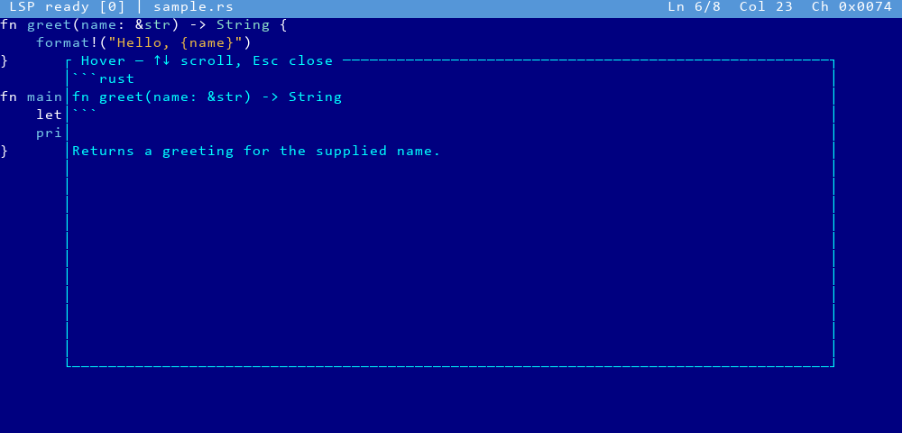
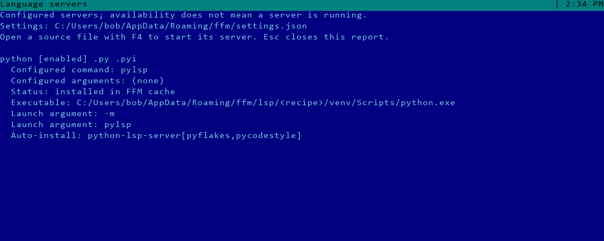

<!-- Purpose: Explain editor language-server setup, behavior, and extension points. -->

# Language servers in the built-in editor

The [September 2026 delivery report](lsp-delivery-2026-09-23.md) records merged
commits, architecture, review fixes and verification results.

Opening a supported source file with F4 asks whether to trust the workspace. Language
servers can execute project build scripts and macros. The default choice keeps
LSP disabled; select **Trust** with Down and confirm with Enter only for a project
you trust. Approval lasts until FFM exits and applies to that workspace root.
Approval also permits downloading a missing server using its configured installation
recipe. Installation and startup run in the background. Editing and saving still
work if a runtime, network connection or server is unavailable.
The editor header reports pending trust, startup, readiness, failure, and diagnostic counts.
Errors and warnings underline the affected text; placing the cursor there shows
the message in the header. Information and hints are also displayed.



| Editor key | Action |
|---|---|
| Ctrl+Space | Request completions |
| Ctrl+K | Show hover information |
| Ctrl+] | Go to definition (Ctrl+5 too: terminals without the kitty keyboard protocol send Ctrl+] as Ctrl+5's byte) |
| Ctrl+Alt+R | Restart the language server or reopen the trust prompt |
| Up / Down | Select a popup result or scroll hover text |
| Enter / Esc | Accept / dismiss the popup |

Completions show labels, kinds, details, and supplied documentation. The editor
applies text edits and additional edits atomically. Unsupported snippets produce
a notice; their placeholder syntax is never inserted into the file. Hover shows
plain text and Markdown, including code fences, without a web renderer.
Multiple definitions open a selection list. Save with F2 before following a
definition into another file when the current buffer has unsaved changes.

## Configuration

**F9 → Commands → Language servers (LSP)**, or `lsp` on FFM's command line,
opens the Language servers dialog: every server FFM knows, what each would
start, and a form to change them. Opening it never installs or starts a server,
and never waits for the `PATH` scan.



The list shows each server's language, `[x]` or `[ ]` for enabled, its command,
its extensions and one word of availability:

| Tag | Meaning |
|---|---|
| `ready` (green) | The configured command is found, or the installed server that provides it |
| `auto` (amber) | Not installed yet; installs after you trust a workspace, and what it installs with (Python 3, Node.js with npm, Java) is on PATH |
| `recipe` (amber) | The configured command is not found, so the auto-install recipe's own program runs instead |
| `missing` (red) | Not found, and no auto-install (or no install cache) |
| `error` (red) | A broken install receipt, or a runtime the install needs is not on PATH (`LSP installation requires Node.js and npm`) |

`*` marks a server changed since the file was read; `!` marks a problem, red
when it blocks F2 and amber when it only warns. The pane below details the
selected server: command, arguments, status, the executable and launch
arguments FFM would run (for Java, with the active panel's project data
directory), and the auto-install recipe as highlighted JSON, which is also
valid YAML and can be pasted into the settings file as it is. **F3** shows
every server this way. Availability is what FFM would start, not a process
list.

### Editing

| Key | Action |
|---|---|
| Up / Down, PgUp / PgDn, Home / End | Select a server |
| Enter, F4 | Edit the selected server |
| Space | Turn it on or off |
| Ins, F7 | Add a server |
| Del, F8 | Reset a catalog server's command, arguments, extensions and on/off to the catalog; remove an added server |
| F2 | Save to `settings.yaml` (only the changed fields) |
| F3 | Every server, scrolled; F3 or Esc returns |
| F5 | Check availability again |
| Esc, F10 | Close; with unsaved changes, asks Save / Discard / Cancel |

In the form, Tab and Shift+Tab move between the fields, Space toggles
**Enabled**, Enter presses OK and Esc drops the form's changes. The full key and
mouse tables, with their Far precedents, are in the
[hotkey parity document](knowledge-base/09-far-manager-compatibility/hotkeys-and-parity.md#-language-servers-dialog).

**Suggestions.** Ctrl+Space, Ctrl+Down or Alt+Down opens a list for the
focused field (on macOS the system may take the first two; Alt+Down, that is
Option+Down, reaches FFM when the terminal sends Option as Alt). With
Options → AutoComplete on, typing opens the list by itself without taking Enter
away from the form; Down enters it and Enter then takes the highlighted row.
**Command** offers the catalog's server programs and the commands your servers
use, then, from two typed letters on, programs found on `PATH`; **Arguments**
offers the arguments the catalog and your servers use (such as `--stdio`);
**Extensions** offers known extensions with the languages that claim them, so a
conflict shows before you make it. The `PATH` list is read once per session.

**Arguments** are one line: spaces separate them; quote an argument that holds
a space, `"a b"`, and write a quote inside quotes twice, `"a""b"`. There are no
backslash escapes, so `C:\tools\server` is written as it is. OK refuses an
empty command, a command starting with `~` (no shell runs the server, so
nothing expands it), an unclosed quote, an extension with a dot inside
(`d.ts` can never match: FFM compares the text after the last dot) and the same
extension listed twice; the form keeps the cursor on the field and says why.

### What F2 writes

F2 writes only the fields you changed — `enabled`, `command`, `args`,
`extensions` — under `lsp.<language>` in `settings.yaml`, quoting every value
YAML would otherwise read as something else, so `123`, `~` or `a: b` come back
as the text you typed. A catalog server's field set back to its catalog value
is removed rather than pinned, so partial overrides stay partial and catalog
updates keep reaching you. A server you add is written whole, `install: null`
included. `root_markers`, `install` (an explicit `null` included) and every
other key of the file, inside `lsp` and out, keep their values and their
order. Like every save, it rewrites the file under a header comment and keeps
no comments and no backup; a Discard or Del in the dialog is the way back.

Changes apply the next time a file is opened in the editor: no server runs
while the dialog is open, and the exit auto-save leaves what F2 wrote alone. A
hand edit of `settings.yaml` applies after FFM restarts.

A changed command that shows `recipe` is not the program being run. To make it
stick, install it on `PATH`, enter its full path, or set `install: null` for
that language by hand in `settings.yaml`.

### When the dialog only shows, or F2 refuses

The dialog opens read-only, naming the reason on its first row and in full on
its message row, when the session has no settings file, or `settings.yaml` is
not a regular file, is larger than 1 MiB or does not parse (the reason gives
the line and column of a syntax error, or the key path of a wrong value such as
`lsp: python: invalid type`). It then shows the servers FFM would start. While
there is no `settings.yaml`, the dialog opens on the `settings.json` of an
older FFM, and F2 writes `settings.yaml` beside it.

F2 writes nothing, keeps your changes and says why when two enabled servers
would claim one extension (the one earlier in the list would win). Every other
refusal begins with `Not saved:`: another FFM is saving the file at that
moment; another program changed the servers in `lsp` while the dialog was open
(close without saving and open it again; edits outside `lsp` never block F2);
another program wrote the file while F2 was saving it (press F2 again); the
file stopped parsing; or the file cannot safely be replaced — like every
save of the settings file, F2 writes through a symbolic link, and refuses a
link to a missing file, a file with other hard links, another user's file and
one it cannot write. Save setup (Shift+F9) and the exit auto-save keep the
`lsp` key too; see [The settings file](knowledge-base/07-core-features/main-menu.md#the-settings-file).

### The settings file

Language servers live under the `lsp` key of the settings file,
`ffm/settings.yaml` in the configuration directory: `%APPDATA%\ffm\settings.yaml`
on Windows, `$XDG_CONFIG_HOME/ffm/settings.yaml` (by default
`~/.config/ffm/settings.yaml`) elsewhere. Anything the file leaves out keeps its
default. See [The settings file](knowledge-base/07-core-features/main-menu.md#the-settings-file)
for how FFM saves it and how it reads a `settings.json` from an older FFM.

```yaml
lsp:
  rust:
    enabled: true
    command: rust-analyzer
    args: []
    extensions: [rs]
    root_markers: [Cargo.toml, .git]
```

An explicit command is used as configured; otherwise the default executable is
resolved through PATH. Arguments are passed directly to the executable, not
through a shell. Use an absolute executable path for an installation outside
PATH. The nearest ancestor containing a configured root marker is the workspace
root; without a marker, the source file's parent directory is used.

Catalog entries are merged with settings field by field. For example,
`python: {enabled: false}` disables Python without replacing its other
defaults. `install: null` disables automatic installation for one server.

| Language | Server | Installation prerequisite |
|---|---|---|
| Rust | rust-analyzer | Install on PATH, e.g. `rustup component add rust-analyzer` |
| Python | python-lsp-server (pylsp) | Python 3 with venv and pip |
| Java | Eclipse JDT LS 1.61.0 | Java 21+ and curl 8.4+; JAVA_HOME takes precedence for Java |
| JavaScript / JSX / TypeScript / TSX | typescript-language-server + TypeScript 6 | Node.js and npm |
| HTML / CSS / JSON | vscode-langservers-extracted | Node.js and npm |
| YAML | yaml-language-server | Node.js and npm |
| Bash | bash-language-server | Node.js and npm |

Python and Java have optional real acceptance tests. Other catalog entries use
the same tested npm installation path; their runtime behavior depends on the server.
FFM does not install language runtimes or change global PATH. It first tries the
configured executable. Only a missing executable triggers automatic installation.
Packages go into `ffm/lsp/<recipe hash>` beside settings, not into the project or
global package directories. Identical recipes reuse an installation. Python uses
a private venv; npm uses a private prefix. Java's HTTPS archive is pinned and
checked against its SHA-256 before extraction. Each workspace has separate JDT
configuration and index data. Package-manager installation scripts can execute;
use only recipes and projects you trust.

Additional stdio servers can be added under their standard LSP language ID. For
example, this installs a configured Go server into the managed directory:

```yaml
lsp:
  go:
    enabled: true
    command: gopls
    args: []
    extensions: [go]
    root_markers: [go.mod, go.work, .git]
    install:
      kind: command
      steps:
        - command: go
          args: [install, golang.org/x/tools/gopls@latest]
          env:
            GOBIN: '{install_dir}/bin'
      executable: bin/gopls.exe
```

Quote a value that starts with `{`, as `'{install_dir}/bin'` is here: unquoted,
YAML reads `{` as the start of a mapping and the file no longer parses. Use
single quotes for any value that is not a plain word, path or number: some
unquoted values do not fail but change without a word. A value that starts
with `[`, `@`, `%` or a backquote does not parse; one that starts with `!` is a
YAML tag, which FFM refuses as `lsp.go.command: !x is a YAML tag`; one that
starts with `&` or `*` is an anchor or an alias; ` #` starts a comment, so the
rest of the line is dropped; and `: ` inside a value starts a mapping. An empty
value or `~` is no text at all, and FFM reports it rather than reading it as an
empty string. Inside double quotes a backslash starts an escape, so
`"C:\tools\new"` holds a TAB and a line break: write Windows paths in single
quotes (`'C:\tools\new'`).

Use `bin/gopls` on Unix and install Go separately. The example requires the Go
version required by the chosen gopls release. Custom steps receive literal argument
arrays and run in a staging directory; `{install_dir}` is expanded in commands,
arguments and environment values. The executable must be a relative path inside
the installation. Install tools must produce relocatable artifacts. Servers must
support UTF-16 positions and standard document/feature messages.

## Behavior and troubleshooting

Document changes are batched after 120 ms of inactivity. An explicit feature
request flushes pending changes first. Incremental synchronization is preferred
when advertised; full synchronization and disabled synchronization are honored.
F2 sends `didSave` if the server requests it. Rust-analyzer's Cargo diagnostics
describe saved files, so save after fixing a Cargo error to trigger a fresh check.

An unavailable server usually means its command cannot be found. Verify
`rust-analyzer --version` from the environment used to launch FFM. After installing
it or correcting PATH, restart the server with Ctrl+Alt+R. A failed server is not
restarted automatically. A server still indexing may reject a request as content
modified (`-32801`); request the information again when indexing settles.

During installation the header shows `LSP installing`. Closing the editor or
quitting cancels the installer and terminates its process tree. Failed partial
installations are removed; Ctrl+Alt+R retries explicitly, without an automatic
restart loop. A corrupt cached receipt is reported instead of overwritten: close
FFM, remove only that server's cache directory (the Language servers dialog
shows its executable path), and reopen the file.
Installations wait on a per-recipe lock when another FFM instance is installing.
Commands have a ten-minute timeout; archive downloads have a five-minute timeout.
Python needs its venv/pip components; npm must be installed beside Node.js. For
Java, set JAVA_HOME to a JDK 21+ if PATH still selects an older Java. Package
manager failures show a concise status without exposing captured package output,
naming the step that failed: `python3 -m venv failed; install python3-venv`,
`pip install failed` or `npm install failed; check the network`, `the download
failed`. A cache folder FFM cannot create or write says so (`the LSP cache folder
is not writable`, `… is on a read-only file system`, `no space left for the LSP
cache`) instead of a storage error.

FFM's debug logging (on by default, `FFM_LOG=0` turns it off) records request methods/IDs, lifecycle changes and error
codes. Source text is not logged. Stderr is drained separately and its byte counts
are logged with contents redacted, because a server may print source text there.

Current limits: one active editor/server session, explicit completion triggers,
UTF-16 positions, no snippets, no completion-item resolve requests, no formatting,
rename, code actions or edits requested by the server. Unversioned diagnostics
cannot be conclusively associated with an earlier document version.

## Developer architecture

```text
Editor (buffer, revision, caret, diagnostics, popup)
  ↕ application::lsp_jobs::EditorLspController (UI thread)
  ↕ bounded command/event channels
LspManager worker (server lifecycle, synchronized snapshots, requests)
  ↕ LspClient (initialize, capabilities, JSON-RPC IDs, document versions)
  ↕ separate stdin writer / stdout reader / stderr drain threads
Language server (stdio Content-Length frames)
```

The controller creates snapshots only when synchronization is needed. Process
startup, filesystem root discovery, framing and pipe I/O run off the UI thread.
Rendering reads model state and performs no server operations. Replies carry the
document identity, revision and request position; stale results are discarded.
Cancellation removes superseded request IDs and sends `$/cancelRequest`.

Local debug-build measurements for the small acceptance workspace: background
startup handoff 0.26 ms, diagnostics after 2.42 s, completion 42.15 ms, an edit
handoff 0.006 ms, shutdown 40.14 ms. With a busy fake server, 1,000 editor edits
and controller pumps took 6.13 ms; controller startup with LSP disabled took
0.361 ms. These are observations, not portable performance thresholds.

Closing the editor sends `didClose` and shuts down its server. Application exit
joins the worker: `shutdown` has a bounded response wait, then `exit` has a bounded
process wait. Remaining processes are terminated and reaped; Windows job objects
and Unix process groups include descendants. No async runtime is required.
On Unix, exit polling retains the child PID until its group is terminated and
reaped, preventing a reused PID from receiving cleanup signals. A full writer
queue retains messages for retry in order, with a bounded backlog.

Cached npm and Java servers discover their runtime again on each launch, so moving
Node.js or changing `JAVA_HOME` does not require reinstalling the server. The
Language servers dialog uses the same workspace identity and runtime discovery
without running package managers or language servers.

The Java download requires curl 8.4+ because older versions do not enforce
`--max-filesize` when the response has no known length; see the
[curl documentation](https://curl.se/docs/manpage.html#--max-filesize).

The worker owns a cancellable installation job in its `Preparing` state and keeps
the latest document snapshot while installation runs. A dedicated installer thread
owns package-manager process trees. A temporary staging directory becomes a cache
entry only after installation and entry-point validation succeed. Atomic rename,
a portable file lock and a launch receipt make reuse independent of editor widgets.
No installer or recipe parsing runs in rendering code.

The Language servers dialog is `models::lsp_editor` (its state, form and
problems), `ops::lsp_editor` (opening, checking, saving, suggestions),
`popup::lsp_editor` (keys) and `ui::lsp_editor` (drawing). Availability comes
from `lsp::Probe`, which tests replace with a temporary cache and `PATH`;
suggestions are pure, in `complete::servers`; every writer of the settings file
— the dialog's F2, Save setup and the exit auto-save — goes through
`config::document`, and the dialog's change is `config::lsp::patch`.

The pure protocol client is independent of widgets and of rust-analyzer. Add
language defaults in `src/config/lsp/catalog.json`; installation adapters live under
`src/lsp/install/`; generic server support belongs under
`src/lsp/`, editor effects under `src/ops/editor_lsp.rs`, and presentation in the
editor model/input/rendering modules.

Deterministic protocol tests use memory streams; lifecycle/controller tests run
a tiny Python stdio peer in a temporary directory. They require Python but do not
require rust-analyzer. The optional real smoke test creates a temporary Cargo
workspace and is excluded from ordinary test runs:

```sh
cargo test --lib real_rust_analyzer_supports_the_complete_editor_protocol -- --ignored --nocapture
cargo test --lib real_python_package -- --ignored --nocapture
cargo test --lib real_java_package -- --ignored --nocapture
```
