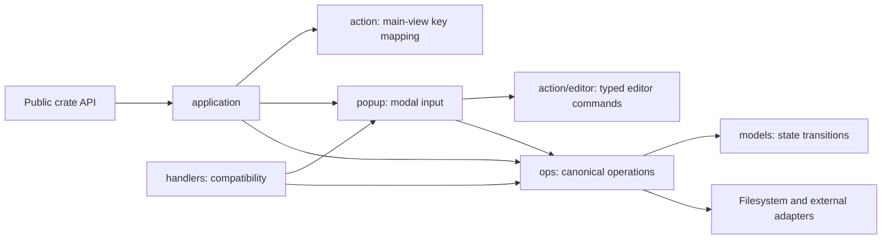

<!-- Purpose: Maps source modules to implementation ownership and test placement. -->

# Module Structure

For runtime diagrams and boundary rules, see
[System Architecture](system-architecture.md).

## Entry, coordination, and host effects

| Source | Responsibility |
|---|---|
| `src/main.rs` | Thin binary calling `funny_file_manager::run()` |
| `src/lib.rs` | Module declarations and stable public entry-point re-exports |
| `src/bootstrap.rs` | Production `App` and history setup, terminal composition, panic restoration hook |
| `src/application/mod.rs` | Draw/read event loop, viewport updates, event filtering, injected event source |
| `src/application/dispatch.rs` | Main-view `Action` effects and modal-first keyboard/mouse routing |
| `src/application/dispatch/dialog_mouse.rs` | Mouse input translation for dialogs |
| `src/application/wsl_jobs.rs` | Serial WSL worker, injected backend, and completion delivery |
| `src/diagnostics.rs` | Opt-in logging, payload redaction, lifecycle log wrapper |
| `src/terminal.rs` | `TerminalOps`, `TerminalSession`, and `TerminalSuspension`; transition rollback and restoration |
| `src/terminal/keyboard.rs` | The kitty keyboard protocol: asked for once, pushed on entry and resume where the terminal supports it, popped on exit, suspension and abort |

The crate-root `run`, `run_app`, and `run_app_with_event_reader` paths remain
available. `run_app_with_wsl_backend` supplies both the optional-event polling
seam and an injected system backend. The implementation is owned by bootstrap
and application modules.

## State and presentation

| Source | Responsibility |
|---|---|
| `src/models.rs` | `App`, shared domain values, bookmarks, command-line state, view and lifecycle enums |
| `src/models/panel.rs` | Panel entries and snapshot metadata, listing commit, cursor restoration after a reload, and navigation state |
| `src/models/panel/sort.rs` | Listing order for each `SortMode`, directories first |
| `src/models/panel/cursor.rs` | Highlighted-row movement, paging, and the in-range selection invariant |
| `src/models/panel/marks.rs` | Marking, mask selection, and the previous selection Ctrl+M restores |
| `src/models/panel/search.rs` | Quick search and select-by-name |
| `src/models/overlay.rs` | Mutually exclusive modal state (`Overlay`, `Confirm`) |
| `src/models/overlay/{name_fields,name_prompt,mask_prompt}.rs` | Typed prompt payloads: the name dialog (`NamePurpose`, `LinkType`, `NameField`, `NamePrompt`) and the mask dialog (`MaskPurpose`, `MaskPrompt`) |
| `src/models/editor.rs` | Built-in editor buffer, cursor, edits, and serialization state |
| `src/models/editor/selection.rs` | Typed selection anchors, cursor movement, selected text, and replacement |
| `src/models/clipboard.rs` | Session ownership of an injected clipboard backend |
| `src/models/wsl.rs` | Validated distribution names, dialog selection/activity, typed request IDs, and the state-only request queue |
| `src/models/viewer.rs` | Viewed-file metadata, offsets, and viewer state |
| `src/models/viewport.rs` | Viewport dimensions and paging rules |
| `src/models/drives.rs` | Drive rows and drive selection data |
| `src/models/panelview.rs` | `PanelView` (Far's ten column layouts), `PanelKind` (files, tree, quick view), `PanelsShown`, and `SortMode` |
| `src/models/filter.rs` | `PanelFilter` applied in `Panel::apply_listing`, and the `Ctrl+I` prompt |
| `src/models/entry.rs` | `DirEntry` and its facts: `EntryKind`, `FileSize`, `Modified` (any timestamp), `Attributes` (mode bits / Windows flags) |
| `src/models/histories.rs` | `ViewHistory` and `FolderHistory` — bounded path lists persisted beside the command history. A folder visit is noted by `Panel::apply_navigation` in `Panel.pending_visit` and moved into `FolderHistory` by `App::record_folder_visits`, which the event loop calls once per event; a test that navigates and then reads the history calls it itself |
| `src/models/tree.rs`, `src/models/quickview.rs` | Folder-tree and quick-view state carried by `PanelKind` |
| `src/models/shortname.rs` | `ShortName`, Far's 8.3 form of a name for `Ctrl+N` off |
| `src/models/archive.rs`, `attributes.rs`, `apply.rs`, `describe.rs` | Files-menu dialog state (archives, attributes, apply command, descriptions) |
| `src/models/findfile.rs`, `histlist.rs`, `usermenu.rs`, `associations.rs`, `shortcuts.rs`, `screens.rs`, `tasks.rs`, `hotplug.rs` | Commands-menu dialog state |
| `src/models/sortmenu.rs`, `src/models/settings_dialog.rs` | Sort-modes menu and the one settings dialog for every Options page |
| `src/models/session.rs`, `src/models/session/fields.rs` | `Session` — a NetBox-style stored connection — with `Protocol`, `Auth`/`AuthKind` (password asked at connect, key file, agent; never a stored password) and `Origin`; the checked values `SessionName`, `HostName`, `Port`, `UserName`, `KeyFile` and their one error, `InvalidField` (`Field` + `Problem`, never the refused value). `serde` goes through the same checks |
| `src/models/remote_path.rs`, `src/models/row_cursor.rs` | `RemotePath` (absolute, normalised, joins only single names) and `RowCursor`/`RowMotion`, the clamped cursor of the sessions list, the remote panel and the F11 list |
| `src/models/sessions_panel.rs`, `src/models/remote_panel.rs` | NetBox panel state carried by `PanelKind::Sessions` / `PanelKind::Remote`: the session rows under their `..`, and a remote directory's `DirEntry` listing (names that are not one path part left out) with the `RemoteLink` it came through |
| `src/models/session_edit.rs`, `src/models/plugin_commands.rs`, `src/models/prompts.rs` | The session dialog's fields (`Overlay::SessionEdit`), the rows of Far's F11 list (`Overlay::PluginCommands`), and the input / yes-no dialogs with their purposes (`Overlay::InputPrompt`, `Overlay::Question`) |
| `src/ui/tree.rs`, `src/ui/quickview.rs` | Panel renderers chosen by `PanelKind` in `ui.rs::render_one_panel` |
| `src/ui/sessions.rs`, `src/ui/remote.rs` | Panel renderers for the NetBox panel kinds, chosen in `ui.rs::render_one_panel` |
| `src/ui/session_edit.rs`, `src/ui/plugin_commands.rs`, `src/ui/prompts.rs` | The session dialog, the F11 Plugin commands list, and the input / yes-no dialogs |
| `src/ui/stub.rs`, `src/ui/<feature>.rs` | Placeholder dialog frame and one renderer per F9 menu dialog, routed by `ui/overlays.rs` |
| `src/ui.rs`, `src/ui/` | Ratatui composition, panels, console, prompt, menus, overlays, and shared text rendering |
| `src/ui/console.rs` | Console layer: black ground, transcript rows, the Ctrl+O screen with its output-following prompt, and the scrollback note |
| `src/ui/wsl.rs` | WSL distribution list, operation feedback, and keyboard controls from state |

`ui/panel.rs` renders stored panel entries and metadata. It does not load
directories or query disk space. The renderer may update layout bookkeeping
such as list offsets and mouse hit areas.

`models` is not an isolated effects-free domain crate: existing construction
and drive enumeration retain adapter access. The placement of an inherent
method's implementation determines its responsibility, even when Rust callers
still invoke it through a model type.

## Input and canonical operations

| Source | Responsibility |
|---|---|
| `src/action.rs` | Pure main-view `KeyEvent` to `Action` mapping |
| `src/action/keymap.rs` | Shared ordered `keymap!` DSL with `has`, `exact`, and `without` modifier policies |
| `src/action/editor.rs` | Declarative editor keymap and typed `EditorCommand` language; no state mutation or effects |
| `src/action/wsl.rs` | Pure WSL dialog keymap and distinct `WslCommand` update intents |
| `src/popup.rs` | Exhaustive overlay routing and shared editor-search prompt helpers |
| `src/popup/command_line.rs` | Command-line editing, completion, history, and command acceptance |
| `src/popup/viewer.rs`, `src/popup/confirmation.rs` | Viewer input and help, information, quit, and delete confirmations |
| `src/popup/name_prompt.rs`, `src/popup/mask_prompt.rs`, `src/popup/copy_prompt.rs`, `src/popup/new_file.rs` | Focused input and acceptance for each prompt |
| `src/popup/drives.rs`, `src/popup/menu.rs` | Drive selection and menu interaction |
| `src/popup/editor.rs` | Editor command interpreter, with confirmation and search input taking priority |
| `src/popup/wsl.rs` | WSL command interpreter and busy-state input policy; no process execution |
| `src/popup/stub.rs`, `src/popup/<feature>.rs` | Esc/F10 close for the placeholder dialogs; one input owner per F9 menu dialog, routed by `popup.rs` |
| `src/command.rs` | Typed command parsing, validation, and shared command metadata |
| `src/lineedit.rs`, `src/complete.rs`, `src/complete/` | Command editing, recall, and completion candidates |
| `src/ops.rs` | Canonical operation exports |
| `src/ops/dispatch.rs` | Parsed command execution and built-in/shell dispatch |
| `src/ops/file.rs` | Create, copy, move, mkdir, delete, and transfer outcomes |
| `src/ops/panel.rs` | `Panel::new`, `load_entries`, `navigate_to`, and `enter`; load before applying state |
| `src/ops/editor.rs` | `Editor::save` and filesystem save behavior |
| `src/ops/editor/clipboard.rs` | Editor copy/paste effects and clipboard outcome reporting |
| `src/ops/shell.rs` | Bounded shell-process execution and output capture |
| `src/ops/shell/console.rs` | Independent Windows console launch with fresh input/output handles |
| `src/ops/viewer.rs` | File viewer and MCP-status opening; the status screen surveys both scopes through `ops/mcp_install` and the shared client table |
| `src/mcp_clients.rs` | The one client table (Claude Code, Codex, Junie, Kiro) the installer and the `:mcp` screen share; pure JSON/TOML state and upsert logic, the `Host` seam and its newtypes |
| `src/ops/mcp_install.rs` | F9 Commands > Install MCP server: `open`, `switch_scope`, `register`; children survey the machine (`survey`), write configs atomically (`config_file`), run `claude mcp` (`claude`), build the report (`report`) and read the real machine (`system`) |
| `src/ops/vault.rs` | KeePass file detection and vault-browser opening |
| `src/ops/wsl.rs` | WSL request creation, completion interpretation, and panel navigation |
| `src/ops/tree.rs`, `quickview.rs`, `panels.rs`, `longnames.rs`, `panelview.rs` | Left/Right menu toggles (`Ctrl+T`, `Ctrl+Q`, `Ctrl+F1/F2`, `Ctrl+N`) and the view-mode switch (`Ctrl+1` … `Ctrl+0`) |
| `src/popup/tree.rs`, `src/popup/quickview.rs` | Keys of a tree or quick-view panel, asked by `dispatch_key` before the file-panel actions while `Panel.kind` is one of them |
| `src/popup/sessions.rs`, `src/popup/remote.rs`, `src/popup/netbox.rs` | Keys of a sessions or remote panel, asked the same way while `Panel.kind` is `Sessions` or `Remote`; `netbox.rs` holds their list keys and refuses a key whose `Action::scope()` is `Entries` |
| `src/popup/session_edit.rs`, `src/popup/plugin_commands.rs`, `src/popup/input_prompt.rs`, `src/popup/question.rs` | Keys of the session dialog, the F11 list, and the input / yes-no dialogs |
| `src/ops/sessions.rs`, `src/ops/sessions/import.rs`, `src/ops/remote.rs`, `src/ops/prompts.rs`, `src/ops/plugin_commands.rs` | The sessions panel and every change to the store (`change` saves a copy before it takes effect), `:sessions` (`execute`) and the `.netbox` import (`import::run`); browsing a host through a `RemoteFs` (`connect`, `open_with`, `enter`, `leave`); the answers of the input / yes-no dialogs; running an F11 row |
| `src/sessions.rs`, `src/sessions/import.rs`, `src/sessions/import/netbox.rs` | `SessionStore` (`<config>/ffm/sessions.json`, owner-only, atomic, size-bounded; a file that did not load is never written over; `adopt` keeps the user's own entries) and `read_text`; what an import found (`Imported`, `Skipped`, `SkipReason`, `ImportReport`, `ImportError`); the `.netbox` importer — size-bounded, no DTD, node and session limits, every value URL-decoded and checked, saved passwords counted and never read |
| `src/remote.rs`, `src/remote/fake.rs` | The `RemoteFs` trait, `RemoteError`, `RemoteLink` and `connect` — which in this build reports `NoTransport` for every protocol; the in-memory fake for tests (`test`/`test-helpers`) |
| `src/action/scope.rs` | `ActionScope` and `Action::scope` / `menu_scope`: whether an action acts on the active panel's entries or on the program — what the NetBox panels refuse |
| `src/usermenu.rs`, `src/associations.rs`, `src/i18n.rs` | Where the user menu and the associations files live (`config::dir()`), and the interface-string lookup for `Settings.languages` |
| `src/ops/link.rs`, `wipe.rs`, `archive.rs`, `attributes.rs`, `apply.rs`, `describe.rs` | Files-menu `open` functions, one dialog each |
| `src/ops/findfile.rs`, `history_list.rs`, `videomode.rs`, `findfolder.rs`, `view_history.rs`, `folder_history.rs`, `compare.rs`, `usermenu.rs`, `associations.rs`, `shortcuts.rs`, `filter.rs`, `screens.rs`, `tasks.rs`, `hotplug.rs` | Commands-menu `open`/`run`/`toggle` functions; `associations::association_command` is consulted by `Enter` before the executable rule |
| `src/ops/sortmenu.rs`, `settings.rs`, `stub.rs` | Sort menu and direct sort keys, Options pages, and the "coming in this release" status (Save setup is `ops/menu/settings.rs`) |
| `src/handlers.rs` | Historical operation and popup API re-exports; no implementation ownership |

The modal layer calls `ops` directly. Unsupported overlay keys are consumed;
they never fall through to main-view actions. Some modal acceptance paths still
perform synchronous I/O; a fully pure input/effect protocol is not implied.
Main-view `Action`, editor `EditorCommand`, WSL `WslCommand`, and command-line
`Command` share the same pattern: input translation produces typed intent, then the owning
interpreter applies domain transitions or delegates effects to canonical operations.

## Adapters and supporting modules

| Source | Responsibility |
|---|---|
| `src/directory.rs`, `src/directory/owner.rs` | Local directory loading, entry metadata (links, owner via a per-listing uid cache, allocation, three timestamps, attributes, description), hidden names, and free-space snapshot |
| `src/description.rs` | Far-format description files (`Descript.ion`): read per listing, rewritten by `set_description` |
| `src/config.rs`, `src/config/pages.rs` | `Settings` — one struct per Options page, YAML under the config directory, loaded in `bootstrap` and saved at exit |
| `src/config/document.rs` | The settings file on disk: `settings.yaml`, one YAML mapping that `config::Settings` and the Options pages (`models::settings::OptionsSection`, under `options`) share. Parsed once into a YAML value that both read from; refuses YAML tags. A save merges three ways (`document/merge.rs`: as loaded, as held, as on disk) under a `settings.yaml.lock` lock, writes only what the session changed, and refuses a value changed both on disk and in the session; reads a legacy `settings.json` until the first save and never writes it; refuses to save over a file that does not parse. `edit` is the one other way in: a change to the file's own mapping (the Language servers dialog's `lsp` patch, `config/lsp/patch.rs`) under the same lock, re-parsed before it is written. Both share `rewrite`, which reads the file again just before the write and refuses a save whose file another program changed meanwhile. Every save writes through a symbolic link and refuses a dangling link, a file with other hard links and another user's file (`file_write::real_target`, `has_other_names`, `owned_by_us`) |
| `src/diskfree.rs`, `src/windows.rs` | Platform disk/drive information and diagnostics |
| `src/platform.rs`, `src/platform/` | Safe wrappers for OS calls std lacks: uids, write access, process-group kill, Windows drives and attributes |
| `src/fileload.rs` | Bounded regular-file loading shared by viewer and editor |
| `src/editor.rs` | Built-in editor opening and external-editor process integration |
| `src/utils.rs` | Existing size/transfer helpers, unique destinations, recursive copy, and panel refresh |
| `src/history.rs`, `src/console.rs`, `src/status.rs` | Persistable history, in-memory transcript, and typed user-facing outcomes |
| `src/highlight.rs`, `src/highlight/` | Typed scanner selection, dotenv continuation rules, and optional Colorer adapter |
| `src/search.rs`, `src/quicksearch.rs`, `src/scroll.rs` | Search and scrolling rules |
| `src/menu.rs`, `src/mouse.rs` | Menu rows (`Entry`, `Run`, `Check`, `MenuCommand`, `OptionsPage`), hit testing, and click interpretation |
| `src/copy.rs`, `src/prompt.rs`, `src/mask.rs` | Transfer prompt, name input, and selection-mask rules |
| `src/stats.rs`, `src/git.rs` | Directory statistics and repository information |
| `src/s3.rs`, `src/s3/` | Optional AWS S3 adapter and virtual paths |
| `src/keepass.rs`, `src/kdbx.rs`, `src/kdbx/` | Optional KeePass storage, session, secret, and editing behavior |
| `src/clipboard.rs`, `src/clipboard/` | Native clipboard read/write and terminal copy fallback; backend injection |
| `src/wsl.rs`, `src/wsl/process.rs` | `WslBackend`, system WSL command arguments, package-manager selection, and bounded process/output capture |

KeePass also has focused state, presentation, and input modules at
`models/vault_browser.rs`, `ui/kdbx.rs`, and `popup/kdbx.rs`. These are compiled
with `keepass`; they are not detached source files.

## Separate MCP package

| Source | Responsibility |
|---|---|
| `mcp/src/main.rs` | MCP protocol/server composition, request DTOs, tool declarations, and dispatch |
| `mcp/src/paths.rs` | Root confinement and path validation |
| `mcp/src/fsops.rs` | Server filesystem operations |
| `mcp/src/content_search.rs`, `mcp/src/pattern_search.rs` | Content, glob, and metadata searches with their existing result/depth/read limits |
| `mcp/src/replace.rs`, `mcp/src/cleanup.rs` | Filtered text replacement and pattern deletion, including dry-run and error reporting |
| `mcp/src/directory_tools.rs`, `mcp/src/reports.rs` | Directory ordering, available drives, composition, and duplicate-content reports |
| `mcp/src/s3_profiles.rs` | Local AWS profile parsing and region metadata shared by profile and drive tools |
| `mcp/src/kdbx.rs` | Read-only KeePass tools |
| `mcp/src/lib.rs`, `mcp/src/tree_walk.rs` | Reusable directory-size and tree rendering implementation |
| `mcp/src/tool_names.rs` | Import-free tool names shared with the TUI status viewer |

`mcp/Cargo.toml` and its lockfile are independent. Root-crate tests do not run
the MCP suite; use `cargo test --manifest-path mcp/Cargo.toml`.
Extracted tool modules validate requested paths through the server before
their scans or writes. Tool annotations and protocol request types stay at the
server boundary; focused helpers own parsing, traversal, and result assembly.

## Test ownership

Tests are separate source files compiled through `#[cfg(test)]` declarations.
Private unit tests stay with the module whose behavior they verify; integration
tests stay under `tests/`. Canonical operations own their tests, rather than
using the compatibility facade as a test container.

| Location | Scope |
|---|---|
| `src/application/tests/` | Real event-loop behavior with scripted input |
| `src/application/dispatch/tests/` | Keyboard/mouse dispatch and action effects |
| `src/action/editor/tests.rs` | Pure editor command resolution, binding order, and modifier policies |
| `src/popup/editor/tests.rs` | Editor command interpretation, modal precedence, and operation outcomes |
| `src/popup/drives/tests.rs` | Drive-selection behavior and private helper regressions |
| `src/sessions/tests.rs`, `src/sessions/import/tests.rs`, `src/sessions/import/netbox/tests.rs`, `src/remote/tests.rs`, `src/remote/fake/tests.rs` | The sessions file in temporary directories, the `.netbox` importer against made-up and hostile exports, and the fake remote filesystem |
| `src/ops/sessions/tests.rs`, `src/ops/sessions/import/tests.rs`, `src/ops/remote/tests.rs`, `src/popup/{sessions,remote,netbox,plugin_commands,session_edit,input_prompt,question}/tests.rs`, `src/ui/tests_netbox.rs` | The NetBox panels over the store and a fake host, their keys, and what they draw; shared fixtures in `src/test_support/netbox.rs` |
| `src/diagnostics/tests/` | Logging and lifecycle wrappers with temporary paths |
| `src/ops/tests/` | Operation regressions moved from the historical handlers facade; explicit popup imports for mixed workflows |
| `src/ops/editor/tests.rs` | Filesystem save regression tests |
| `src/<owner>/tests*.rs` or `src/<owner>/tests/` | Focused private unit tests |
| `src/test_support/{backend,environment,events,coverage}.rs` | Writable backend, shared environment fixtures, scripted events, and coverage probes |
| `tests/` | Public API integration, workflows, UI, and structural architecture checks |
| `tests/features/`, `tests/features_ru/` | Cucumber scenarios |

`test-helpers` exposes support APIs without replacing runtime behavior.
Fault-injection controls are cfg-gated in-memory seams, not environment
variables. Tests that must change environment variables use the shared guards;
filesystem and logging fixtures use temporary directories.

## Architecture checks

`tests/module_boundaries_test.rs` enforces these contracts on parsed source.
`tests/unsafe_boundary_test.rs` keeps `#[allow(unsafe_code)]` items on a reviewed file allowlist.
The shared checker in `tests/architecture/` resolves every path a file names
(imports, expressions, types, patterns, bounds and macro input) to where it
points, so comments, doc comments and string literals never count as code. It
also resolves grouped and renamed imports, and `crate::`, `super::` and `self::` chains.
Each rule has a real-tree test and a fixture that plants a violation and pins
the reported `file:line: path` message.

| Rule | Checked | Contract |
|---|---|---|
| Rendering reads state | `src/ui*` | Never names `std::fs`, `std::process`, `std::net`, `std::env::{set_var, remove_var, set_current_dir}`, or `crate::{application, bootstrap, directory, diskfree, ops, handlers, popup, editor, terminal}` |
| Key resolution is pure | `src/action*` | The rendering list, plus `std::io` and `std::env` |
| State stays below its users | `src/models*` | Never names `crate::{ui, action, popup, application, bootstrap, handlers, ops, terminal, editor}`, `std::process`, `std::net`, or environment mutation. One reported exception: `models/clipboard.rs` reads `crate::CLIPBOARD_CLEAR`, which `application` owns |
| Modal input uses canonical operations | `src/popup*` | Never names `crate::handlers` |
| Facades only wire | `src/lib.rs`, `src/handlers*` | Only `mod` and `use` items, no `#[cfg(test)]`; `handlers` forwards only `crate::ops` and `crate::popup` |
| One owner per operation | `src/` | Each listed operation is exported (`pub` or `pub(crate)`) from exactly one file |
| Tests beside, not inside, production code | `src/`, `mcp/src/`, `colorer-sys/src/` | No `#[test]`-style attribute outside `tests*.rs` files |
| `test-helpers` exposes seams | `run`, `main_impl`, `handle_edit` | One definition each, and none names `feature = "test-helpers"` |
| Restore before changing the terminal | `bootstrap::run_session` | `std::panic::set_hook` comes before `TerminalSession::enter` |
| MCP is a separate process | Both lockfiles, `mcp/src/` | Neither package resolves the other. The TUI compiles only `mcp/src/tool_names.rs` from MCP, and that file imports nothing. Only `main.rs` calls `paths::`. Every extracted tool handed `&FfmServer` starts with `server.safe_path*`. Only allowlisted modules name `std::fs` |

What the checker cannot see:

- **Macros** are scanned as tokens for `a::b` sequences; a path a macro
  assembles from fragments, or a file pulled in with `include!`, is invisible.
- **Name resolution** is per file. A re-export in another module or a glob
  import (`use super::*;`) hides the original path; the glob itself is
  reported. Imports at a crate root are followed (`crate::run_app` is
  `crate::application::run_app`).
- **cfg**: only items marked exactly `#[cfg(test)]` are skipped. All other
  configurations are checked as source, including Windows-only code on Linux.
  That checks what the source names; it does not compile or run that code.
- **Module paths** come from file locations; `#[path]` on a `mod` is not
  followed, attributes are not scanned, and `build.rs` is not checked.
- **Filesystem access** through `Path` methods (`exists`, `canonicalize`,
  `read_dir`) never names `std::fs`, so the MCP allowlist cannot see it.

## Adding or moving code

Choose the implementation owner from these tables. Keep state transitions with
their state, coordinate effects in application/operations, and collect external
facts before rendering. Preserve compatibility with re-exports or existing
method signatures rather than duplicate implementations.
For a new editor binding, declare its typed intent in `action/editor.rs`, then
interpret it in `popup/editor.rs`; keep buffer invariants in the editor model
and external effects in `ops/editor`.

Put executable tests in dedicated test files. Target at most 300 lines per file,
splitting by responsibility rather than line count. The current guard in
`tests/file_line_limit_test.rs` enforces a separate hard limit of 1000 lines for
each Rust file under `src/`; passing that guard does not replace the 300-line
design target.
