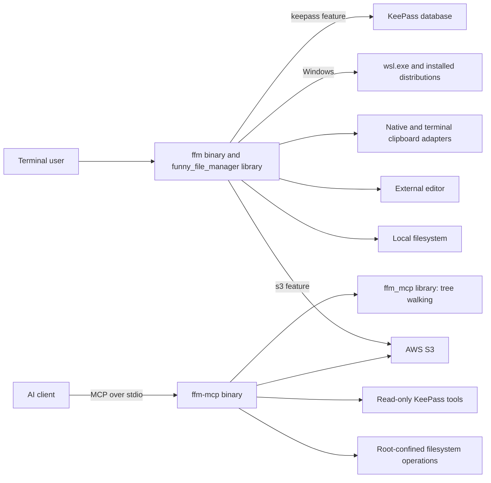
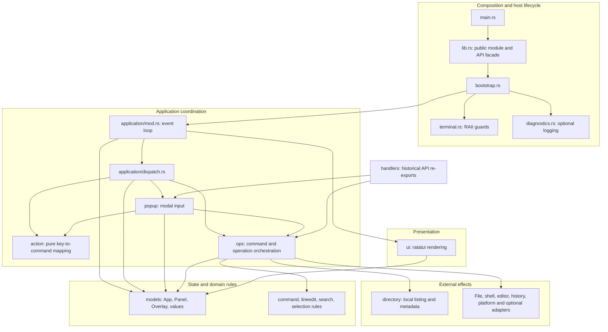
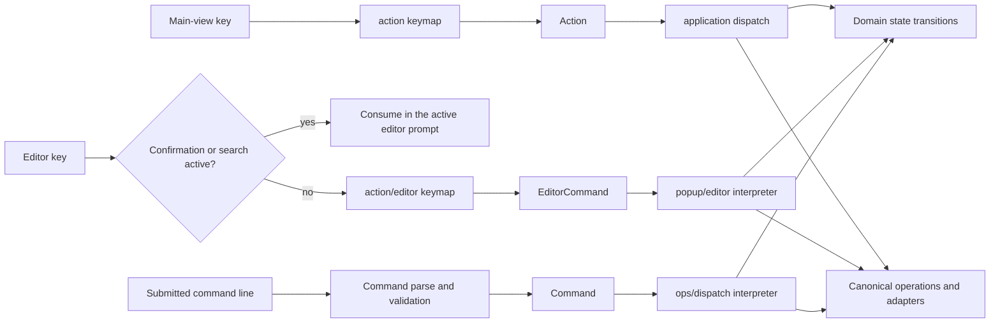
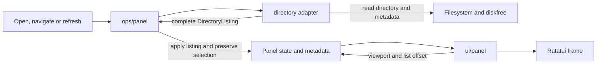
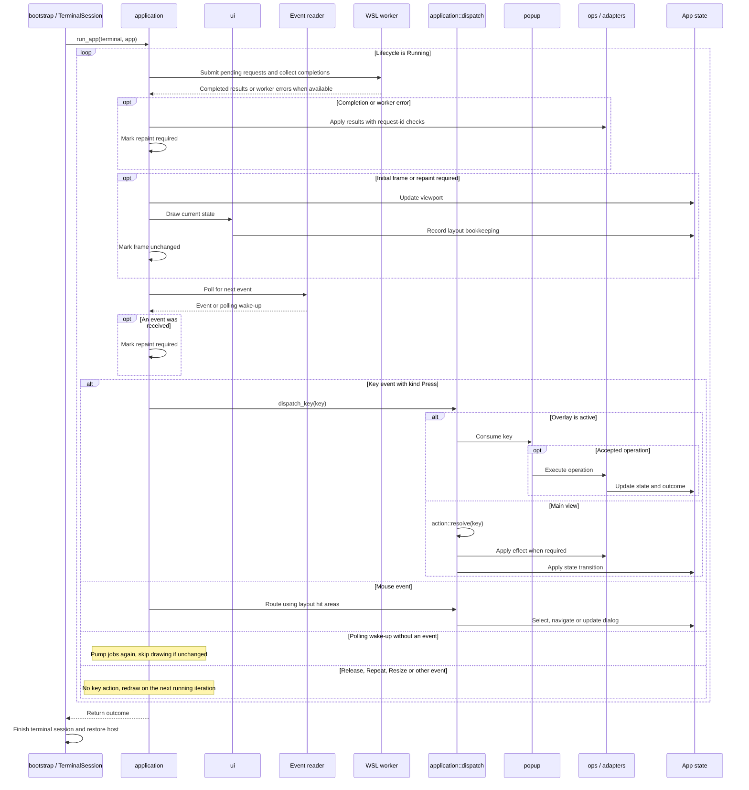
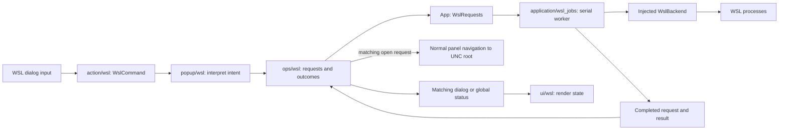
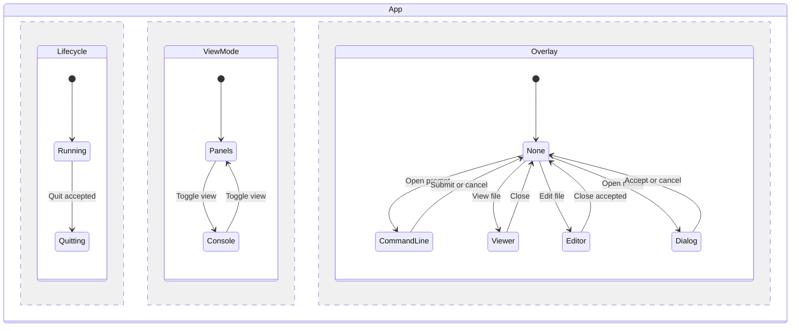
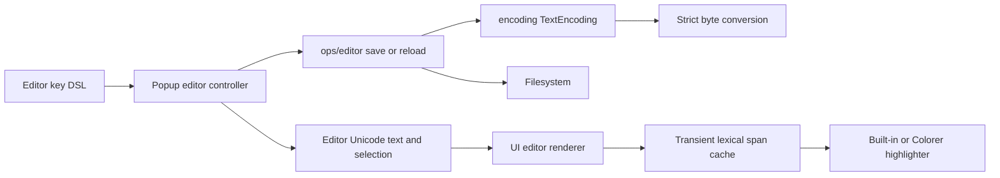
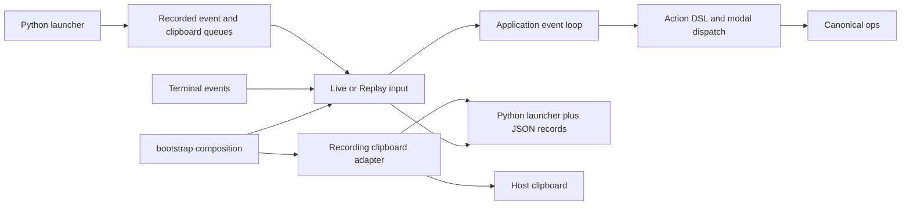

<!-- Purpose: Documents the implemented layers, runtime, state, and dependency boundaries. -->

# System Architecture

FunnyFileManager separates application coordination, input, presentation,
state, and external effects. The [module map](module-structure.md) identifies
the source owner for each responsibility; this document describes how those
owners work together.

## System context

The interactive application and MCP server are separate Cargo packages with
separate lockfiles. Running the TUI does not start an MCP server.

The MCP package includes a library for reusable tree-walking operations and a
binary for protocol handling. Its path validation and filesystem operations
are independent of the TUI. Both use `mcp/src/tool_names.rs`: the TUI's status
viewer includes this import-free file so displayed tool names match the
server's list. This does not couple their event loops or request handling.

## Responsibilities and dependencies

Arrows below mean calls or state access; the compatibility facade is kept
outside the application path.

The enforced boundaries are specific:

- `lib.rs` declares modules and exposes stable entry points. `application`
  owns the loop and non-modal effect dispatch.
- `action::resolve` maps main-view keys to typed `Action` values without I/O.
  `action::editor` maps editor keys to typed `EditorCommand` values. Modal
  routing decides which language receives the input before either is resolved.
- `ops` owns the canonical command, file, shell, viewer, vault-opening,
  editor-saving, and panel-loading operations. `handlers` only re-exports
  compatibility paths; production code calls the canonical owner.
- `ui` draws application state. Panel rendering reads cached filesystem
  facts; it never refreshes a directory or queries free space while drawing.
- `terminal` owns terminal mode transitions. `bootstrap` composes production
  dependencies, chooses the real history location, and installs restoration
  before entering the TUI.

These are module boundaries within one crate, not independent domain and
adapter crates. Existing `App` construction, drive enumeration, completion,
and modal code retain some synchronous I/O. Public `Panel` loading/navigation
and `Editor::save` methods remain inherent methods for compatibility, but
their implementations live in `ops/panel.rs` and `ops/editor.rs`. Do not infer
that every method reachable through `models` is free of effects.

## Typed command languages

Input is translated into a small domain-specific language (DSL), represented
by Rust enums, before an interpreter changes state or invokes an operation.
The language records the user's intent; the interpreter owns its consequences.

| Input context | Typed language | Interpreter |
|---|---|---|
| Main view | `Action`, resolved by the declarative keymap in `action.rs` | `application/dispatch.rs` |
| Editor buffer | `EditorCommand`, resolved by `action::editor::resolve(KeyEvent)` | `popup/editor.rs::apply_editor_command` |
| WSL manager | `WslCommand`, resolved by `action::wsl::resolve(KeyEvent)` | `popup/wsl.rs` |
| Submitted command line | `Command`, parsed and validated in `command.rs` | `ops/dispatch.rs` |

Both keymaps use the shared `keymap!` syntax in `action/keymap.rs`. Bindings
are ordered and the first match wins. Modifier policy is explicit:

| Binding clause | Meaning |
|---|---|
| `has(SHIFT)` | Requires Shift and allows additional modifiers |
| `exact(CONTROL)` | Requires Control alone, as for editor copy |
| `without(CONTROL + ALT)` | Rejects either modifier, as for inserted text |
| No clause | Matches the key regardless of modifiers |

The editor language expresses `Move { motion, selection }`, text editing,
search, save/close, and clipboard intent. `EditorNavigation` carries direction
or paging intent; the interpreter supplies the page distance when translating
it to the model's `EditorMotion`. `SelectionMode::Extend` preserves the
selection anchor, while `SelectionMode::Move` clears the selection. Unsupported
editor input resolves to `EditorCommand::Ignore` and remains consumed.

The keymap does not borrow `App`,
edit buffers, or access the clipboard. The interpreter delegates selection
and replacement rules to the editor model, and save/clipboard effects to
`ops/editor`. Exhaustive matching makes a new command require an explicit
interpretation.

Confirmation and search prompts consume input before the editor keymap runs.
Likewise, an active overlay is handled before main-view `Action` resolution.
These local languages share the same translation-and-interpretation pattern;
they preserve each context's key precedence and domain types. Command-line
validation still distinguishes invalid built-ins, empty input, and shell
commands before operation dispatch.

## Panel data and presentation

`directory` collects a `DirectoryListing`: entries, the parent entry, and
`PanelMetadata` containing hidden names and available space. The operation
layer applies a complete successful listing to the panel. A failed refresh
leaves the previous snapshot and selection intact. Failed navigation keeps the
original path and tries to refresh it, so a vanished destination disappears
from the current listing; if that refresh also fails, the last snapshot remains.

Free space and hidden attributes reflect the last successful load; refresh
updates them. Rendering still receives `&mut App` because ratatui list offsets,
and mouse hit areas depend on the current layout. This is
presentation bookkeeping, so describing the renderer as entirely immutable or
mathematically pure would be inaccurate.

## Runtime and input flow

The main loop processes input and draws on the UI thread. Production polls
crossterm at 100 ms intervals so WSL worker completions can update the
application even without a key press; tests inject events into the same loop.
The initial frame, real input events, and background completion/error outcomes
request a redraw. An idle `None` poll pumps background work again without
redrawing unchanged state. `Redraw::Needed` and `Redraw::Unchanged` make this
decision explicit; `draw_frame` updates the viewport and renders when needed.
WSL system jobs run on a serial background worker. Ordinary directory scans,
copies, and other synchronous operations still occupy the UI thread.

An active overlay consumes unsupported keys as well as supported ones. They
must not fall through to panel actions. Menu selections can explicitly enqueue
their advertised shortcut after the menu closes; this is deliberate command
dispatch, not unhandled-key fallback. Mouse activation uses the same command
paths as the keyboard.

Routine operation failures become typed `Status::Error` values rather than
terminating the loop. Terminal draw/read failures propagate to bootstrap, where
session cleanup still runs. `TerminalSession` and `TerminalSuspension` provide
best-effort restoration after partial transitions and normal return; the panic
hook covers aborting builds where destructors do not run.

## WSL management

The Windows WSL manager follows the same typed-command boundary. The main-view
shortcut, menu entry, and bare `wsl` command open one overlay. Within it,
`WslCommand` distinguishes opening a root, refreshing the list, updating the
WSL platform, and updating packages in the selected distribution.

`popup`, `ui`, and the model queue never start processes. Application workers
own execution through the injected backend; operations apply completed results.
Opening a distribution uses the existing `Panel::navigate_to` path, so files
under its UNC root use ordinary panel browsing and file operations.
Loading that UNC directory runs on the UI thread and can block while the
filesystem responds; the background worker does not make panel navigation asynchronous.
`DistributionName` validates one share component. The system backend passes
that name as a separate process argument when updating packages; the package
script is constant. Process duration and captured output are bounded, and
unsupported package managers return explicit errors.

While an operation is busy, users can navigate the list or close the overlay;
additional operations are disabled. Esc closes the manager without cancelling
an update. A finished background request can report global status, but its
request ID must still match before it changes an open dialog or navigates a
panel. A late result cannot reopen a closed manager or replace a later one.
Quitting ffm ends completion reporting without waiting for its worker; it does
not guarantee termination of running WSL or package-manager processes. On a
timeout, the adapter attempts to stop the Windows WSL client. Linux descendants
may continue, and completed package changes are not rolled back.

See [Windows platform support](../08-platform-support/windows-behavior.md) for
controls and supported package-update behavior.

## State and durability

`App` owns two panels, active side, background view, one overlay, lifecycle,
bookmarks, status, command history, and an in-memory console transcript.
The three state dimensions below are independent; the overlay examples are
representative, not an exhaustive list of variants.

`Overlay` stores each dialog's payload in its enum variant, making two active
dialogs unrepresentable. `ViewMode` remains separate so the command prompt can
operate over either panels or the console. `Lifecycle` is the single exit
state. Panel methods own selection bounds and preserve selection across reload.
Domain types such as `FileName`, `FileSize`, `BookmarkSlot`, `ScrollTop`, and
`Confirm` prevent callers from confusing values or states.

`App::new()` reads the current directory and loads both panels. Its history is
session-only: it does not discover or persist the user's history file.
`bootstrap` selects persisted history for a production session.
It also loads each saved panel directory independently through
`ops/panel_session`; a missing or unreadable directory falls back to the launch
directory. The event loop checkpoints changed directory pairs before rendering
and once when it returns. A default `App` never enables this persistence.

| Store | Owner and lifetime | Boundary |
|---|---|---|
| Command history | `history`, optionally persisted | `DurableLine` admits supported durable commands and rejects shell/invalid lines |
| Command transcript | `console`, process memory | Shell output is not written as history |
| Panel directories | `panel_session`, config directory | Atomic `panel-session.json`; unchanged paths cause no writes; independent of setup autosave |
| Diagnostic logs | `diagnostics`, opt-in with `FFM_LOG=1` | Character key payloads are redacted; tests supply temporary paths |
| Editor clipboard | `models/clipboard` owns the session backend | `ops/editor/clipboard` coordinates copy/paste; UI only renders selection and feedback |
| KeePass browser | `kdbx`, under `keepass` | Session and secret types back `Overlay::Kdbx`; clipboard access has its own adapter |

The KeePass browser is wired into the crate through `ops/vault`, `popup/kdbx`,
`ui/kdbx`, and `models/vault_browser`. S3 remains behind `s3`; its client exposes
synchronous wrappers around the async AWS SDK. Feature-specific behavior is
compiled only when that feature is enabled. Text clipboard support is available
in ordinary builds; bootstrap installs the native/terminal adapter, while tests
inject a backend. Editor selection and replacement are domain transitions in
`models/editor/selection`; clipboard effects live under `ops/editor`.
`test-helpers` exposes test seams
without substituting a different production event loop or editor path.

## Build profiles

The root and MCP packages distinguish fast development builds from optimized
release builds. `dev` and `test` compile project code at `opt-level = 0`, disable
LTO and debug information, and enable incremental compilation with 256 codegen
units. Dependencies use `opt-level = 2`, preserving their runtime performance
without optimizing the application's changing code on every edit.

The root `release` profile keeps `opt-level = 3`, fat LTO, one codegen unit,
stripped symbols, and aborting panics; MCP retains Cargo's release defaults.
Use `cargo build --release` for production artifacts;
plain `cargo build` and `cargo run` favor development turnaround. See
[build and verification commands](../04-development-workflow/build-run-test.md).

The packages retain independent lockfiles but share the root `target/`
directory, allowing dependency artifact reuse when versions, features, and
profiles match.

## Tests and boundary checks

Executable test bodies live in separate test source files, attached to their
owner with `#[cfg(test)]`. Integration tests use the public crate API from
`tests/`. The [testing strategy](../05-testing/testing-strategy.md) describes
fixtures, seams, and the verification matrix.

Source-level architecture tests check canonical operation ownership,
compatibility paths, the thin crate facade, separate test bodies, and rendering
dependencies. They scan `action/` recursively to guard the input languages
against operation and adapter dependencies. The file-size guard enforces the
1000-line ceiling under `src/`.
These complement behavioral tests; neither a diagram nor a source scan
substitutes for exercising the actual event loop.

## Editor conversion and presentation cache

Encoding belongs to the file format; changing the save encoding preserves the
Unicode buffer. Reload is a separate operation and requires a clean editor.
Rendering reads document state and maintains only a transient cache. Exact
source/path validation prevents stale spans after public buffer mutation.

## Production input recording

The event loop receives the same event type in live and replay sessions.
Bootstrap chooses input and clipboard adapters and the replay viewport.
Recorded resize events update the frame; mouse hit testing uses that frame.
External program launch belongs to `ops/program`, which suspends the terminal
through its RAII boundary and restores it after the process exits.

See [editor and replay usage](../../editor-and-replay.md),
[cursor benchmark](../../editor-performance.md), and
[mutation results](../../mutation-results.md).
