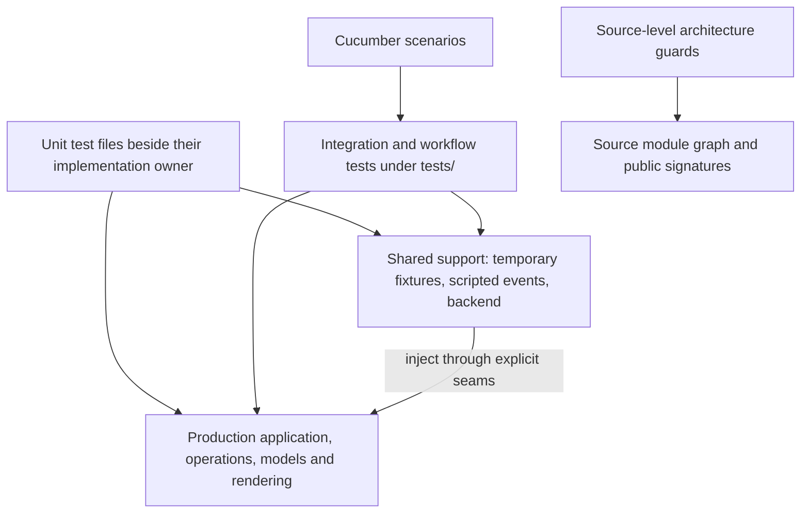

<!-- Purpose: Describes test ownership, injected boundaries, fixtures, and verification. -->

# Testing Strategy

Tests exercise production state transitions, operations, rendering, and the
event loop. Test code lives in dedicated files; support features expose seams
without selecting a different runtime implementation.

## Test layers and ownership



- **Unit tests** use a separate `tests.rs`, `tests_*.rs`, or `tests/` child
  module behind `#[cfg(test)]`. This preserves private access while keeping
  executable test bodies out of production source files. Tests belong to the
  implementation owner, not a compatibility facade.
- **Integration tests** under `tests/` exercise public APIs and complete
  workflows. Tests using helper-only APIs declare `test-helpers` requirements
  in Cargo configuration or cfg gates.
- **BDD scenarios** under `tests/features/` and `tests/features_ru/` run through
  the Cucumber harnesses. They describe user-observable behavior.
  `tests/behavior_features/` runs from the library test
  `application::tests::bdd::recent_features_bdd`, including ordinary
  `cargo test` runs. Its Gherkin scenarios exercise queued event-loop input,
  rendered panels and task dialogs, fixture process/network workers, local
  stdio language servers, OS-opening requests, action statistics, provider
  token reports and private connection settings. Run it
  alone with `cargo test --lib recent_features_bdd`. Missing steps, parse
  errors and undiscovered features fail the test; fixtures never control
  live processes or contact external diagnostic endpoints.

- **Architecture tests** check canonical operation ownership, compatibility
  signatures, the thin crate facade, separate test bodies, rendering
  dependencies, recursive `action/` and `popup/` dependencies, and the 200-line hard limit
  for every Rust and Python file in the repository (application, tests, benches, examples,
  `mcp/`, `colorer-sys/` and scripts), with a shrink-only `EXEMPT` list. These checks are intentionally
  structural and supplement behavior checks.
- **Readability policy fixtures** under `scripts/tests/fixtures/readability/`
  are compiled by a direct-Clippy script included in the full lint gate. They prove the configured
  limits reject complex functions and accept equivalent refactored functions,
  without starting Cargo inside ordinary tests.
- **Benchmarks, mutation, and coverage** use Criterion, cargo-mutants, and the
  repository's coverage scripts. Refresh stored coverage artifacts only when
  intentionally updating them.

The MCP package has its own unit, integration, and BDD tests. It is built and
tested separately from the root crate.

The English and Russian Cucumber executables run their generated futures on a
dedicated thread with an 8 MiB stack. This avoids overflowing the smaller
Windows executable entry stack. CI runs these suites on Linux and Windows;
Windows also runs the complete default-feature test suite and Clippy.

### Recent-feature acceptance scenarios

| Feature file under `tests/behavior_features/` | Observable guarantees |
|---|---|
| `token_usage.feature` | F9 opens the report; fixture JSON pages reach the background worker and rendered totals; F5 refreshes; unavailable data is an error; late responses cannot reopen or populate another panel |
| `network_drives.feature` | Saved mounts preserve server profiles and unrelated YAML; offline discovery retains entries; a changed target does not duplicate a mount; malformed YAML stays byte-for-byte intact |
| `server_profiles.feature` | JSON profiles migrate without changing the old file; Shift+F4/F4/F8 create, edit and delete across reloads; concurrent saves and malformed or duplicate profiles cannot overwrite existing settings |

These scenarios use temporary `ffm.yml` files and per-scenario fixtures.
Provider JSON goes through the production aggregation and pagination code;
the worker accepts an injected callback without selecting a separate runtime
implementation. No scenario reads real API credentials, enumerates the host's
network drives or contacts an external provider. A channel gate holds late
responses until the scenario releases them, rather than relying on sleeps.
## Seams and fixtures

| Boundary | Test technique |
|---|---|
| Input DSL | Test keys or command text against typed intent without constructing `App` or invoking effects |
| Command interpretation | Verify model transitions and operation outcomes through the owning dispatcher; editor confirmation/search must consume keys before ordinary editor commands |
| WSL system jobs | Use `run_app_with_wsl_backend` with a fake `WslBackend`; `None` events model polling wake-ups so completion can be tested without a key press |
| Event input | Supply a scripted closure to `run_app_with_event_reader`; the production loop still runs |
| Terminal drawing | Use ratatui `TestBackend` or `WritableTestBackend` for APIs requiring `Write + Backend` |
| Idle redraw policy | `src/application/tests/idle_render.rs` uses `CountingBackend` from `idle_render/backend.rs` to count real draws: idle polls preserve the frame, keys/resize repaint, a size change without an event repaints, a background completion repaints once without input, and a minute turning over repaints once |
| Clock | Unit tests read a clock standing still at noon; `clock::set_test_time` moves it, so no minute turns over by accident in a test that counts frames |
| Terminal lifecycle | Implement `TerminalOps` to record transitions and force setup/cleanup failures without a TTY |
| Real terminal (Linux) | `tests/pty_session_test.rs` runs the `ffm` binary on a pseudo-terminal: a burst typed in one write, and a terminal that hangs up |
| Panel state | Construct entries with `Panel::from_entries` for sorting, selection, and rendering tests |
| Directory loading and operations | Use `tempfile::TempDir` and real files for metadata, refresh, transfer, and failure behavior |
| Exceptional filesystem paths | Use cfg-gated in-memory fault injection in operation/helper modules |
| External editor | Use the explicit editor-result seam and guarded environment fixtures |
| Diagnostics | Pass log paths inside a test's temporary directory |
| Complete editor workflow | `tests/editor_workflow_test.rs` drives the real event loop with a fake clipboard and shared frame backend; verifies `.env` colors, selection, copy/paste, saved bytes, resizing, and clipboard failure |
| Complete WSL workflow | `tests/wsl_workflow_test.rs` drives real keys and rendered frames with a fake backend; verifies distinct update operations, selected-distribution root navigation, compact controls, and completion after closing a busy manager |
| Task list sampling | `application/task_jobs/tests.rs`, `tests_stall.rs` and `tests_failures.rs` drive `TaskJobs::pump_at(app, now)` with synthetic instants over `FixtureHost::gated()`, so staleness at 5 s and abandonment at 10 s are checked to the millisecond without sleeping; only the worker's answer is waited for, with a real-time deadline. `application/tests/task_refresh.rs` runs the real loop with `CountingBackend`: one frame per sample applied, none while the list is closed |
| Process host | `test_support::processes::FixtureHost` stands in for the platform's `ProcessHost` wherever a test sits above the ports (controller, ops, popup, BDD): its readers serve canned samples and it records signals and renices without sending them, so those tests never reach a real process. `FixtureHost::gated()` gives readers that block until the test opens their `Gate`, to hold a sample in flight, late or stuck without sleeping |
| Process reader | `src/process_table/procfs/tests_reader.rs` builds a fake `/proc` in a `TempDir`, which `tests_reader_cache.rs` and `tests_reader_system.rs` share (lines end with a newline, as the kernel writes them) and points `ProcFs` at it; a file replaced by a directory fails every read even for root, so unreadable files need no `chmod`. One `cfg(target_os = "linux")` test samples the real `/proc` and finds its own process and start time |
| Untrusted text parsers | `src/process_table/procfs/tests_robustness.rs` feeds each `/proc` parser every prefix of its fixture (a file cut short by an exiting process), ten thousand byte flips from a fixed-seed linear congruential generator (no new dependency), and every number at and past `u32` and `u64` limits; nothing may panic, because release builds abort on a panic and do not check overflow, and a file read for one value, cut anywhere, must read as nothing or as the whole, never as a smaller number. Each whole fixture must still parse, so the corpus cannot silently test nothing |

The application loop tests live under `src/application/tests/`; private
dispatch tests live under `src/application/dispatch/tests/`. Logging tests live
under `src/diagnostics/tests/`. Shared environment guards, writable backend
access, and coverage probes are test support rather than runtime concerns.
Editor key-resolution tests belong to `src/action/editor/tests.rs`; command
interpretation and prompt precedence belong to `src/popup/editor/tests.rs`.
WSL key, popup, and rendering tests live in their respective `wsl/tests.rs`
children. Adapter tests inject captured process results and pipes. Verify
serial execution, busy state, failures, and request IDs that prevent late
results from reopening dialogs or navigating after close. Tests never run
platform or distribution package updates on the host.

`App::new()` loads panels from the current directory, so it is not a no-I/O
fixture. It does start with session-only history and therefore does not resolve
or persist the user's real history file. Prefer explicit temporary paths when
a test depends on directory contents.

Never change process-wide working directory to redirect logs. Tests that must
change `$EDITOR` or other environment variables use shared guards and locks;
ordinary filesystem error injection does not use environment variables.

## What to assert

Verify behavior at the layer that owns it: selection invariants in panel
tests, parsing and key precedence in command/keymap tests, failure/status outcomes in operation tests,
and rendered cells in UI tests. Workflow tests should connect those behaviors
through actual input and dispatch rather than reimplement the expected logic.

For the editor DSL, separate key-resolution cases from command interpretation.
Cover movement versus selection, exact clipboard modifiers, search shortcuts,
and unsupported keys in the resolver tests. Interpreter and workflow tests
verify actual buffer changes, save/clipboard outcomes, and modal consumption.
This keeps a keymap refactor from silently changing editor behavior.

For snapshot-backed panel rendering, verify that a successful refresh updates
entries and metadata together, a failed refresh preserves the existing state
(a deleted folder is not a failure: the panel moves up to an existing one),
and rendering uses that stored state. For modal input, verify unsupported keys
cannot escape into panel operations. Cover useful error paths and public
functions; avoid tests that merely duplicate implementation statements.

## Verification commands

The [terminal UI quality suite](../../ui-quality.md) checks rendered text contrast,
essential labels, Unicode cells and control geometry across viewports and themes.
It runs in ordinary `cargo test`; set `FFM_UI_ARTIFACT_DIR` to export SVGs for
visual review. Linux and Windows CI publish these artifacts automatically.

```sh
cargo test
cargo test --features test-helpers
./ffm.py lint
```

To verify the readability policy itself:

```sh
./ffm.py lint self-test
```

This check requires Python and also runs directly as
`python scripts/test_readability.py`. The full `./ffm.py lint` gate includes it
through its architecture checks; `./ffm.py lint self-test` runs it on its own.
CI also runs it explicitly after the shared lint gate. It resolves `clippy-driver`
and `rustc` through the selected rustup toolchain, or from `PATH` when there is
no rustup (a standalone toolchain). It verifies all three diagnostics from the TUI, MCP, and
Colorer crate directories, so each must discover the shared root configuration.
The refactored fixture must pass, and three compiled tests compare its behavior
with the rejected version. Generated artifacts stay under
`target/readability-selftest/`. The script supplies lint levels directly;
ordinary Clippy gates verify the Cargo manifests' lint settings.

Before the readability check, `./ffm.py lint self-test` runs the developer
scripts' unit tests, `scripts/tests/test_*.py`, with the standard library's
`unittest`. Each test runs its script through `scripts/tests/sandbox.py`: a
fresh HOME, TMPDIR and checkout copy, and a PATH on which Cargo, Git, the AI
tools and the cloud clients are recording fakes, so no test builds, registers
a tool or reaches the network. They also run on their own:

```sh
python3 -m unittest discover -s scripts/tests
```

For the editor DSL and complete workflow specifically:

```sh
cargo test --lib action::editor::tests
cargo test --lib popup::editor::tests
cargo test --features test-helpers --test editor_workflow_test
```

The workflow test opens `.env` through F4, selects with Shift+arrows, copies with
Ctrl+C and Ctrl+Insert, pastes with Ctrl+V, Shift+Insert and terminal paste events,
saves with F2, closes with Esc, and quits
through the normal dialog. It checks rendered colors and Unicode selection,
resizing to an 18×6 terminal, saved line endings, and preservation of the
buffer when clipboard access fails. The input queue tests preserve shortcut order,
deferred errors and editor prompt ownership. The idle-render suite also checks
that a queued 1,000-line paste produces one document redraw before save and close.

For the WSL workflow:

```sh
cargo test --features test-helpers --test wsl_workflow_test
```

The tests wait for rendered outcomes with bounded deadlines. A channel holds
the fake update until the test has closed the manager and used the normal
panel keyboard. `None` events then allow completion without another key press,
matching the production reader's 100 ms polling behavior. Normal directory
navigation, including loading a WSL UNC root, still runs on the UI thread and
can block on filesystem access.

The required lint gate checks formatting in the root, MCP, and Colorer packages. Clippy
checks every target in these configurations, always denying warnings:

| Package | Feature configurations |
|---|---|
| TUI | Default; `--all-features`; `--no-default-features --features test-helpers` |
| MCP | Package defaults |
| Colorer | Package defaults |

The shared `./ffm.py lint` script also runs `module_boundaries_test`,
`file_line_limit_test`, `scripts/test_readability.py`, and
`scripts/test_recording.py`. These checks can be run together with
`./ffm.py lint architecture`. The CI lint job calls the full script, then
runs the self-test (script unit tests, readability fixtures, lint policy) and
`module_boundaries_test`.
Optional-feature behavior needs its own test run when changed:

```sh
cargo test --features keepass
cargo test --features s3
cargo test --manifest-path mcp/Cargo.toml
```

For focused work, select the relevant unit/integration target first, then run
the required gate before committing. Ignored tests are for explicitly manual
or environment-dependent cases; do not make normal validation interactive.

Use `cargo mutants` when evaluating assertion strength and `./ffm.py coverage`
(CI's line-coverage gate) when refreshing coverage. Neither tool replaces
targeted tests of observable outcomes and failure handling.
