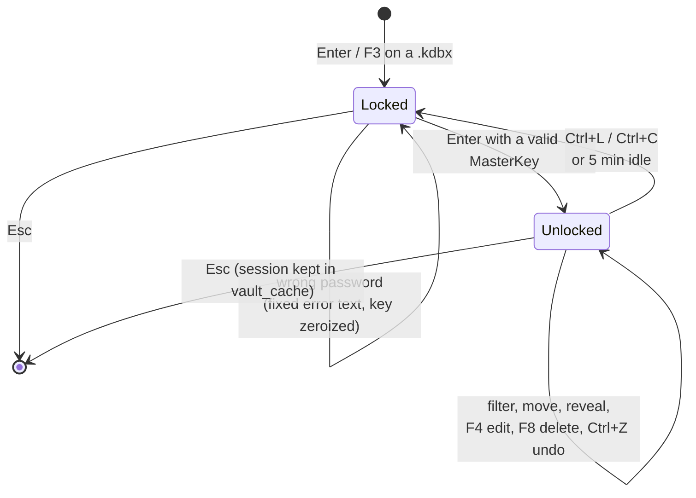
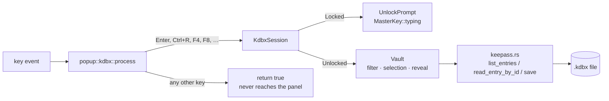

<!-- Purpose: Explains the KeePass (.kdbx) vault browser, its state machine, and its secret-handling rules. -->

# 🔐 KeePass Vault (`.kdbx`)

FunnyFileManager can browse, search and edit KeePass 4 databases directly in a
panel overlay. The feature is **optional but on by default**
(`default = ["colorer", "keepass"]`); build without it using
`--no-default-features` or drop `keepass` from the feature list.

Two layers, deliberately separated:

| Layer | File | Knows about |
|-------|------|-------------|
| Storage | `src/keepass.rs` | the `keepass` crate, files, encryption |
| State machine | `src/kdbx.rs` (+ `src/kdbx/`) | locked/unlocked, filter, reveal, undo |

`src/kdbx.rs` intentionally knows nothing about `crossterm`; keys are mapped by
`src/popup/kdbx.rs`, rendering by `src/ui/kdbx.rs`.

---

## 🚪 Opening a vault

`src/ops/vault.rs` owns the trigger, shared by both entry points:

- `Enter` on a `*.kdbx` file → `open_vault_if_kdbx(app)` → read-only (`Access::View`)
- `F3` on a `*.kdbx` file → the same helper, same guard
- `F4` inside the overlay → escalates to `Access::Edit`

The helper exists because the recurring bug in this codebase is a rule applied
at one call site and quietly not at its twin. The extension test, the directory
guard (a *directory* named `secrets.kdbx` is still a directory) and the overlay
construction all live in one function.

Sessions are pooled in `app.vault_cache`, so re-entering a vault you already
unlocked does not re-prompt until the idle timer fires.

---

## 🔁 The state machine

```rust
pub enum KdbxState {
    Locked(UnlockPrompt),
    Unlocked(Vault),
}
```

Exactly two shapes. "Entries without a master key" and "a revealed password
while locked" are **not representable**. Unlocking is the only way to obtain a
`Vault`, and a `Vault` cannot exist without a `MasterKey`.

`KdbxSession { path, state, access, undo }` wraps it with the file path, the
view/edit access level and one level of persisted undo.



How a key reaches the vault:



Idle auto-lock: `kdbx::IDLE_LOCK = 5 minutes`. Every interaction calls
`Vault::last_activity` / `touch_session`, so the timer measures *idle* time, not
time since unlock.

---

## 🗝️ Secret handling — the rules

This is the part to read before touching any of these files.

- `MasterKey` and `Revealed` (`src/kdbx/secret.rs`) have **no `Debug` and no
  `Display`**. That makes `Vault` and `KdbxSession` underivable in turn, so a
  stray `{:?}` in `log_action` / `log_error` cannot print a password even by
  accident. Do not add `#[derive(Debug)]` to any of them.
- Both zeroize on `Drop`, and `MasterKey::typing()` wraps the buffer from the
  *first keystroke*, so a half-typed password is zeroized too — including when
  the user gives up and hits `Esc`.
- Unlock failures surface **fixed English strings** (`unlock_error_message`),
  never the typed password.
- Secrets must not travel through the `Viewer` or `Editor` overlays: both keep
  scroll buffers alive for the rest of the session.
- `EntryDetails.password` is plaintext by design — do not log it, drop it
  promptly.

---

## ⌨️ Keys inside the overlay

| Key | Action |
|-----|--------|
| `Enter` (locked) | Attempt unlock |
| `Enter` (unlocked) | Copy password to clipboard |
| `Ctrl+U` | Copy username |
| `Ctrl+R` (locked) | Toggle master-password visibility |
| `Ctrl+R` (unlocked) | Toggle reveal of the selected password |
| `Ctrl+L` / `Ctrl+C` | Lock the vault |
| `Ctrl+Z` | Undo the last vault change (one level) |
| `F4` | Edit the selected entry (escalates to `Access::Edit`) |
| `F6` | Toggle view/edit mode |
| `F8` | Delete the selected entry (confirmed) |
| `Up`/`Down`/`PgUp`/`PgDn`/`Home`/`End` | Move the cursor (`Motion`) |
| printable char | Append to the incremental filter |
| `Backspace` | Shorten the filter |
| `Esc` | Close the overlay |

> **Every other key must be swallowed** by returning `true`. A `_ => false`
> fall-through in the command-line overlay once let `F8` reach the panel and
> delete files; a password list is a worse place for that bug.

---

## 🆔 Identity: always by `EntryId`, never by title

Titles are **not unique** in KeePass — two `GitHub` rows in one group are legal
and common after a rotation. Every read and write of a listed entry goes by
`EntrySummary.id`; resolving by name takes the first match, which for the second
row is the wrong entry.

`group_path` is kept structural (`Vec<String>`, e.g. `["Work", "CI"]`) rather
than `/`-joined, because KeePass allows `/` inside a group name, so a joined
string cannot be split back reliably.

---

## 📚 Storage API (`src/keepass.rs`)

| Function | Purpose |
|----------|---------|
| `list_entries` | All entries as `EntrySummary` |
| `read_entry` / `read_entry_by_id` | Full `EntryDetails` incl. plaintext password |
| `create_database` | New vault; refuses to overwrite (`AlreadyExists`) |
| `upsert_entry` / `update_entry` / `update_entry_by_id` | Write one entry |
| `delete_entry_by_id` | Remove one entry |
| `export` / `to_json` / `to_yaml` / `export_json` / `export_yaml` | Structured dump |

Errors are a closed enum, `KeepassError`: `Open`, `Save`, `Io`, `EntryNotFound`,
`AlreadyExists`, `Serialize`.

The unlocked layer has its own `KdbxError` (`Locked`, `NoSelection`, `NoEdit`,
`NothingToUndo`, `ReadOnly`, `Keepass(..)`) so that "the vault is locked" is
never misreported as "entry not found". **No variant carries the master
password.**

Saves are atomic — see the note in `src/keepass.rs` — and go through
`src/file_write.rs`, shared with the F4 editor: a file this process may not
write is refused, and the replacement keeps the original's permissions.

---

## 🧭 Vault navigation (`src/kdbx/vault.rs`, `src/kdbx/vault/`)

`Vault` holds the entry list plus an incremental filter. `entries()` is
everything, `matches()` the indices that pass the filter, `visible()` the
iterator the UI renders. Selection moves via `Motion`, and every mutating call
takes `now: Instant` to refresh the idle timer.

Editing goes through `EntryForm` (`form()` / `form_mut()`, `src/kdbx/edit.rs`).

---

## 🔗 Related

- `docs/kdbx-usage.md` — end-user guide: building, unlocking, the MCP `kbdx`
  tool, `kdbx_dump`, output formats and limits
- `03-rust-best-practices/type-system.md` — why the state machine is an enum
- `06-ui-and-interaction/` — overlay conventions this one follows
