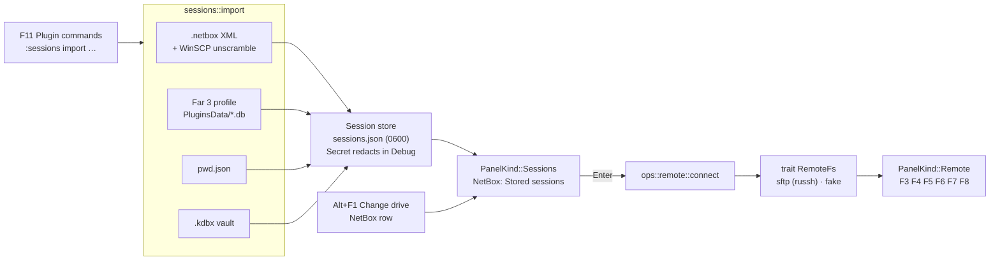

<!-- Purpose: Design for Far's Change drive dialog keys and NetBox-style stored connections with import from Far, pwd.json and KeePass. -->

# Change drive parity and NetBox connections: design

_2026-09-22. Status: approved for implementation (autonomous run)._

## 1. What the user asked for

1. The Alt+F1 / Alt+F2 dialog should look and behave like Far's "Change
   drive": a boxed table `C: fixed │ 467 G │ 5.22 G`, then the plugin rows
   with digit hotkeys (`2 NetBox`, `0 Process list` …), and the key legend
   `Del Shift+Del F3 F4 F9` in the bottom border — with those keys working.
2. "NetBox connections": stored SFTP/SCP/FTP sessions like Far's NetBox
   plugin — a `NetBox: Stored sessions [/]` panel listing them, connecting to
   one browses the remote host in the panel — with **import from Far Manager
   (NetBox), from `pwd.json`, and from `.kdbx` vaults**.

Far's help for the dialog is topic `@DriveDlg` in
`docs/upstream/far-manager/FarEng.hlf.m4`.

## 2. Facts established

- The current dialog (`src/ui/drives.rs`, `src/models/drives.rs`,
  `src/popup/drives.rs`) already draws Far's table and plugin section; the
  footer says `Enter  Esc` because nothing else was handled. S3 profiles are
  the only plugin rows.
- NetBox's session export is WinSCP's format: an XML file
  (`<NetBox version="2.1"><Sessions><Session name="user@host"><HostName>…
  <PortNumber>…<UserName>…<FSProtocol>SFTP%20(SCP)</FSProtocol>
  <RemoteDirectory>…<Password>…`) — values URL-encoded, the password a
  100-hex-character WinSCP "simple" scramble (`SimpleEncChar`: each byte is
  `(~c) ^ 0xA3` written as two hex digits; the stream is flag `0xFF`, length,
  shift, `shift` random bytes, then `key + password` where `key = user + host`,
  padded to 50 bytes). An example export is produced by NetBox's *Export
  sessions* command; test fixtures use made-up values only, and a real
  export's password is never printed.
- On Far 3 the live sessions are in the profile's plugin settings database:
  `%APPDATA%\Far Manager\Profile\PluginsData\<GUID>.db`, SQLite, tables
  `table_keys(id, parent_id, name, description)` and
  `table_values(key_id, name, value BLOB)`; root key id 0; NetBox keeps
  `Sessions\<name>` keys whose values carry the same names as the XML. The
  importer must not depend on the GUID: scan every `PluginsData/*.db` for a
  `Sessions` key holding `HostName` values.
- `pwd.json` (an external two-level credential store): a two-level map
  `{ "<section>": { "<key>": { username?, password?, url?, notes? } } }`.
  Sections look like `Example/Test/Dev`; entries with an `sftp://`, `scp://`,
  `ftp://`, `ftps://` or `ssh://` URL, or a `notes`/`url` that names a host
  and port, become sessions named `section/key`.
- `.kdbx`: `src/keepass.rs` already reads vaults (`list_entries`,
  `read_entry`, URL / user / password fields, `keepass` feature). Entries
  qualify by URL scheme as above.
- Pure-Rust SSH: `russh` 0.63 + `russh-sftp` 3.0 (async, needs `tokio`,
  already an optional dep for S3). SQLite: `rusqlite` 0.40 with the `bundled`
  feature. XML: `roxmltree` 0.21.

## 3. Design

### 3.1 Change drive dialog (owner: `drives`)

- Footer legend shows exactly the keys that work: `Del Shift+Del F3 F4 F9`
  (plus `Ctrl+R`).
- `Del`: for a mounted removable or network filesystem, unmount it
  (`umount <mountpoint>` on Unix; `net use X: /delete` on Windows); for a
  plugin row, delete it (an S3 profile is not deleted — status says why; a
  NetBox row is not deletable here, sessions are managed in their panel).
- `Shift+Del`: safely remove — `udisksctl power-off -b <dev>` or `eject` on
  Linux, `diskutil eject` on macOS; status reports the result.
- `F3`: a small information dialog for the row — device, filesystem type,
  mount options, total/free (from `/proc/mounts` + statvfs on Unix, volume
  info on Windows); for a plugin row, what it is.
- `F4` (and `Ctrl+A`): the attributes dialog (Ctrl+A feature) opened on the
  drive's root directory.
- `F9`: the dialog's settings — which columns to show: type, label,
  filesystem, size/free (Far's Ctrl+1/3/4/5 toggles do the same at once);
  stored in `Settings.drives { show_type, show_label, show_fs, show_size }`
  and saved with the setup.
- `Ctrl+R`: rebuild the rows.
- Plugin rows: every S3 profile (as now), `NetBox` (opens the sessions panel,
  §3.3), `Process list` (opens the Task list dialog, Ctrl+W). Digit hotkeys
  in that order, as Far numbers them from 0.
- Ownership: `src/models/drives.rs`, `src/popup/drives.rs`, `src/ui/drives.rs`,
  `src/ops/drives.rs` (new: the effects), `src/config/pages/drives.rs`,
  tests.

### 3.2 Sessions store (owner: `sessions_store`, lands first)

`src/sessions.rs` + `src/models/session.rs`:

```rust
pub struct Session { pub name: SessionName, pub protocol: Protocol, pub host: String,
    pub port: u16, pub user: String, pub auth: Auth, pub remote_dir: Option<String>,
    pub origin: Origin }
pub enum Protocol { Sftp, Scp, Ftp, Ftps }
pub enum Auth { Password(Option<Secret>), KeyFile(PathBuf), Agent, Prompt }
pub enum Origin { Manual, NetBoxFile(PathBuf), FarProfile, PwdJson(PathBuf), Kdbx(PathBuf) }
```

- File: `<config dir>/ffm/sessions.json` (`crate::config::dir()`), written
  atomically with mode `0600` on Unix; passwords saved only when the session
  says so (`Auth::Password(Some(_))`), otherwise prompted at connect time.
  `Secret` is a newtype that redacts in `Debug` and zeroes on drop.
- `SessionStore { sessions: Vec<Session> }`: `load()`, `save()`, `upsert`
  (by name; an import that finds an existing name keeps the manual entry and
  reports it as skipped), `remove`, `find`, sorted by name for display.
- Default names follow NetBox: `user@host`, with `:port` when not 22.

### 3.3 Sessions panel and F11 plugin commands (owner: `sessions_panel`)

- `PanelKind::Sessions(Box<SessionsPanel>)`: the panel titled
  `NetBox: Stored sessions [/]`, column title `Session name`, rows `..` then
  one per session (name; a second column with `user@host` when the name is
  not that). Enter on `..` returns the panel to files; Enter on a session
  connects (§3.5). `F4` edits the session in a dialog (`Overlay::SessionEdit`:
  name, protocol, host, port, user, auth kind, password / key file, remote
  dir, "Save password"); `Shift+F4` creates one; `F8` deletes after a
  question; `F5` duplicates; `F3` shows the session without its password.
  Quick search (Alt+letter) works on names.
- `F11` becomes Far's "Plugin commands" list (`Overlay::PluginCommands`):
  `MCP status` (what F11 did), `NetBox: stored sessions`, `NetBox: import from
  Far Manager…`, `NetBox: import from .netbox file…`, `NetBox: import from
  pwd.json…`, `NetBox: import from KeePass vault…`. Each import item asks
  for a path in a name prompt (defaults: the Far profile directory, the
  file under the cursor when its extension matches), runs the importer and
  reports `N imported, M skipped` with the skipped names in the console
  transcript. The `:sessions import <far|netbox|pwd|kdbx> [path]` command
  does the same from the command line.
- Ownership: `src/models/sessions_panel.rs`, `src/ui/sessions.rs`,
  `src/popup/sessions.rs`, `src/ops/sessions.rs`, `src/models/plugin_commands.rs`,
  `src/ui/plugin_commands.rs`, `src/popup/plugin_commands.rs`,
  `src/ops/plugin_commands.rs`, `src/popup/session_edit.rs`, `src/ui/session_edit.rs`,
  `src/models/session_edit.rs`, the `:sessions` verb in `src/command.rs` /
  `src/ops/dispatch.rs`, tests.

### 3.4 Importers (owners: `import_netbox`, `import_far`, `import_pwd`, `import_kdbx`)

`src/sessions/import/<kind>.rs`, each a pure function
`fn import(source) -> Result<Vec<Session>, ImportError>` with unit tests on
fixtures (no real secrets committed: fixtures use made-up values, and the
WinSCP scramble test round-trips a known password through an encoder written
for the test).

- `netbox_xml.rs` (+ `winscp.rs`): the `.netbox` file; URL-decode values;
  `FSProtocol` → `Protocol`; `PortNumber`; `RemoteDirectory`; password
  unscrambled with key `user + host` (a mismatch means "no password").
- `far_db.rs` (feature `netbox`, `rusqlite` bundled): locate the profile
  (`%APPDATA%\Far Manager\Profile`, or a path given), open every
  `PluginsData/*.db` read-only, walk `table_keys` for `Sessions/*`, read
  `table_values` (text values as UTF-8, integers as little-endian 8 bytes),
  same field mapping as the XML.
- `pwd_json.rs`: the two-level map; selection rule in §2; `notes` kept as
  the session's description; passwords carried over as saved passwords
  (that is what the source already is).
- `kdbx.rs` (feature `keepass`): `keepass::list_entries` + `read_entry` on a
  vault unlocked with a password prompt (`Overlay::NamePrompt`-style masked
  input already used by the kdbx browser); entries with a matching URL scheme.

### 3.5 Remote panel over SFTP (owner: `remote_sftp`, feature `netbox`)

- `src/remote/mod.rs`: `trait RemoteFs { list, stat, read_to(tmp), write_from,
  mkdir, remove, rename }` with `src/remote/sftp.rs` implementing it on
  `russh` + `russh-sftp` inside a private `tokio` current-thread runtime (the
  blocking facade S3 uses), host-key trust through `~/.ssh/known_hosts`
  (prompt on first contact, append on Yes), auth by saved password, prompted
  password, key file, or agent; timeouts 15 s.
- `PanelKind::Remote(Box<RemotePanel>)`: entries listed as `DirEntry`
  (name, kind, size, modified, attributes, owner), `..` goes up, Enter enters,
  `Alt+F1/F2` or `..` at the root returns to local files, quick search works.
  Ops on a remote panel: `F3` downloads to a temp file and views; `F4`
  downloads, edits, uploads on save; `F5`/`F6` between a remote and a local
  panel (download / upload, directories recursively, the copy prompt's
  destination shows `sftp://name/path`); `F7` mkdir; `F8` delete (confirm);
  `Shift+F6` rename. Every failure reaches the status bar.
- The listing call is synchronous inside the event loop for this release
  (a `Connecting…` status is drawn first); a background job pump is a
  follow-up.
- Ownership: `src/remote/*`, `src/models/remote_panel.rs`, `src/ui/remote.rs`,
  `src/popup/remote.rs`, `src/ops/remote.rs`, feature wiring in `Cargo.toml`
  (`netbox = ["dep:russh", "dep:russh-sftp", "dep:tokio", "dep:rusqlite"]`),
  tests with a fake `RemoteFs`.

## 4. Waves

| Wave | Content | Mode |
|---|---|---|
| 0 | Scaffold: `Session` types + store, `PanelKind::Sessions/Remote`, `Overlay::SessionEdit/PluginCommands`, `RemoteFs` trait + fake, feature `netbox`, Change-drive NetBox/Process-list rows, F11 list with stubs, `:sessions` verb; green gate | one agent, main tree |
| 1 | `drives`, `sessions_panel`, `import_netbox`, `import_far`, `import_pwd`, `import_kdbx`, `remote_sftp` | worktrees in parallel, adversarial review, merge, gate |
| 2 | docs: CLAUDE.md, parity page, module map, a `docs/netbox.md` how-to (import paths, password policy) | sequential |

## 4a. Data flow



## 5. Acceptance

- Alt+F1 shows the legend `Del Shift+Del F3 F4 F9` and each key does §3.1.
- Alt+F1 → `NetBox` opens `NetBox: Stored sessions [/]`; F11 lists the
  import commands; `:sessions import netbox tests/fixtures/example.netbox`
  imports one synthetic session `demo@example.test` with host, port 2222, user,
  remote dir `/var/www`, and a password that unscrambles to printable text
  (verified by length and charset only, never printed).
- `:sessions import pwd <file>` on a fixture imports the SFTP entries and
  skips the rest with reasons; `:sessions import kdbx <vault>` likewise.
- With the `netbox` feature, connecting to a session lists the remote
  directory and F3/F5/F7/F8 work (verified against a fake `RemoteFs` in tests
  and manually against a real host by the user).
- Gate green: fmt, clippy matrix (default, `--all-features`,
  `--no-default-features --features test-helpers`, and
  `--features netbox`), tests, BDD, architecture tests.
