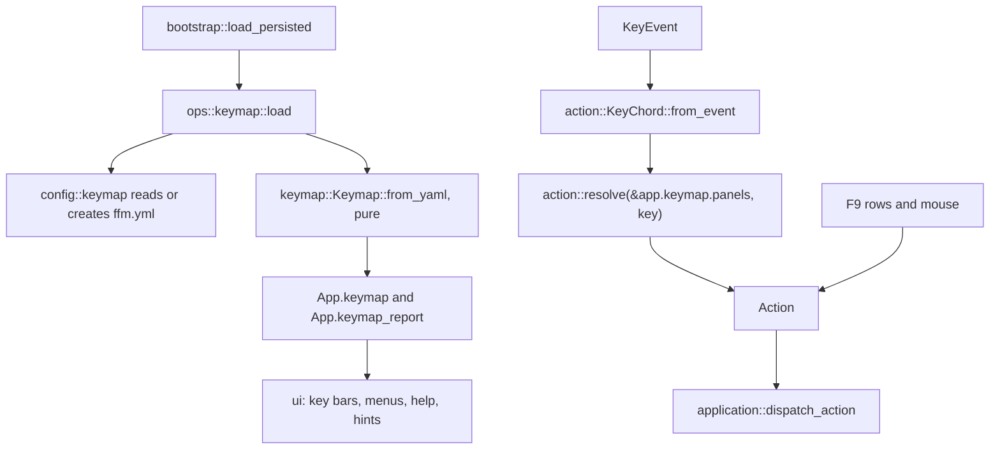

<!-- Purpose: Design for a configurable keymap: every hotkey read from ffm.yml in the settings folder, with the defaults written there on first start. -->

# Configurable keys in `ffm.yml`: design

_2026-09-24. Status: design; steps 1–4, the core of step 5 and the context switches recorded in §14 built. Branch `feat/ffm-yml-keymap`
from `main` fa4a84d; the code lands on `feat/ffm-yml-keymap-impl` from
cefb537c. This file is the plan; once code lands, the reference is the
knowledge-base page named in §11._

## 1. What the user asked for

"Save all hotkeys to ffm.yml." Asked what that means, the user chose:

- a **configurable keymap**: `ffm.yml` in the settings folder, next to
  `settings.yaml` (`config::dir()`), from which FFM reads **every** key
  binding;
- **any key can be reassigned**;
- on **first start** the file is created holding **all default bindings**.

"All hotkeys" is taken literally: a key that runs a command is in the file
unless §4.2 gives a concrete reason why it cannot be.

## 2. Facts established

### 2.1 Where a key is decided today

| Site                                                                                                                                                                       | Screen                                                                | Mechanism                                                                                                                                                                                                                                                      |
| -------------------------------------------------------------------------------------------------------------------------------------------------------------------------- | --------------------------------------------------------------------- | -------------------------------------------------------------------------------------------------------------------------------------------------------------------------------------------------------------------------------------------------------------- |
| `src/action.rs`, `action/menu.rs`, `action/function_keys.rs`                                                                                                               | Panels (and the Ctrl+O console, which reinterprets the same `Action`) | `keymap!` DSL in two layers: `menu::resolve` (`exact(...)` arms returning `MenuCommand`) before `resolve_main` (`has(...)`/unqualified arms). The two layers name several functions twice (`Ctrl+Q` → `MenuCommand::QuickView` and `PanelCommand::QuickView`). |
| `action/editor.rs`                                                                                                                                                         | Built-in editor                                                       | `keymap!` → `EditorCommand`                                                                                                                                                                                                                                    |
| `action/tasks.rs`                                                                                                                                                          | Task list (browse)                                                    | `keymap!` after `normalize` (Shift+letter → capital) → `TaskCommand`; hand-written `HELP` table                                                                                                                                                                |
| `action/wsl.rs`                                                                                                                                                            | WSL manager                                                           | `keymap!` → `WslCommand`                                                                                                                                                                                                                                       |
| `popup/viewer.rs`, `popup/quickview.rs`                                                                                                                                    | Viewer; quick-view panel (the viewer's scroll keys)                   | inline `match`                                                                                                                                                                                                                                                 |
| `popup/tree.rs`                                                                                                                                                            | Tree panel                                                            | inline `match`; refuses `F5`–`F8` by key code                                                                                                                                                                                                                  |
| `popup/sessions.rs`, `remote.rs`, `netbox.rs`                                                                                                                              | NetBox panels                                                         | `ROW_KEYS` table + inline; other keys refused by `Action::scope()`                                                                                                                                                                                             |
| `popup/command_line.rs`                                                                                                                                                    | Command line, Ctrl+R search, completion list                          | inline `match` (37 `KeyCode` arms)                                                                                                                                                                                                                             |
| `popup/tasks/*.rs`                                                                                                                                                         | Task list bars, menus, dialogs                                        | inline                                                                                                                                                                                                                                                         |
| `popup/lsp_editor.rs`, `path_env.rs`, `kdbx.rs`                                                                                                                            | Language servers, PATH editor, KeePass vault                          | inline                                                                                                                                                                                                                                                         |
| ~35 other `popup/*.rs`                                                                                                                                                     | Prompts, confirmations, choice lists, menu bar, sort menu, drive menu | inline; Enter/Esc/F10/Tab/arrows/letters                                                                                                                                                                                                                       |
| `menu/tables.rs`                                                                                                                                                           | F9 rows                                                               | each row stores a shortcut *label string* and a `Shortcut` key that `app.pending_key` replays through `dispatch_key`                                                                                                                                           |
| `ui/fkey_bar.rs` `FKEY_LABELS`, `ui/overlays.rs` `HELP_LINES`, `action/tasks.rs` `HELP`, `models/sortmenu.rs` (`"Ctrl+F{}"`), ~79 hint strings in `ui/`, `status/`, `ops/` | Labels                                                                | hard-coded text                                                                                                                                                                                                                                                |
| `application/dispatch/mouse.rs`, `dialog_mouse/*`                                                                                                                          | Mouse                                                                 | synthesizes keys: wheel = Up/Down, double click = Enter, key bar = `F(n)`, dialog buttons = their keys (vault's Ctrl+R, WSL's F2/F5/F6)                                                                                                                        |
| `application/input.rs`, `application/timing.rs`                                                                                                                            | Editor paste batching; performance labels                             | call `action::editor::resolve` / `action::resolve`                                                                                                                                                                                                             |
| `terminal/keyboard.rs`                                                                                                                                                     | Every screen                                                          | legacy decode: the 0x1C byte (Ctrl+4) becomes Ctrl+\                                                                                                                                                                                                           |
| `ops/shell.rs` `is_cancel_event`                                                                                                                                           | A running shell command                                               | Esc / Ctrl+C, read outside the event loop                                                                                                                                                                                                                      |

Menu hotkey letters come from the `&` in each label (`menu::hotkey_of`);
dialog button letters (`Y`/`N`, `T`/`K`/`S`) are hard-coded beside the label.

### 2.2 How crossterm 0.29 reports keys

Read from `crossterm-0.29.0/src/event/sys/{unix,windows}/parse.rs`. FFM pushes
kitty flags `DISAMBIGUATE_ESCAPE_CODES | REPORT_ALTERNATE_KEYS` where the host
answers the query (`terminal/keyboard.rs`).

| Pressed            | Unix, legacy bytes           | Unix, kitty protocol                                                        | Windows console                                                                              |
| ------------------ | ---------------------------- | --------------------------------------------------------------------------- | -------------------------------------------------------------------------------------------- |
| `k`                | `'k'`                        | `'k'`                                                                       | `'k'`                                                                                        |
| Shift+k            | `'K'` + SHIFT                | `'K'` + SHIFT                                                               | `'K'` + SHIFT (CapsLock: `'k'` + SHIFT)                                                      |
| Shift+=            | `'+'`                        | `'+'`                                                                       | `'+'` + SHIFT                                                                                |
| Ctrl+k             | `'k'` + CONTROL              | `'k'` + CONTROL                                                             | `'k'` + CONTROL (CapsLock: `'K'` + CONTROL)                                                  |
| Ctrl+Shift+k       | `'k'` + CONTROL (Shift lost) | `'K'` + CONTROL (crossterm drops SHIFT when it substitutes the shifted key) | `'K'` + CONTROL + SHIFT                                                                      |
| Alt+Shift+k        | `'K'` + ALT + SHIFT          | `'K'` + ALT                                                                 | `'K'` + ALT + SHIFT                                                                          |
| Ctrl+Alt+k / AltGr | `'k'` + CONTROL + ALT        | same                                                                        | AltGr is reported as CONTROL + ALT with the character AltGr types (`'@'` on a German layout) |
| Ctrl+Shift+=       | — (no control byte)          | `'+'` + CONTROL                                                             | `'='` + CONTROL + SHIFT (`ToUnicodeEx` with an empty key state)                              |
| Shift+Tab          | `BackTab` + SHIFT            | same                                                                        | same                                                                                         |
| Ctrl+Space         | `' '` + CONTROL (NUL)        | same                                                                        | same                                                                                         |

Legacy collisions are already listed in the parity doc ("Terminal Key
Encoding"): Ctrl+\ = Ctrl+4, Ctrl+] = Ctrl+5, Ctrl+I = Tab, Ctrl+M = Enter,
Ctrl+[ = Esc, Ctrl+1/9/0 = the digit, Ctrl+2 = Ctrl+Space, Ctrl+3 = Esc,
Ctrl+8 = Backspace, and Shift/Ctrl/Alt+F3 lost as a cursor-position report
on xterm.

### 2.3 The modifier-leniency bug class

`menu/tests/tests_shortcuts.rs` exists because `Alt+F8` (History) once
resolved to the delete confirmation: the F-key table matched `F(8)` without
checking modifiers. The same leniency is still everywhere a `keymap!` arm is
unqualified or uses `has(...)`: Shift+F5 copies, Ctrl+Down moves the cursor,
Ctrl+Shift+F9 opens the menu bar although Shift+F9 is Save setup. Only the
task list and the WSL manager guard their F-keys (and the task list its Del,
Terminate) with `without(...)`.

### 2.4 How `settings.yaml` is read and written (`config/document.rs`)

One parse into a YAML `Mapping`; YAML tags refused; `read_small_file`
refuses anything but a regular file and anything over 1 MiB; errors name the
file (`settings.yaml does not parse: …`); a save takes `settings.yaml.lock`,
does a three-way merge, re-reads to refuse a file changed since, writes
atomically and owner-only through `history::write_owner_only`, follows a
symbolic link, refuses a dangling link, a hard-linked file and another user's
file, and never replaces a file that does not parse. Its header says comments
are not kept, because a save rewrites the whole file. serde_norway errors
carry a 1-based line and column (`Error::location()`); a custom error raised
while a node is being deserialized gets that node's position
(`error::fix_mark` in `de.rs`).

## 3. Decisions at a glance

| #   | Decision                                                                                                                                                                                                            |
| --- | ------------------------------------------------------------------------------------------------------------------------------------------------------------------------------------------------------------------- |
| D1  | 14 contexts are data-driven (§4.1); a short, reasoned list stays fixed (§4.2).                                                                                                                                      |
| D2  | `ffm.yml` maps context → action → one key or a list; `[]` unbinds; action names are stable snake_case identifiers, each tied to one typed command value (§5).                                                       |
| D3  | Key syntax `Ctrl+Alt+Shift+Key` with Far's key names; Shift is folded into printable characters; letters under Ctrl/Alt ignore case and Shift is written (§5.4).                                                    |
| D4  | Matching is **exact** on the normalized chord. The accidental modifier leniency of §2.3 is not reproduced (§6).                                                                                                     |
| D5  | A key claimed by two actions of one context goes to neither; a key the file gives an action is taken from any action that only had it by default; each context's exit action can never lose its last key (§6.4).    |
| D6  | First start writes the full default file atomically, never over anything; FFM never writes `ffm.yml` again, so comments and order are the user's (§7).                                                              |
| D7  | Problems are reported with line and column, on the status line at start and in full by the `keymap` command; the rest of the file applies; a file that does not parse is never touched and the defaults run (§7.3). |
| D8  | `Keymap` is a value loaded once in bootstrap, held in `App`, passed to pure resolvers; `keymap reload` re-reads it; no file watcher (§8).                                                                           |
| D9  | Menus, the key bars, help pages, hints and mouse actions use the **effective** bindings or dispatch commands, never a hard-coded or synthesized key (§8.5).                                                         |
| D10 | Defaults are proven equal to today's resolvers by an exhaustive golden table generated from the old code before it is removed (§9.1).                                                                               |

## 4. Scope

### 4.1 Data-driven contexts

| YAML key                  | Screen                                                                                                                                                      | Typed command                          | Consulted                                                                                   |
| ------------------------- | ----------------------------------------------------------------------------------------------------------------------------------------------------------- | -------------------------------------- | ------------------------------------------------------------------------------------------- |
| `panels`                  | File panels and the Ctrl+O console, every F-key with and without Shift/Alt/Ctrl, marking, the command-line opener, every F9 command (keyless ones included) | `Action`                               | when no overlay is open                                                                     |
| `tree_panel`              | Ctrl+T tree                                                                                                                                                 | `TreeCommand` (new)                    | before `panels` while the active panel is a tree                                            |
| `netbox_panel`            | NetBox sessions list and remote panel                                                                                                                       | `NetboxCommand` (new)                  | before `panels` while the active panel is one of them                                       |
| `command_line`            | `:` command line (readline keys)                                                                                                                            | `LineCommand` (new)                    | while the command line is open                                                              |
| `command_line_search`     | Ctrl+R history search                                                                                                                                       | `LineSearchCommand` (new)              | instead of `command_line` while the search runs                                             |
| `command_line_completion` | Tab completion list                                                                                                                                         | `CompletionCommand` (new)              | before `command_line` while the list is open                                                |
| `viewer`                  | F3 viewer and report screens; its scroll commands also drive the quick-view panel                                                                           | `ViewerCommand` (new)                  | viewer overlay; quick-view panel (scroll commands only, the rest falls through to `panels`) |
| `editor`                  | F4 editor                                                                                                                                                   | `EditorCommand`                        | editor overlay, after its own dialogs                                                       |
| `task_list`               | Ctrl+W task list                                                                                                                                            | `TaskCommand`                          | browse mode; its bars' list keys and the sort menu's `I` come from here                     |
| `task_list_search`        | The task list's `/` bar                                                                                                                                     | `TaskSearchCommand` (new: `find_next`) | while the bar is open                                                                       |
| `wsl_manager`             | Ctrl+Alt+W                                                                                                                                                  | `WslCommand`                           | WSL overlay                                                                                 |
| `language_servers`        | Options → Language servers: list and view                                                                                                                   | `LspListCommand` (new)                 | list and view modes (the form is a dialog, §4.2)                                            |
| `path_editor`             | Commands → Edit PATH                                                                                                                                        | `PathCommand` (new)                    | browse mode                                                                                 |
| `vault`                   | KeePass vault (feature `keepass`)                                                                                                                           | `VaultCommand` (new)                   | browse mode and the entry form's command keys                                               |

Why separate contexts rather than one set of navigation keys shared by every
screen: the same chord means different things on different screens (F3 is
View in the panels, Close in the viewer, Info in the task list), and a
per-screen table is what every existing resolver already is. The one sharing
that is kept is where the code already says "the same keys": the quick-view
panel scrolls with the viewer's commands.

### 4.2 What stays fixed, and why

| Fixed                                                                                                                                                                                                                                                                 | Reason                                                                                                                                                                                                                                                                                                                                                                                                                                        |
| --------------------------------------------------------------------------------------------------------------------------------------------------------------------------------------------------------------------------------------------------------------------- | --------------------------------------------------------------------------------------------------------------------------------------------------------------------------------------------------------------------------------------------------------------------------------------------------------------------------------------------------------------------------------------------------------------------------------------------- |
| **Text entry**: printable characters inserting themselves in the editor, the command line, prompts and bars; Backspace/Delete/arrows/Home/End inside one-line dialog fields                                                                                           | Not hotkeys: a character that types another character is a keyboard layout, not a binding. The editor's and the command line's Backspace/Delete/arrows *are* in their contexts, because there they are commands of a command language.                                                                                                                                                                                                        |
| **Parametric families**: panels' Alt+character quick search and "any printable key opens the command line holding it"; the task list's Alt+character search and digit PID jump; the tree's typed-character search                                                     | Each is a rule over every character, not a key: a binding names one chord, and a family would need a pattern syntax in the file for three uses. Far fixes its fast find to Alt (or Alt+Shift) too; if another modifier is wanted, it is one setting, not a key binding (open question Q3). The file names the explicit keys around them (`quick_search_backspace`, `command_line` on `:`), and an explicit binding always wins over a family. |
| **Dialog protocol** in the ~35 small modal dialogs, choice lists, the F9 bar and the sort and drive menus: Enter = default button, Esc and F10 = cancel, Tab/Shift+Tab/Up/Down = focus, Left/Right = heading or button, Space = checkbox, PgUp/PgDn/Home/End in lists | One protocol shared by every dialog, as in Far's dialog engine. Making it configurable per dialog would add ~35 contexts of identical tables; making it configurable globally is possible later without redesign (open question Q2). A modal the user could not leave is the failure to avoid, and mouse buttons synthesize exactly these keys (`dialog_mouse/button_keys.rs`).                                                               |
| **Letters derived from labels**: menu row and heading hotkeys (`&` in `Detai&led`), dialog buttons (`Y`es/`N`o, `T`erminate/`K`ill/`S`end), drive-menu digits                                                                                                         | The letter is part of the label text; a second copy in `ffm.yml` would drift from the label and from its future translation. They act only inside the open menu or dialog.                                                                                                                                                                                                                                                                    |
| **Keys whose meaning follows another binding**, not a table of their own                                                                                                                                                                                              | The help box closes on the keys of `panels.toggle_help`, the information box on `panels.information`, the quit question answers Yes on `panels.confirm_quit`, the F9 bar closes on `panels.menu_bar`, the sort menu's Ctrl+F-keys are the `panels.sort_by_*` keys, the task list's help page closes on `task_list.help`/`close`. Remapping the opening key remaps these with it.                                                              |
| **Keys read outside the event loop**: Esc/Ctrl+C cancelling a running shell command (`ops/shell.rs`), the "press any key" pause after a program, Ctrl+C / Ctrl+\ delivered as signals while a program owns the terminal (`terminal/interrupts.rs`)                    | The event loop is blocked; these mirror the terminal's own interrupt keys, and the signals are the kernel's, not FFM's.                                                                                                                                                                                                                                                                                                                       |
| **Terminal decode**: the legacy 0x1C byte read as Ctrl+\ (`terminal::decode_input`)                                                                                                                                                                                   | Input decoding, not a binding; recordings hold the decoded key. A binding on Ctrl+4 is warned about (§7.3).                                                                                                                                                                                                                                                                                                                                   |
| Mouse gestures                                                                                                                                                                                                                                                        | Not keys; they dispatch commands (§8.5).                                                                                                                                                                                                                                                                                                                                                                                                      |

The console toggle is **not** fixed: `toggle_console` is an ordinary `panels`
action and the console view resolves keys through `panels` too. It is one of
the actions that can never lose its last key (§6.4), because without it the
console has no way back to the panels except F9/F12, which may be remapped
as well.

## 5. The file

### 5.1 Location and name

`config::dir().join("ffm.yml")`: `$XDG_CONFIG_HOME/ffm/ffm.yml` (else
`~/.config/ffm/ffm.yml`), `%APPDATA%\ffm\ffm.yml` on Windows, beside
`settings.yaml`. `None` when the environment names no home: the defaults run
and nothing is written, as for the settings. The extension is the user's
choice (`.yml`); it is not renamed to match `settings.yaml`.

It is a file of its own rather than a section of `settings.yaml` because
`settings.yaml` is rewritten by Save setup (its header says comments are not
kept), while a keymap is edited by hand and lives on its comments.

### 5.2 Layout

A mapping of context → mapping of action → key. A key is a string or a list
of strings; `[]` means the action has no key. Contexts and actions may appear
in any order and any subset. The rendered default file:

```yaml
# FunnyFileManager key bindings.
#
# FFM wrote this file once, with every default, and never writes it again:
# edit it freely; comments and order are yours. A change applies at the next
# start, or at once with `keymap reload` on the command line. `keymap` shows
# the bindings in force and any problem in this file, with its line.
#
# Each section is a screen; each line an action and its keys:
#   action: 'Key'               one key
#   action: ['Key', 'Other']    several keys
#   action: []                  no key
# An action left out keeps its default, so a file from an older FFM gains
# the new actions. A key two actions of one section claim goes to neither.
# A key given here to an action is taken from any action that only had it by
# default.
#
# Keys: Ctrl, Alt and Shift joined by '+', then the key: F1-F24, Enter, Esc,
# Tab, Backspace, Ins, Del, Home, End, PgUp, PgDn, Up, Down, Left, Right,
# Space, or one character: '+', ':', '\', 'K'. A capital letter is Shift and
# that letter. With Ctrl or Alt a letter's case does not matter and Shift is
# written out: 'Ctrl+Shift+K'. More: 'Shift+F4', 'Alt+Left', 'Ctrl+\', 'Alt++'.
#
# Not here, and not changeable: typing text; Enter, Esc, Tab and the letters
# of dialogs and menus; Alt+letter quick search; the task list's digits.

panels:
  # Moving around
  cursor_up: 'Up'                   # Move the cursor up · Far: Up
  cursor_down: 'Down'               # Move the cursor down · Far: Down
  open: 'Enter'                     # Enter the folder or run the file · Far: Enter
  go_root: 'Ctrl+\'                 # Go to the root of the drive · Far: Ctrl+\
  # Marking
  toggle_mark: ['Ins', 'Space']     # Mark or unmark, then move down · Far: Ins
  select_group: '+'                 # Select files by a mask · Far: Gray +
  # Function keys
  view: 'F3'                        # View the file under the cursor · Far: F3
  rename: 'Shift+F6'                # Rename or move the entry in place · Far: Shift+F6
  # View modes
  view_wide: 'Ctrl+4'               # Wide view · Far: Ctrl+4 · without the kitty keyboard protocol terminals send Ctrl+\ instead
  # F9 commands without a default key
  compare_folders: []               # Compare folders · Far: none
  key_bindings: []                  # The key bindings in force and this file's problems · FFM
editor:
  save: 'F2'                        # Save the file · Far: F2
  go_to_definition: ['Ctrl+]', 'Ctrl+5']  # Language server: go to definition · FFM · Ctrl+5 is what terminals without the kitty protocol send for Ctrl+]
```

(Excerpt; the full default lists every action of Appendix A.)

Rendering rules: every key in single quotes (a backslash is literal there and
only `'` needs doubling, so `'Ctrl+\'` and `''''` are the only special cases a
user copies); one line per action, a flow list for several keys; a trailing
comment with the row's summary and its origin (`Far: <key>`, `Far: none`,
`htop: P`, `bash: Ctrl+A`, `FFM`) plus, for a default that some terminals
cannot deliver, what they send instead; `# Group` comment lines between the
groups of a context. The parser accepts plain scalars, block lists and
integers (`1` for the digit key) as well.

### 5.3 Action names

- snake_case ASCII, unique within a context, verb or noun phrase of what the
  user sees (`view`, `sort_by_size`, `drive_menu_left`, `history_search`);
- each name is tied to **one typed command value** in a per-context row table
  (§8.2): `("sort_by_size", Action::Panel(PanelCommand::Sort(SortMode::Size)))`.
  Dispatch never compares strings; the string exists only at the file
  boundary;
- a value with a payload gets one name per payload value (`view_brief` …
  `view_alternative_full`, `drive_menu_left`/`_right`); payloads that range
  over characters (`CommandLineChar`, `QuickSearch`, `Insert`, `PidJump`,
  `Search(Some(_))`) are the fixed families of §4.2 and have no name;
- names are stable. A renamed action keeps its old name as an accepted alias
  (a note in the report suggests the new one) for as long as the parity doc
  lists it; a removed action's name becomes a warning, not an error.

Appendix A lists every name with its defaults.

### 5.4 Key syntax

```
chord    = *(modifier "+") key
modifier = "Ctrl" / "Alt" / "Shift"          ; case-insensitive, each at most once, any order
key      = named / fkey / character
named    = "Enter" / "Esc" / "Tab" / "Backspace" / "Ins" / "Del" / "Home" / "End"
         / "PgUp" / "PgDn" / "Up" / "Down" / "Left" / "Right" / "Space"
fkey     = "F" 1*2DIGIT                       ; F1 to F24
character = one printable Unicode scalar other than space
```

- **Names** are Far's spellings (what FFM's own hints already print: `Ins`,
  `Del`, `PgUp`). Accepted aliases, case-insensitive: `Insert`, `Delete`,
  `PageUp`, `PageDown`, `Escape`. Output always uses the canonical spelling.
- **The key is what follows the last separating `+`**: `'+'` is the plus key,
  `'Alt++'` is Alt and plus, `'Ctrl+'` is an error ("no key after Ctrl+").
- **Characters and Shift.** A printable key is the character it types, so
  Shift is part of the character: `'K'` is Shift+k, `'+'` is whatever
  produces `+` on the user's layout. `'Shift+k'` is accepted and read as
  `'K'`; Shift with any other character (`'Shift+1'`, `'Shift+Space'`) is an
  error that says to write the character itself.
- **Letters under Ctrl or Alt** ignore case (`'Ctrl+r'` = `'Ctrl+R'`, written
  `Ctrl+R` as Far does) and Shift is explicit: `'Ctrl+Shift+R'`. This is the
  only form all three platforms can agree on (§2.2).
- **Other characters under Ctrl or Alt** are taken as written. Where Shift
  produces the character (`'Ctrl++'`), terminals disagree (kitty reports `+`,
  Windows `=` with Shift); the report warns and suggests listing both.
- **Canonical text** (`KeyChord`'s `Display`) is the one format used by the
  file, the report, menus, key bars, help and hints: modifiers in the order
  Ctrl, Alt, Shift; letters under Ctrl/Alt upper-case. One visible change:
  the Files menu shows `+`, `-`, `*` where it showed `Gray +` (Q6).

### 5.5 Unbinding and absence

| In the file                                      | Meaning                                                                  |
| ------------------------------------------------ | ------------------------------------------------------------------------ |
| action absent                                    | its defaults, minus any key the file gives another action of the context |
| `action: []`                                     | no key (the command stays reachable from F9 or its own screen)           |
| `action:` / `action: ~`                          | error: "write [] to leave view without a key"; default kept              |
| context absent                                   | all its defaults                                                         |
| context `null` (`editor:` with nothing under it) | same as absent                                                           |

## 6. Matching

### 6.1 Normalization: `KeyChord::from_event`

One pure function turns a crossterm `KeyEvent` into the chord the tables are
keyed by; everything else sees the chord. Platform rules are a `Platform`
value (as `config::Platform` does), so both rule sets run in every build's
tests.

1. SUPER, HYPER and META are dropped: FFM binds none, and a desktop that
   passes them through should not make a key dead.
2. `BackTab` becomes `Tab` + Shift.
3. A character without Ctrl or Alt: SHIFT is removed (it is already in the
   character).
4. A letter with Ctrl or Alt: lower-cased; Shift is set from the SHIFT flag,
   and on Unix also from an upper-case letter (kitty's shifted key, whose
   SHIFT crossterm drops). On Windows an upper-case letter without SHIFT is
   CapsLock and does not mean Shift.
5. Codes FFM cannot bind (`CapsLock`, `NumLock`, `Media`, `Modifier`, `Null`,
   …) produce no chord: the context's fallback handles them.

The command families (§4.2) read the **raw** event's character, so text and
quick search keep exactly what was typed (CapsLock included).

### 6.2 Exact match

A context's bindings are looked up by the normalized chord exactly. There is
no "a modifier nobody bound is ignored": Shift+F5 no longer copies, Ctrl+Down
no longer moves the cursor, a modified Delete never terminates a process.
Reasons: §2.3's bug class disappears by construction; a remap means exactly
what it says (a user who moves Copy off F5 does not expect Shift+F5 to follow
it); Far gives Shift+F5, Shift+F8, Alt+F3 … meanings of their own. Anyone
who wants the old behaviour for a chord binds it (`copy: ['F5', 'Shift+F5']`).
The exact set of chords that change is generated, pinned and reviewed
(§9.1); the parity doc lists the ones people are likely to meet. Keeping the
leniency instead is open question Q1.

### 6.3 Fallbacks and layering

After the exact lookup fails, each context has a fixed fallback in code —
the same behaviour today's `_ =>` arms have:

| Context                                                             | Fallback                                                                                                                                                                                                                                                                                                                                                                                                                                                                         |
| ------------------------------------------------------------------- | -------------------------------------------------------------------------------------------------------------------------------------------------------------------------------------------------------------------------------------------------------------------------------------------------------------------------------------------------------------------------------------------------------------------------------------------------------------------------------- |
| `panels`                                                            | Ctrl + character: nothing (clears quick search); Alt + character: quick search for it; other character: command line holding it; anything else: clears quick search                                                                                                                                                                                                                                                                                                              |
| `tree_panel`                                                        | a `panels` chord bound to a Program-scope action falls through (so `:` still opens the command line); a character without Ctrl searches the tree; a `panels` action on entries is refused with the tree's status line; the rest falls through. Today only F5–F8 are refused, by key code, which cannot follow a remap; refusing by the action's scope, as the NetBox panels already do, also stops F3, F4, Ins, Alt+Del, Ctrl+A … acting on the file list hidden behind the tree |
| `netbox_panel`                                                      | today's `refuse_entry_key`: Entries-scope actions refused, Program-scope fall through                                                                                                                                                                                                                                                                                                                                                                                            |
| `command_line`                                                      | a character without Ctrl/Alt is inserted; else nothing                                                                                                                                                                                                                                                                                                                                                                                                                           |
| `command_line_search`                                               | a character without Ctrl/Alt extends the query; else nothing                                                                                                                                                                                                                                                                                                                                                                                                                     |
| `command_line_completion`                                           | the key goes on to `command_line`                                                                                                                                                                                                                                                                                                                                                                                                                                                |
| `viewer`, `language_servers`, `path_editor`, `wsl_manager`, `vault` | nothing (every key is consumed); the vault types characters into its filter or password field as today                                                                                                                                                                                                                                                                                                                                                                           |
| `editor`                                                            | a character without Ctrl/Alt is inserted; else nothing                                                                                                                                                                                                                                                                                                                                                                                                                           |
| `task_list`                                                         | Alt + character: search for it; digit: PID jump; else nothing                                                                                                                                                                                                                                                                                                                                                                                                                    |
| `task_list_search`                                                  | bar editing (fixed), then a `task_list` motion closes the bar and moves                                                                                                                                                                                                                                                                                                                                                                                                          |

Layering is always "the narrower context first, then its parent", as today:
`tree_panel`/`netbox_panel` before `panels`; `command_line_completion` before
`command_line`; the command line's search replaces it.

### 6.4 Building a context from the file

In this order, per context:

1. **Explicit keys**: every action the file names, with the keys that parsed.
   An action whose every key failed to parse keeps its defaults (error).
2. **Duplicates**: a chord two explicit actions claim is removed from both
   (error, naming both lines). Neither is guessed: an ambiguous key that does
   nothing is safer than one that deletes.
3. **Defaults**: each action the file does not name gets its default chords
   minus those step 1 gave to another action (a note says which default was
   displaced).
4. **Exit actions**: each context has one or two actions without which its
   screen cannot be left — `panels.confirm_quit` and `panels.toggle_console`,
   `viewer.close`, `editor.close`, `command_line.cancel` and `submit`,
   `command_line_search.cancel`, `command_line_completion.close`,
   `task_list.close`, `wsl_manager.close`, `language_servers.close`,
   `path_editor.close`, `vault.close`. If one ends with no chord that a
   legacy terminal delivers, its defaults are restored, taken back from any
   action holding them (error). `tree_panel`, `netbox_panel` and
   `task_list_search` fall through to a parent and need none.

The result satisfies the `Bindings` invariant: no chord appears twice in a
context.

## 7. First start, upgrades, problems

### 7.1 First start

When `ffm.yml` does not exist (`NotFound`, not any other read error):

- the default file (§5.2, rendered from the row tables) is written to a temp
  file beside it, owner-only, synced, then published with
  `NamedTempFile::persist_noclobber` — atomic, and it fails instead of
  replacing a file that appeared meanwhile (another FFM starting, the user's
  editor);
- only into a config directory this user owns (`file_write::owned_by_us`):
  `sudo ffm` with a preserved `HOME` must not leave a root-owned `ffm.yml`
  the user cannot read;
- never through a symbolic link: a dangling `ffm.yml` link is reported and
  left alone;
- the status line says `Wrote the default key bindings to <path>`; a failure
  says why and the defaults run.

### 7.2 Never rewritten; upgrades

FFM writes `ffm.yml` only in §7.1. No save, no merge, no export in this
version, so the user's comments, order and layout survive by construction —
which is also why the three-way merge and the lock of `settings.yaml` are not
needed here.

Upgrades: an action the file does not name runs with its default (§6.4 step
3), so a new FFM's new actions work at once. The `keymap` report lists them
under "Not in ffm.yml; their defaults apply" as YAML lines ready to paste,
with their comments. An `export` that writes the effective keymap to
`ffm.yml.new` is cheap (the renderer exists) and is open question Q4.

### 7.3 Problems

| Severity | Problem                                                                                                                                                                                                                                                                                                                                                                                                                                                                                                             | Effect                                                                                                                                                          |
| -------- | ------------------------------------------------------------------------------------------------------------------------------------------------------------------------------------------------------------------------------------------------------------------------------------------------------------------------------------------------------------------------------------------------------------------------------------------------------------------------------------------------------------------- | --------------------------------------------------------------------------------------------------------------------------------------------------------------- |
| —        | unreadable (permission, not a regular file, over 1 MiB, not UTF-8), YAML that does not parse, a YAML tag, a top level that is not a mapping, a duplicate mapping key                                                                                                                                                                                                                                                                                                                                                | **Whole file unusable**: every default runs; the file is never written; the status line says `ffm.yml does not parse: line L, column C: …; default keys in use` |
| Error    | unknown context; unknown action (with "did you mean" for an edit distance ≤ 2); a context that is not a mapping; a value that is null, a number other than a digit, or a nested structure; a key that does not parse (`F25`, `Ctrl+`, `Shift+1`, a repeated modifier, an empty string); a chord two actions claim; an exit action left without a deliverable key                                                                                                                                                    | that entry is skipped as §6.4 says; **the rest applies**                                                                                                        |
| Warning  | a chord the file introduces (not a default of that action) that legacy terminals do not deliver or deliver as another key (Ctrl+I, Ctrl+M, Ctrl+[, Ctrl+digit, Ctrl+Shift+letter, Shift/Ctrl/Alt+F3, F13–F24); one terminals or the OS commonly take first (F10 in GNOME Terminal, F11, Alt+F4, Alt+Enter, Alt+Space, Ctrl+Shift+C/V/T/N/W, Shift+PgUp/PgDn, Ctrl+Alt+Del; macOS Option without "Option as Meta", Ctrl+arrows); on Windows a Ctrl+Alt+symbol, which is what AltGr types; Ctrl with a shifted symbol | applied; the binding may still work (kitty terminals, Windows)                                                                                                  |
| Note     | a default displaced by an explicit key; a key listed twice for one action; a `vault` section in a build without KeePass; an alias used                                                                                                                                                                                                                                                                                                                                                                              | report only                                                                                                                                                     |

Defaults are not warned about: their delivery limits are in their comments.

**Line and column.** The interpretation works on the parsed `Mapping`, which
has no positions, and records each problem's YAML path
(`panels.view[1]`). A pure locator re-reads the text with serde_norway using a
`DeserializeSeed` that walks that path and raises a custom error at the
target node (at the key itself for an unknown action); serde_norway attaches
the node's 1-based line and column. It runs only for problems, at most 100
(then "and N more"), and when it cannot place one (an alias, say) the path
alone is shown.

**Where problems show.** At start, one status line — `ffm.yml: 3 problems;
type keymap to see them` — set only if nothing more important (a settings
error) already holds the line. The `keymap` command (and Options → Key
bindings) opens `Viewer::report("Key bindings", …)`: the file and how it was
loaded; each problem as `ffm.yml:12:5: panels.vieww: unknown action; did you mean view?`
then every context's effective bindings (a cheat sheet, changed ones marked),
then the paste-ready "not in ffm.yml" block.

### 7.4 Reload

`keymap reload` re-reads the file: on success it replaces `app.keymap` and
reports like a start; when the file is unusable it **keeps the keymap in
force** (a half-edited file must not strip a running session's bindings) and
says why. No file watcher: no new dependency, no background thread, and
editing `ffm.yml` in FFM's own F4 editor then typing `keymap reload` is the
Far way of configuring.

## 8. Architecture

### 8.1 Modules and dependencies



| Module                             | Owns                                                                                                                                                                                                                                                                                         | Purity                                                                                                                                                                |
| ---------------------------------- | -------------------------------------------------------------------------------------------------------------------------------------------------------------------------------------------------------------------------------------------------------------------------------------------- | --------------------------------------------------------------------------------------------------------------------------------------------------------------------- |
| `action/chord.rs` (new)            | `KeyChord { key: Key, modifiers: Modifiers }`, `Key` (`Char(char)`, `F(FunctionKey)`, `Named(NamedKey)`), `FunctionKey(u8)` 1–24, `Modifiers` (Ctrl/Alt/Shift only), `from_event`, `to_event`, `FromStr`, `Display`, `Delivery` (which terminals send it)                                    | pure                                                                                                                                                                  |
| `action/bindings.rs` (new)         | `Bindings<C>`: each command with its chords in file order; `command(chord)`, `keys(command)`, `label(command)`; constructor refuses a repeated chord                                                                                                                                         | pure                                                                                                                                                                  |
| `action.rs`, `action/<context>.rs` | the typed command enums and `resolve(&Bindings<C>, KeyEvent) -> C` = lookup, then the §6.3 fallback                                                                                                                                                                                          | pure (existing rule)                                                                                                                                                  |
| `keymap.rs` (new) + children       | `Keymap` (one `Bindings` per context), `Context`, the row tables (name, command, default chords, origin, summary, key-bar label, help flag, group), `Keymap::default()`, `from_yaml(text, &Mapping) -> Loaded { keymap, problems }`, the locator, the default-file renderer, the report text | pure: added to the "Key resolution is pure" architecture rule (no `std::{fs,io,env,process,net}`, no `crate::{ops,popup,ui,application,bootstrap,terminal,config,…}`) |
| `config/keymap.rs` (new)           | `path()`, `read(path) -> io::Result<Option<String>>`, `create(path, text)`                                                                                                                                                                                                                   | I/O, reusing `document::read_small_file`, the error wording (`named`, `does_not_parse`), and `history::write_owner_only` extended with a no-clobber mode              |
| `config/document.rs`               | exposes its YAML text → `Mapping` step (tags refused, non-mapping refused) as `pub(crate) fn parse_yaml` for both files: one loader, two interpreters                                                                                                                                        | unchanged behaviour                                                                                                                                                   |
| `ops/keymap.rs` (new)              | load at start, reload, the report overlay, status lines                                                                                                                                                                                                                                      | effects                                                                                                                                                               |

Direction: `keymap` → `action` (commands, chords, bindings); `models` holds a
`keymap::Keymap`; `ui` reads it for labels; `ops` loads it; `config` never
names `keymap`. Every new file starts with `//! Purpose:`, tests live in
`<module>/tests*.rs`, files stay under 300 lines (the row tables split by
group: panels keys, panels F9 commands, …), none reaches the 1000-line guard.

### 8.2 Types

```rust
/// src/keymap.rs — one screen's rows, the single source of every fact about an action.
pub struct Row<C: 'static> {
    pub name: ActionName,          // newtype over &'static str, snake_case (test-enforced)
    pub command: C,
    pub defaults: &'static [KeyChord],
    pub origin: Origin,            // Far(&str) | FarSame | Htop(&str) | Bash(&str) | Ffm
    pub summary: &'static str,     // file comment, help page, report
    pub bar: Option<&'static str>, // six-cell key-bar label ("RenMov")
    pub help: bool,                // listed on the F1 page
}

pub struct Keymap {
    pub panels: Bindings<Action>,
    pub tree_panel: Bindings<TreeCommand>,
    /* … one field per context of §4.1 … */
}

pub struct Loaded { pub keymap: Keymap, pub problems: Vec<Problem> }
pub struct Problem { pub severity: Severity, pub path: YamlPath, pub position: Option<TextPosition>, pub kind: ProblemKind }
pub enum ProblemKind { UnknownContext(String), UnknownAction { suggestion: Option<ActionName> }, NotAMapping, EmptyValue, WrongType, BadKey(KeyError), Claimed { chord: KeyChord, first: ActionName, second: ActionName }, ExitRestored, Delivery(Delivery), DefaultDisplaced { chord: KeyChord, to: ActionName }, … }
pub enum KeymapSource { Defaults /* no config dir */, Created(PathBuf), Loaded(PathBuf), Unusable { path: PathBuf, reason: String } }
```

Default chords are written with `const fn` constructors (`f(3)`, `shift_f(4)`,
`ctrl('\\')`, `ch('+')`, `named(NamedKey::Ins)`), so defaults are typed,
infallible and need no `expect`. `ActionName ↔ command` is a bijection per
context (test-enforced), which requires one `Action` value per function
first: the `menu::resolve` layer's `MenuCommand` twins of `PanelCommand`,
`FileCommand` and `ToolCommand` are unified (migration step 3).

### 8.3 State and start-up

`App` gains `keymap: Keymap` and `keymap_report: KeymapSource` +
problems. `App::new`/`with_panels` use `Keymap::default()`, so every test
and the TUI harness are hermetic; only `bootstrap::load_persisted` calls
`ops::keymap::load_default(app)` (after the history, beside the settings).
Replays go through the same bootstrap and therefore use the replaying
machine's `ffm.yml`, exactly as they use its `settings.yaml` (risk R7).

### 8.4 Resolution stays pure

```rust
// action.rs
pub fn resolve(bindings: &Bindings<Action>, key: KeyEvent) -> Action {
    KeyChord::from_event(key)
        .and_then(|chord| bindings.command(chord))
        .unwrap_or_else(|| fallback(key))
}
```

Every caller passes its context: `dispatch_key` → `&app.keymap.panels`,
`popup::editor` → `&app.keymap.editor`, `application/input.rs` (paste
batching) and `timing.rs` (labels) likewise. Tests call
`resolve(&Keymap::default().panels, key)` through a `test_support` helper.

### 8.5 Dispatch by command, labels from the keymap

- **Menus.** `Entry::Item` holds an `Action` (a keyless command is an
  `Action` too). `app.pending_key: Option<Shortcut>` becomes
  `pending_action: Option<Action>`, run by a new `dispatch_action` (panel-kind
  refusal, quick-search clearing, console reinterpretation — what
  `dispatch_key` does after resolving). `menu::Shortcut` and the label
  strings go; the shortcut column is `keymap.panels.label(action)`, blank for
  an unbound action; the view-mode tick matches the row's `Action` directly.
- **Mouse.** Panel and console wheel → `cursor_up`/`cursor_down` actions;
  double click → `open` (`NetboxCommand::Open` on a NetBox panel); viewer,
  editor, task list wheel → their scroll commands; the vault's Reveal button
  → `VaultCommand::Reveal`; the WSL buttons → their `WslCommand`. Buttons of
  fixed-protocol dialogs keep synthesizing protocol keys. A key-bar click
  still dispatches `F(n)` with the held modifiers, which stays consistent
  because the bar's labels are looked up from `F(n)`.
- **Key bars.** Cell *n* shows the `bar` label of whatever `F(n)` is bound to
  in `panels` (or `task_list`), blank when unbound.
- **Help.** `HELP_LINES` is generated from `panels` rows with `help: true`
  (effective keys, then the summary), plus the static command-line lines; the
  task list's `HELP` from its rows; an unbound action is left out.
- **Hints and status text** that name a rebindable key (`F3 View  F5 Check`,
  `[F2 Refresh list]`, `Encoding: … (F8 changes encoding)`, `(Ctrl+O hides
  both)`, `quit with F10`, the sort menus' `Ctrl+F3` …) take the label from
  the keymap and read "(no key)" when unbound. Protocol keys (Enter, Esc,
  Tab) stay literal. The future i18n lookup must translate the template,
  not the formatted text.
- **Toggling overlays** close on their opener's effective chords (§4.2).

### 8.6 What goes away

The `keymap!` macro (`action/keymap.rs`), `action/menu.rs`,
`action/function_keys.rs`, every inline key `match` of §4.1's contexts,
`menu::Shortcut`, `pending_key`, `FKEY_LABELS`, `HELP_LINES`, `tasks::HELP`,
`tasks::normalize` (subsumed by `from_event`) and the TUI harness's private
key parser (it uses `KeyChord::from_str` + `to_event`).

## 9. Tests

### 9.1 The golden regression oracle

Generated from the old code before it is removed (step 4), per context.

- **Domain**: every raw key crossterm can report that FFM could meet — F1–F24,
  every named code (`Backspace` … `Esc`, `BackTab`, and the unbindable ones:
  `CapsLock`, `NumLock`, `Null`, `Media`, …), every printable ASCII
  character and a sample of non-ASCII ones (`é ж Ж ß € 中`) — times all eight
  Ctrl/Alt/Shift combinations. Each is normalized; the oracle records, for
  each distinct chord (or "no chord"), what the old resolver returns for the
  chord's canonical event (`to_event`).
- **Format**: `tests/golden/keymap/<context>.tsv`, one line per chord:
  `chord<TAB>class<TAB>result`, where result is an action name or the
  fallback's debug form. Classes, assigned mechanically by the generator in
  this order:
  - `fallback`: the context's fallback value;
  - `lenient`: a named command that a strict subset of the chord's
    modifiers also yields (Ctrl+Down ≡ Down, Ctrl+Shift+F3 ≡ Shift+F3) —
    §2.3's leniency;
  - `bound`: any other named command.
- **Assertion** (`keymap/tests/golden.rs`): with `Keymap::default()`, every
  `bound` chord resolves to the same name, every `lenient` and `fallback`
  chord resolves to the fallback, and the number of `lenient` chords per
  context is pinned in the test next to its reason, so a change is visible in
  review. Before the switch the same test runs against the live old
  resolvers, which proves the generator.
- **Tree and NetBox panels** are compared as outcomes — consumed command,
  refused, falls through with an `Action` — since their old code decides
  consumption; the tree's scope-based refusal (§6.3) is the one named class
  of change, pinned the same way.
- Non-key-table changes are pinned by ordinary tests: Ctrl+E accepting the
  command line's suggestion at the end of the line like End (`line_end` is
  one command now), the information box no longer closing on a bare `L`, the
  menu's `+`/`-`/`*` labels.

### 9.2 Unit tests

- **Normalization**: a table of raw events per platform and protocol (§2.2
  rows: kitty Ctrl+Shift+k, Windows CapsLock Ctrl+R, Windows `'+'`+SHIFT,
  Unix `'K'`+SHIFT, BackTab, SUPER) → chord, for `Platform::Unix` and
  `Platform::Windows` on any host.
- **Key syntax**: every name and alias; case rules; `'+'`, `'Alt++'`,
  `'Ctrl+\'`, `'Ctrl+'`, `'Shift+a'` → `A`, `'Shift+1'`, `'Ctrl+Ctrl+X'`,
  `F0`/`F25`, empty, multi-character, space; `Display` round-trips `FromStr`
  for every chord of the domain.
- **Interpretation**: each `ProblemKind` with its position; one bad entry
  among good ones leaves the good ones applied; duplicates removed from
  both; explicit beats default; absent action → default; `[]` unbinds; null
  refused; exit actions restored; aliases; the 100-problem cap; a YAML tag,
  a duplicate mapping key, a top-level list, non-UTF-8 and 1 MiB + 1 byte are
  unusable.
- **Locator**: block style, flow style, quoted keys, comments, CRLF, an
  alias it cannot place.
- **Tables**: names unique and snake_case; name ↔ command bijection; every
  menu row's `Action` has a name; every `bar` label fits six cells; every
  `Origin::FarSame` row's Far key is among its defaults; no context's
  defaults repeat a chord.
- **Round trip**: `from_yaml(render_default())` equals `Keymap::default()`
  with no problems; the rendered file is pinned in
  `tests/golden/keymap/ffm.default.yml` (a change is a reviewed diff).
- **Files** (`TempDir`): first start creates the file owner-only with the
  default text; an existing file is never replaced (also when it appears
  between the check and the publish); a dangling link and a directory owned
  by someone else are left alone; an unusable file runs the defaults and is
  byte-for-byte unchanged afterwards; `reload` keeps the old keymap on an
  unusable file.
- **UI**: with `view` and `edit` swapped, the key bar shows `3Edit`/`4View`,
  the Files menu shows `F4` beside View, F1's page lists `F4: View …`; an
  unbound action's menu row has a blank shortcut and still runs; a double
  click opens with Enter unbound; the wheel scrolls with Up/Down remapped.
- **Label lint** (`tests/keymap_labels_test.rs`, beside
  `private_data_lint_test.rs`): string literals in `src/ui*`, `src/status*`,
  `src/ops*` matching a key label are refused unless the key is on the
  protocol allowlist (Enter, Esc, Tab, Space, arrows), so a rebindable key
  cannot be named in hard-coded text again.
- **Architecture**: `src/keymap*` added to the purity rule, with a planted
  violation fixture like the other rules.

### 9.3 TUI BDD (`tests/tui_features/keymap.feature`)

```gherkin
Feature: Key bindings in ffm.yml
  Scenario: First start writes every default to ffm.yml
    Given a TUI workspace
    When I open the TUI on the workspace settings at 120 by 30
    Then the screen contains "Wrote the default key bindings"
    And the workspace settings file "ffm.yml" contains:
      """
        view: 'F3'
      """

  Scenario: A key remapped in ffm.yml runs its new action everywhere it is shown
    Given a TUI workspace with a file "notes.txt" holding "hello"
    And the workspace settings file "ffm.yml" holds:
      """
      panels:
        view: 'F4'
        edit: 'F3'
      """
    When I open the TUI on the workspace settings at 120 by 30
    Then the key bar shows "3Edit" and "4View"
    When I press "F4"
    Then the screen contains "hello"
    And the workspace settings file "ffm.yml" still holds:
      """
      panels:
        view: 'F4'
        edit: 'F3'
      """

  Scenario: A problem is reported with its line and the rest of the file applies
    Given a TUI workspace
    And the workspace settings file "ffm.yml" holds:
      """
      panels:
        vieww: 'F4'
        edit: 'F3'
      """
    When I open the TUI on the workspace settings at 120 by 30
    Then the screen contains "ffm.yml: 1 problem"
    When I type "keymap" and press "Enter"
    Then the screen contains "ffm.yml:2:3: panels.vieww: unknown action"

  Scenario: A file that does not parse is never overwritten and the defaults run
    Given a TUI workspace
    And the workspace settings file "ffm.yml" holds:
      """
      panels: [
      """
    When I open the TUI on the workspace settings at 120 by 30
    Then the screen contains "ffm.yml does not parse"
    And the workspace settings file "ffm.yml" still holds:
      """
      panels: [
      """
```

The harness gains a `test_support::restore_keymap(app, path)` seam, the twin
of `restore_settings`, so a scenario reads its own config directory and never
the developer's. (`vieww` is a deliberate misspelling the spell checker
does not flag.)

### 9.4 Gates

Every step: `./ffm.py lint` (typos, Clippy on all feature sets with the
reliability lint set), `cargo test`, `cargo test --features test-helpers`,
`./ffm.py coverage` (98 %), the module-boundary and file-line-limit tests,
and the TUI BDD suite when a step touches it.

## 10. Migration plan

Each step is one reviewable commit (or a short series), leaves no dead code,
passes §9.4, and says in its message what users see change.

| Step | Change                                                                                                                                                                                                                                                                                                                                                                                | Users see                                                              |
| ---- | ------------------------------------------------------------------------------------------------------------------------------------------------------------------------------------------------------------------------------------------------------------------------------------------------------------------------------------------------------------------------------------- | ---------------------------------------------------------------------- |
| 1    | `action/chord.rs`: `KeyChord`, syntax, `Display`, `from_event`, `Delivery`; unit tests. Not wired.                                                                                                                                                                                                                                                                                    | nothing                                                                |
| 2    | Extract the inline key matches of the viewer, quick view, command line (three modes), tree, NetBox panels, Language servers, PATH editor and vault into pure `resolve` functions over new command enums; popups interpret commands. One commit per context.                                                                                                                           | nothing                                                                |
| 3    | One `Action` per function (unify the `MenuCommand` twins); menu rows hold `Action`; `pending_action` + `dispatch_action`; mouse wheel, double click, vault and WSL buttons dispatch commands.                                                                                                                                                                                         | nothing                                                                |
| 4    | Golden oracle: generator (test-only) and committed TSVs; assertion against the live resolvers.                                                                                                                                                                                                                                                                                        | nothing                                                                |
| 5    | `Bindings`, row tables, `Keymap::default()`, `App.keymap`; switch one context per commit (panels; editor; viewer and quick view; command line trio; task list and its search; tree; NetBox; WSL; Language servers; PATH; vault), deleting its old code and pointing the golden test at the keymap; the parity doc's leniency list grows with each. Finally delete `action/keymap.rs`. | exact matching (§6.2); normalization fixes (§6.1); tree refusal (§6.3) |
| 6    | Labels from the keymap: key bars, menu shortcut column, F1 page, task list help, sort menus, toggling overlays, hints and status texts; the label lint.                                                                                                                                                                                                                               | `+ - *` menu labels; generated help pages                              |
| 7    | `keymap` interpretation, locator, default renderer, report text (pure); `document::parse_yaml` shared.                                                                                                                                                                                                                                                                                | nothing                                                                |
| 8    | `config/keymap.rs`, the no-clobber owner-only writer, `ops::keymap` at start-up, status lines.                                                                                                                                                                                                                                                                                        | `ffm.yml` appears and is obeyed                                        |
| 9    | `keymap` and `keymap reload` commands, Options → Key bindings row (`MenuCommand::Keymap`, letter `b`), TUI BDD feature.                                                                                                                                                                                                                                                               | the report                                                             |
| 10   | Knowledge-base page and the doc pass of §11.                                                                                                                                                                                                                                                                                                                                          | documentation                                                          |

## 11. Documentation

- New `docs/knowledge-base/07-core-features/key-bindings.md`: location,
  format, syntax, contexts, fixed keys and why, matching and fallbacks,
  problems, reload, terminal limits; linked from `00-index.md`.
- `09-far-manager-compatibility/hotkeys-and-parity.md`: every table is the
  **default** keymap; a "Configurable keys" section; the chords exact
  matching no longer accepts; the Terminal Key Encoding table points to the
  report's warnings.
- `06-ui-and-interaction/keyboard-handling.md`: dispatch through the keymap,
  `dispatch_action`, mouse by command, the binding tables.
- `02-architecture/module-structure.md` and `system-architecture.md`: the new
  modules, the purity rule for `keymap`, `App.keymap`, start-up order.
- `AGENTS.md` "Where Changes Belong": "Main-view hotkey → its row in
  `src/keymap/…`, then effect dispatch".
- `TUTORIAL.md` and `README.md`: a short "Changing keys" section.

## 12. Risks

| #   | Risk                                                                                                                                                                                                                                                        | Mitigation                                                                                                           |
| --- | ----------------------------------------------------------------------------------------------------------------------------------------------------------------------------------------------------------------------------------------------------------- | -------------------------------------------------------------------------------------------------------------------- |
| R1  | Terminal quirks: legacy collisions (§2.2), keys emulators and desktops take first, macOS Option and F-keys, non-Latin layouts under kitty (Ctrl+С arrives as Cyrillic), CapsLock on Unix legacy terminals (Alt+k arrives as Alt+Shift+K, indistinguishable) | Warnings for user-introduced chords; comments on affected defaults; the KB page's terminal table                     |
| R2  | Windows AltGr is CONTROL + ALT: a binding on Ctrl+Alt+symbol takes an AltGr character; text contexts already drop AltGr characters (`without(CONTROL + ALT)`), an existing limitation                                                                       | Warning; text fallbacks unchanged by this work; fixing AltGr text is a separate change (Q9)                          |
| R3  | Dropping modifier leniency breaks muscle memory (Shift+arrows, Shift+F-keys in the panels)                                                                                                                                                                  | Generated, pinned list; parity doc; one line in `ffm.yml` restores any chord; or Q1                                  |
| R4  | A user makes a screen hard to leave                                                                                                                                                                                                                         | Exit actions (§6.4); dialog protocol fixed; the command line's `quit`                                                |
| R5  | Far parity drifts                                                                                                                                                                                                                                           | Defaults are Far's and pinned by the golden and snapshot tests; `Origin` comments; the parity doc documents defaults |
| R6  | Mouse, menus or hints still assume a key                                                                                                                                                                                                                    | §8.5 changes them to commands and labels; UI tests with swapped keys; the label lint                                 |
| R7  | A recording replayed under another `ffm.yml` diverges                                                                                                                                                                                                       | Same as `settings.yaml` today; documented. Recording the keymap in the header is Q8                                  |
| R8  | Size: 14 contexts, ~40 files touched                                                                                                                                                                                                                        | Ten steps, each gated and reviewable; contexts switch one at a time                                                  |
| R9  | Positions cannot be found for every problem                                                                                                                                                                                                                 | The YAML path is always shown; the locator is best effort                                                            |
| R10 | Upgrades change a default the user's file pins                                                                                                                                                                                                              | The user's file wins by design; the report's "not in ffm.yml" block shows new actions                                |

## 13. Open questions for the user

- **Q1** Drop the accidental modifier leniency (recommended; §6.2), or keep
  it with a "most specific subset of modifiers wins" rule?
- **Q2** Keep the dialog protocol (Enter/Esc/F10/Tab/arrows/Space and label
  letters in ~35 small dialogs) fixed (recommended), or add one global
  `dialogs` context?
- **Q3** Quick search stays on Alt+character, as in Far (recommended); if
  another modifier is wanted, as one Options setting rather than a key?
- **Q4** Never write `ffm.yml` after creating it (recommended), or add
  `keymap export` writing the effective keymap to `ffm.yml.new`?
- **Q5** `keymap reload` without a file watcher (recommended), restart only,
  or a watcher?
- **Q6** Menus show `+ - *` in the canonical key format, or keep Far's
  `Gray +` wording as a display-only exception?
- **Q7** Are the dialog-like screens (Language servers, PATH editor, KeePass
  vault, WSL manager) wanted in the first version, or after the main screens?
- **Q8** Should a recording carry the keymap it was made with?
- **Q9** Fix AltGr text input on Windows as a follow-up?

### 13.1 Decisions (2026-09-24)

Answered by the user:

- **Q1 — exact match.** A key resolves only to a binding with exactly its
  modifiers; Shift+F5 is not F5 and an unbound combination does nothing.
- **Q2 — the dialog protocol stays fixed.** Enter/Esc/F10/Tab/arrows/Space
  and label letters in the ~35 small dialogs are not in `ffm.yml`.
- **Q4 / Q5 — `keymap reload`, and FFM never writes `ffm.yml` after
  creating it.** The full default file is written once, at first start; the
  user edits it and applies it with `keymap reload` (or a restart). No file
  watcher, no export command.
- **Q7 — all 14 contexts in the first release,** Language servers, PATH
  editor, vault and WSL manager included.

Not asked yet; the implementation takes the recommended default and the user
may still change it:

- **Q3** Quick search stays on Alt+character, as in Far.
- **Q6** Menus keep Far's key labels ("Gray +").
- **Q8** A recording carries the keymap it was made with, so a replay
  resolves keys the way the recorded session did.
- **Q9** Windows AltGr text input is a separate follow-up.

## 14. As built

Where the code that landed differs from the plan above, and why. The plan is
not rewritten; a step's entry here is what a reader of the code should trust.

### 14.1 Step 1: `action/chord.rs` (2026-09-25)

- **`Platform` lives in `action::chord`**, not `config`. §6.1 says "as
  `config::Platform` does": that value is `pub(super)` in `config::home`, and
  the purity rule forbids `action` to name `config`, so `chord::Platform`
  is its own two-variant enum (`Unix`, `Windows`) with a `CURRENT` constant.
  `KeyChord::from_event(key)` is `Platform::CURRENT.chord(key)`; tests run
  both platforms' rules on any host.
- **Space is a named key**: `Key::Named(NamedKey::Space)`, never
  `Key::Char(' ')`. `from_event` folds crossterm's `Char(' ')` into it, so a
  binding written `Space` matches Ctrl+Space's NUL as well.
- **`f4` reads as F4.** §5.4 spells the function keys `F1`–`F24`; names are
  case-insensitive, and so is the `F`.
- **`from_event` never reads `KeyEventKind`**: the event loops pass presses
  only (`application::input`, `terminal::crossterm_ops`), so a release or
  repeat handed to it means the same chord.
- **`to_event` sends `BackTab`** for Shift+Tab, with the SHIFT flag, because
  that is what every terminal sends and what the old resolvers match; the
  golden oracle (step 4) feeds `to_event` to them.
- **Shift is in a symbol under Alt as it is without modifiers.** §5.4 says
  a character other than a letter under Ctrl *or Alt* is taken as written,
  and §6.1 rule 3 removes SHIFT only without Ctrl or Alt. But every terminal
  sends Alt+Shift+= as the symbol Shift produced: Unix as Alt+`'+'` with no
  flag (legacy bytes, and kitty through crossterm's alternate-key
  substitution), the Windows console as Alt+`'+'` *with* SHIFT, because it
  sets the flag whenever Shift is down. So `from_event` drops SHIFT from a
  non-letter (Space included) under Alt without Ctrl on both platforms —
  `Alt++` matches on Windows too — and the syntax refuses `Alt+Shift+=` and
  `Alt+Shift+Space` with the `Shift+1` error, since no terminal could send
  them. Under Ctrl nothing changes: Windows reports the unshifted key
  (`'='` + CONTROL + SHIFT), so `Ctrl+Shift+=` stays writable and
  `ShiftedSymbol` warns about it. A letter under Alt keeps Shift written out.
- **`to_event` upper-cases a shifted letter under Alt** (`Alt+Shift+K` →
  `'K'` + ALT + SHIFT), the legacy Unix and Windows event of §2.2, which
  reads back as itself on both platforms; the golden oracle thus records
  `QuickSearch('K')`, as a terminal gives it. A shifted letter under Ctrl has
  no event that reads the same on both platforms (legacy bytes lose the
  Shift, kitty upper-cases the letter and drops the flag, Windows keeps
  both), so it stays lower-case with the SHIFT flag: what both platforms
  read back, and the lower-case letter the old `has(CONTROL)` resolvers
  match.
- **`is_printable` refuses the invisible format characters** that
  `char::is_control` does not name — U+00AD soft hyphen, U+200B–U+200F
  zero-width and bidi marks, U+2028–U+202E separators and bidi embeddings,
  U+2060–U+2069 word joiner and bidi isolates, U+FEFF — as `NotPrintable`,
  because one pasted from a browser or an editor would otherwise be a
  silent, invisible dead binding. §5.4's "printable Unicode scalar" is read
  as excluding them.
- **`Delivery` follows the parity doc's byte table, not §7.3's shorthand.**
  One answer per chord, the worst first — a key that never arrives outranks
  one the desktop may take, which outranks a symbol terminals report
  differently:
  - `LegacyAs(chord)`: Ctrl+I → Tab, Ctrl+M → Enter, Ctrl+[ and Ctrl+3 →
    Esc, Ctrl+8 → Backspace, Ctrl+1/9/0 → the digit, Ctrl+2 and Ctrl+@ →
    Ctrl+Space (NUL), Ctrl+4 → Ctrl+\ (which `terminal::decode_input`
    makes of 0x1C), Ctrl+] → Ctrl+5, Ctrl+^ → Ctrl+6, Ctrl+_ → Ctrl+7, and
    Ctrl+Shift+letter → Ctrl+letter (Shift lost) — or that byte's key when
    it has one, Ctrl+Shift+I → Tab and Ctrl+Shift+M → Enter, because Shift
    does not reach a control byte. Ctrl+5, Ctrl+6 and Ctrl+7
    are **not** warned about: the parity doc says they reach their view
    modes, and §7.3's "Ctrl+digit" is read as the digits that do not.
    Ctrl+@, Ctrl+^ and Ctrl+_ are added because crossterm reads 0x00 and
    0x1C–0x1F as Ctrl+Space and Ctrl+4–7, the same table the parity doc
    cites for Ctrl+\ and Ctrl+].
  - `LegacyLost`: F3 with any modifier (xterm's cursor-position report, for
    Ctrl+Shift+F3 too), F13–F24 with or without modifiers.
  - `TakenFirst(Taker)`: `Terminal` for F10, F11, Alt+Enter, Shift+PgUp/PgDn;
    `Desktop` for Alt+F4, Alt+Space, Ctrl+Alt+Del and Ctrl+Space (IBus and
    macOS both take it, per the parity doc's NetBox notes); `MacOs` for
    Ctrl+arrows and for Alt with a character (Option without "Option as
    Meta" types a character; Alt with a named or function key is delivered).
    §7.3's Ctrl+Shift+C/V/T/N/W are not a class of their own: every
    Ctrl+Shift+letter is already `LegacyAs`, and Ctrl+Shift+C arriving as
    Ctrl+C is the worse of the two problems.
  - `AltGr`: Ctrl+Alt with anything but a letter (digits included), unless
    a legacy collision came first (Ctrl+Alt+2 is Alt+NUL as bytes).
  - `ShiftedSymbol`: Ctrl with a symbol Shift produces on the US layout
    (`~!@#$%^&*()_+{}|:"<>?`) or with Shift written out before a non-letter
    (`Ctrl+Shift+=`); Ctrl+= and Ctrl+; are `Everywhere`, as §7.3 does not
    name them.
  - `Delivery::on_legacy` is the §6.4 exit-action test: `Everywhere`,
    `TakenFirst` and `AltGr` pass; `LegacyAs`, `LegacyLost` and
    `ShiftedSymbol` (§2.2: no control byte for Ctrl+Shift+=) do not.
- **Tests** are the sibling files `chord/tests*.rs` (helper and small types,
  syntax, round trips over the whole §9.1 domain on both platforms, raw
  events, named keys, delivery), each under the repository's 200-line cap —
  the 300 of §8.1 is the older figure — with the event tables as
  module-level constants so no test function passes Clippy's 30 lines.

### 14.2 Step 2: typed commands for the inline contexts (2026-09-25)

- **One module per context, one `resolve(KeyEvent) -> Option<C>` each**:
  `action/viewer.rs` (`ViewerCommand { Close, Scroll(ViewerScroll) }`,
  the ten scroll moves; the quick view takes `Scroll` alone),
  `action/command_line.rs` (`LineCommand`, with `Move(LineMotion)` and
  `Edit(LineEdit)` so the popup applies a caret move and a text change
  through one function each), `action/command_line/search.rs`
  (`LineSearchCommand`), `action/command_line/completion.rs`
  (`CompletionCommand`), `action/tree.rs` (`TreeCommand`),
  `action/netbox.rs` (`NetboxCommand { Move, NewSession, Row(RowCommand) }`,
  the row commands being the bare keys on the row under the cursor),
  `action/lsp_editor.rs` (`LspListCommand`; the module is named after its
  `popup`/`ops`/`models` siblings, the context stays `language_servers`),
  `action/path_env.rs` (`PathCommand`), `action/vault.rs` (`VaultCommand`)
  and `action/tasks/search.rs` (`TaskSearchCommand`). `None` is the
  popup's fallback of §6.3: fall through (quick view, tree, NetBox), swallow
  (viewer, Language servers, PATH editor, vault) or the bar's editing keys
  (task search).
- **The resolvers are stateless.** The step was phrased as
  `resolve(event, state)`, but no context needs state to name the command.
  Where a mode selects the key map — the command line's editing, search and
  completion; the Language servers' list and view; the vault's list and
  entry form — the popup picks which context's resolver runs, which is
  §6.3's layering and what §8.4's "every caller passes its context" will
  be. Where state decides what a command *does* — the tree's Esc and
  Backspace consume the key only with a search running, the vault's Enter
  and Ctrl+R depend on locked or unlocked, the PATH editor's Esc closes at
  once when nothing changed — the interpreter decides, as the old `match`
  arms did.
- **Families and fallbacks are variants**: `TreeCommand::Search(char)`,
  `VaultCommand::Type(char)`, `LineEdit::Insert(char)`,
  `LineSearchCommand::Extend(char)`, as `TaskCommand::Search` and
  `PidJump` already were; step 5 moves them into the fallback arm of §8.4.
  `TreeCommand::NeedsFilePanel` is today's F5–F8 refusal by key code; the
  refusal by scope stays step 5's.
- **The six list motions are `models::ListMotion`** in `tree_panel`,
  `netbox_panel` and `vault` (`ListMotion::with_page` is now crate-visible,
  so a NetBox panel turns a move into its `RowMotion`); `language_servers`
  keeps its own `models::lsp_editor::Step`, and the viewer and the PATH
  editor name their moves flat, as their models do.
- **No edge changes** (§10: users see nothing), where binding by command
  alone would have changed two. (1) On the command line the grey suggestion
  is still taken on the Right and End *key codes*, with any modifier, and
  the popup checks that before it resolves the key: A.4 ties the acceptance
  to `char_right`, `word_right` and `line_end`, and by command Ctrl+E and
  Alt+F would accept where today they move a caret that is already at the
  end. Step 5 binds it by command and records that change, with the
  knowledge-base page, as its own. (2) In the vault's entry form Ctrl+Z
  undoes with exactly Ctrl held, as it always did: `VaultCommand::Undo`
  keeps the list's `has(CONTROL)`, and the form reads the event's modifiers
  before it takes the command. §6.2's exact matching makes both exact at
  step 5, so the form never loosens and tightens again in between.
- **The quick view's `scroll_view` is `popup::viewer::scroll_viewer` over
  `QuickView`**: the same ten arms, a second copy under the Rule of Three
  (the two inline key matches were twins already). A third copy, or the
  step that next touches the viewer, makes the six scroll methods one trait
  the two models share, and one function.
- **The vault form's Ctrl+C** (copy the password being edited) is the
  form's own key, not a `vault` action — A.8 gives the form `save` and
  `undo` only — and is matched before the resolver's `lock_and_quit`.
- **The F11 Plugin commands list** borrowed the NetBox panels' list-key
  helper. It is a fixed-protocol dialog (§4.2) and must not follow a
  `netbox_panel` remap, so it holds its own bare-or-shifted list keys.
- **Modifier leniency is kept for now**: each resolver reproduces today's
  policy chord by chord (`has`, `exact`, `without`, unqualified), so the
  golden oracle of step 4 pins the old behaviour and §6.2's exact matching
  arrives with step 5.
- **Tests**: every behaviour test is unchanged, and the two edges above
  are pinned by new ones — on the command line Ctrl+E and Alt+F leave the
  suggestion alone while Right and End with a modifier take it, the open
  completion list withdraws the ghost and its closing brings it back; in
  the vault form Ctrl+Z with Shift or Alt held does nothing. The tests of
  the private helpers the refactor dissolved moved with them —
  `popup/netbox`'s `row_motion` and `is_bare` to `action/netbox` and
  `popup/plugin_commands` — and `popup/tree`'s probe of `step` with a
  non-cursor key went, the helper now taking a `ListMotion`. Each resolver
  has its own table test in `action/<context>/tests.rs`.

### 14.3 Step 3: one `Action` per function, `dispatch_action` (2026-09-26)

- **The twins went the families' way.** `MenuCommand` lost every variant a
  `PanelCommand`, `FileCommand` or `ToolCommand` already named; Ctrl+T and
  Ctrl+F12, which had no twin, became `PanelCommand::Tree` and
  `PanelCommand::SortMenu`, rows of the Left / Right menu like the rest of
  that enum. `MenuCommand` keeps the rows Far gives no key, and Save setup:
  `Action::Menu(MenuCommand::SaveSetup)` is therefore the one `Menu` value a
  key (Shift+F9) resolves to. `Action::MenuCommand` is gone. The exact-
  modifier layer `action/menu.rs` stays until step 5 deletes it, now
  returning the unified actions, so the leniency of every chord is exactly
  what it was (§2.3): Ctrl+Shift+T is still not the tree.
- **A row holds its `Action`**, and only that: `menu::Shortcut`,
  `Activation`, `Entry::command`, `menu_command()` and `key()` are gone,
  `Entry::item(label, shortcut, action)` is the one constructor, and the
  drop-down's ticks read the row's action instead of resolving a key. The
  printed shortcut strings stay until step 6; the unit test
  `every_printed_shortcut_resolves_to_the_rows_action` parses each with
  `KeyChord` (Far's `Gray +` as the plain `+`) and resolves it, which
  replaces the integration test's private key parser.
- **`pending_action` is `App.pending_row: Option<menu::Entry>`.** §8.5 puts
  an `Option<Action>` on `App`, but the models layer may not name `action`
  (`module_boundaries`: `models_do_not_reach_into_higher_layers`), and it
  already names `menu`. The row is the one thing ever pending;
  `dispatch::run_pending_row` takes its action after the drop-down has
  closed, from `dispatch_key` and from the menu click alike. `ops::menu::
  activate` only closes the menu and leaves the row.
- **`dispatch_action` is `dispatch_key` for an action**: the active panel's
  kind reads it first (`panel_kind_answers`, the twin of
  `panel_kind_consumes`), then `apply_action` clears the quick search and
  reinterprets the console as before. The panel kinds read an action the
  way they read a key: `TreeCommand::from_action`,
  `NetboxCommand::from_action` and `ViewerScroll::from_action` name the
  cursor moves, Open and — for the tree — Re-read, the group keys and the
  F5–F8 refusal; for a NetBox list the file actions whose keys Far's NetBox
  gives a session, so Files → View over the sessions list still views the
  session as F3 does. What a NetBox panel does not read is refused by scope
  through `popup::netbox::refuse_entry` (the action form of
  `refuse_entry_key`, with the "this command works on files" line that
  `ops::menu` used to print); the tree and the quick view let the rest fall
  through, as their keys do — the tree's refusal by scope is step 5's
  (§6.3). `dispatch_key` itself is unchanged: a key still goes through the
  panel kinds' key resolvers, so nothing a key did moved.
- **Effects by family live in `ops::menu`**: `execute_panel`,
  `execute_file`, `execute_tool` beside `execute(MenuCommand)`, since the
  twins' effects had been split between `application` and `ops`. The
  console runs the three families as it ran their `MenuCommand` twins: the
  exact chords behave as before; a chord with an extra modifier
  (Ctrl+Shift+A) that used to be swallowed there now runs too (§2.3). The
  sort modes Ctrl+F3 … Ctrl+F11 (`PanelCommand::Sort`) never had a twin and
  were swallowed there; they still are, and `PanelCommand::View` with them,
  as `Action::PanelView` is. The review of step 3 found them sorting the
  hidden panel; `ctrl_f3_in_the_console_leaves_the_hidden_panel_alone`
  pins the swallow.
- **`models::MenuPrompt`** says what the one-line prompt asks for —
  `Filter`, `FindFolder`, `Settings(page)` — because the prompt held a
  `MenuCommand` and can hold neither `ToolCommand` nor `Action`.
  `ops::menu::submit` takes it, so "this command has no text prompt" is a
  type error rather than an `io::Error`; Find file's prompt existed only
  for tests, which call `find_files`.
- **Edges that changed**, all in corners a key never reaches:
  - Files → Invert selection over a tree panel "needs a file panel" like
    the other file operations; the `*` key still searches the tree for `*`.
  - A keyed row refused over a NetBox panel prints the command line ("this
    command works on files …") where its key printed the key line; the
    remote panel's line differed as well. Keyless rows: unchanged.
  - The wheel carries no modifiers any more: Ctrl+wheel over a tree moved
    the hidden file list's cursor, now the tree's; Ctrl- or Alt+wheel over
    a NetBox panel was refused with the key line, now moves the list;
    Shift+wheel in the editor extended the selection, now moves the caret.
- **Mouse.** The wheel is `mouse::Wheel`, read once from the event; over the
  panels it is `Action::NavUp` / `NavDown` and a double click `Action::Open`
  through `dispatch_action`, so the console, the tree, the preview and a
  NetBox list answer as they answer the keys. Over an overlay `popup::wheel`
  gives it to the viewer (a line), the editor's text (`EditorCommand::Move`
  without selection — the editor scrolls by moving the caret) or the task
  list's table (`TaskCommand::Move`); over anything else, the editor's and
  the task list's own dialogs included, it stays the Up or Down key of the
  dialog protocol. A key-bar cell still presses `F(n)` (§8.5).
- **Buttons.** The WSL manager's controls carry a `WslCommand` and a click
  applies it through `popup::wsl::apply`; `ui::wsl_button_at` returns the
  command. The vault's unlock prompt buttons are `VaultCommand::Activate`,
  `Reveal` and `Close` (`vault_prompt_button`, applied by
  `popup::kdbx::apply`); the password dialog's and the delete question's
  buttons keep the protocol's Enter and Esc (`kdbx_button_key`). Every other
  dialog's buttons synthesize protocol keys, as §8.5 keeps them.
- **`dispatch_key` is exported under `test-helpers`** and
  `tests/menu_commands_test.rs` gained `required-features = ["test-helpers"]`:
  choosing a row now runs it through the dispatcher, which draws, so the
  test drives a `WritableTestBackend` the way `e2e_test` does.
- **A latent twin found, left for step 5**: `Action::PanelView(mode)` (the
  keys and the rows, `ops::panel_details::set_view`) and
  `PanelCommand::View(mode)` (`ops::panelview::set`, reached by one test
  only) both set a view. The row tables' bijection deletes the second.
- **The twin tables are held to one meaning until step 5.**
  `action::tests::keyed_sources` lists every key-less source of an action —
  the menu rows with a printed shortcut, and the mouse's Up, Down and Enter
  — and each panel kind's tests assert that `from_action` reads each as
  `resolve` reads its key. The NetBox lists agree in full, and the quick
  view's scroll twin on every scroll (Close is the viewer's alone). The
  tree's exceptions are listed in its test and are these and no others:
  `*` (above), and Alt+F6, Alt+F7 and Alt+F8, which the key table answers
  with "needs a file panel" because it takes F5–F8 with any modifier
  (§2.3) while the rows — Link, Find file, History — are not the tree's
  and fall through. That leniency predates step 3 (`popup::tree` on main)
  and step 5's exact matching ends it.
- **Tests**: the NetBox menu-row tests moved from `ops::menu::tests_netbox`
  to `application::dispatch::tests::netbox_panels`, since the refusal moved
  layers, and gained the session's F8 from the Files menu; the ops tests
  call `execute_panel` / `execute_file` / `execute_tool` and `MenuPrompt`,
  and the assertions that a file row "has no text prompt" went with the
  error they asserted. New: `action_over_panel_kinds` (a tree's moves,
  its F5–F8 line, a program row over it, the preview's scroll, a host's
  refusal), `dialog_mouse::tests::wheel`, the `from_action` tables, the
  vault's Reveal button through the pointer. The diagnostics log names
  `Panel(Tree)` where it named `MenuCommand(Tree)`. A keyed row's timing
  label on the stats screen is `Menu/<command>` as it was, whichever family
  names the command now (`timing::menu_row_label`; the review of step 3
  found the families falling to the generic `Menu/…/Enter` line); two
  names follow their variants, `Menu/Sort` → `Menu/SortMenu` and
  `Menu/Archive` → `Menu/AddToArchive`. The knowledge base's `main-menu.md`
  and the Ctrl+Q row of the parity page name the new types; the doc pass is
  still step 10.

### 14.4 Step 4: the golden oracle (2026-09-26)

- **`tests/keymap_golden/<context>.tsv`**, not `tests/golden/keymap/`, with
  a `README.md` beside the tables: the folder says what it holds, next to
  the other repository-level guards under `tests/`. The generator and the
  replay are one integration test, `tests/keymap_golden_test.rs` with its
  modules under `tests/keymap_golden_test/`, rather than the
  `keymap/tests/golden.rs` of §9.1: at step 4 there is no `keymap` module,
  a test under `tests/` reaches every resolver through the public API, and
  it may read and write files, which `src/action` may not. The generator is
  the ignored test `regenerate_the_golden_tables`; the replay walks each
  table in lockstep with the domain and fails on the first line whose key,
  class or result is not what the resolver gives, on a missing row and on
  an extra one, so a table cannot drift by hand. Step 5 keeps the test and
  points it at the keymap.
- **Fifteen tables, not fourteen.** `quick_view.tsv` records the `viewer`
  context as the quick-view panel reads it — its scroll commands consumed,
  everything else, the viewer's closing keys included, falling through to
  `panels` — because that layering is the one fact of §4.1 the `viewer`
  table alone cannot pin. The Language servers' list and view, the vault's
  list and form, and the tree with and without a search running share a
  resolver each (§14.2) and need no second table.
- **Layered contexts are recorded as outcomes**, as §9.1 says for the tree
  and NetBox panels, and likewise for the completion list over
  `command_line`, the quick view over `panels` and the task list's search
  bar, where Up, Down, PgUp and PgDn close the bar and go on to `task_list`,
  F3 is the bar's own key, and every other key is the bar's fixed editing,
  written `nothing`. The result column is a consumed command in its debug
  form, `nothing`, `-> <action>` for a fall-through with the parent's
  answer, or `refuses <action>` for a NetBox panel's refusal by scope
  (`popup::netbox::refuse_entry_key`; the remote host reads the same table
  and hands the five commands that need or make a session — Shift+F4's
  `NewSession` and the four row commands of F3, F4, F5 and F8 — back to be
  refused, Shift+F4 as the panels' `Dialog(NewFile)`, which acts on the
  entries; `a_host_hands_the_five_session_commands_back_to_be_refused`
  pins the five). The tree's F5–F8 refusal is the consumed command
  `NeedsFilePanel`, as its resolver returns it: at step 5 it becomes a
  refusal by scope, the pinned change of §6.3, and F3, F4, Ins, Alt+Del,
  Ctrl+A … stop falling through with it.
- **The result column is the debug form throughout**, since action names
  arrive with step 5's row tables; §9.1's "an action name" is read as the
  command the name stands for, so step 5 compares by command value and
  does not rewrite 13 500 rows.
- **Classes are mechanical.** Only a consumed command can be `bound` or
  `lenient`; `nothing`, a fall-through and a refusal are always
  `fallback`. A consumed command equal to what §6.3's fallback gives the
  raw event — the families `CommandLineChar`, `QuickSearch`, `Insert`,
  `Search`, `Type`, `Extend`, `PidJump`, and the `_ =>` arm's own
  `QuickSearchClear` or `Ignore` — is `fallback`; a command that a strict
  subset of the chord's modifiers also yields is `lenient`, a subset being
  read back through the terminal's event so that Shift alone with a letter
  is the capital (`K` is a subset of `Ctrl+Shift+K`, `Alt++` has none but
  `+`); any other command is `bound`. The tree's `:` therefore reads
  `fallback -> CommandLine` although the old table names it: a fall-through
  is not a command of the tree's.
- **The domain** is the round-trip tests' (§14.1) without the Super key,
  in a copy of its own: an integration test cannot reach a `#[cfg(test)]`
  module, and sharing the list would put the oracle behind the
  `test-helpers` feature, out of a plain `cargo test`. Both copies carry a
  `TODO(Rule of Three)` that names the other, and a third user moves the
  domain behind that feature. The oracle does not lean on the two staying
  alike: it proves the round trips of its own rows (**Tests** below). The
  domain is F1–F24, the fifteen named keys, `BackTab`, printable ASCII and
  `é ж Ж ß € 中`, times the eight modifier sets, normalized on both
  platforms and united — the Windows rules add no chord, so there are 804
  — plus twelve codes no chord
  names (F0, F25, Null, CapsLock, ScrollLock, NumLock, PrintScreen, Pause,
  Menu, KeypadBegin, Media(Play), Modifier(LeftShift)) with every modifier
  set, named as crossterm names them behind the chord's modifier prefix so
  that they never parse as chords: 900 rows per table. Rows are sorted by
  `KeyChord`'s own order — characters by code point, then F-keys, then
  named keys; within a key none, Shift, Alt, Alt+Shift, Ctrl, Ctrl+Shift,
  Ctrl+Alt, all three — the unbindable rows after, so a key's variants
  stand together in a diff.
- **At step 4, the lenient count per context was pinned** beside its reason in
  `tests/keymap_golden_test.rs`, as §9.1 asks: panels 222, tree_panel 53,
  netbox_panel 6, quick_view 54, viewer 82, editor 106, command_line 100,
  command_line_search 30, command_line_completion 31, task_list 91,
  task_list_search 7, wsl_manager 36, language_servers 0, path_editor 89,
  vault 100 — 1 007 rows over the fifteen tables
  whose meaning §6.2's exact matching changes at step 5. Three rows record
  what §2.3 did not name: the panels' Ctrl+Space marks, because the `Space`
  arm is unqualified and comes before the Ctrl combos; the panels' Shift+Tab
  (`BackTab`) does not switch panels; the command line's Alt+Shift+B does
  nothing, because the arm matches the lower-case `b` while the terminal
  sends `B`.
  These are the step-4 counts; by foundation `29dadeb2`, the command line
  pinned 103 lenient rows and the total was 1 010 before context switches.
- **Tests**: the replay; every event of the domain gives a chord on both
  platforms, so no key is silently left out; every row's text parses to
  the chord that both platforms read from the event its result was
  recorded for, and an unbindable row gives no chord either way, so the
  keymap's tests can read the tables (the review of step 4 found that
  test comparing a row's event with itself); every row names a different
  key; the pinned counts. The `Outcome`, `Class` and `Context` types and
  the fifteen `run`/`family` pairs live in the test's modules, not in
  `src`, since nothing but the oracle needs them.

### 14.5 Step 5, core: `Bindings`, the row tables, `Keymap::default()` (2026-09-27)

The context switches below read their keys from the keymap through the
shared core described here. Each screen keeps its own fallback and modal
boundary while replacing its old resolver's binding table.

The WSL manager, Language servers list, PATH editor and vault use the same
`app.keymap` foundation as the panels, editor, viewer, quick view, command line
and NetBox. Their switches preserve each context's own fallback.
The PATH editor's pinned lenient count is now 0 (89 before its switch), as
are the other switched contexts' counts. The tree and task contexts retain
their old resolvers until their own switches: `tree_panel` still has 53
lenient rows, `task_list` 91 and `task_list_search` 7; `language_servers`
already had 0 before its switch. `ffm.yml` loading remains
step 8; the current application uses `Keymap::default()`, while tests can
inject different bindings.

**What a context switch uses.**

```rust
// crate::action::Bindings<C>, C: Copy + PartialEq  (src/action/bindings.rs)
pub fn command(&self, chord: KeyChord) -> Option<C>;   // exact
pub fn resolve(&self, key: KeyEvent) -> Option<C>;     // from_event, then command
pub fn keys(&self, command: C) -> impl Iterator<Item = KeyChord> + '_;
pub fn chords(&self) -> impl Iterator<Item = (KeyChord, C)> + '_;
pub fn bind(&mut self, command: C, chord: KeyChord) -> Option<C>;

// crate::keymap::Keymap: one pub field per context, `Default` = the tables
app.keymap.viewer: Bindings<ViewerCommand>

// a context's resolver after its switch (§8.4), its callers passing
// `&app.keymap.<context>`:
pub fn resolve(bindings: &Bindings<ViewerCommand>, key: KeyEvent) -> Option<ViewerCommand> {
    bindings.resolve(key)
}
pub fn resolve(bindings: &Bindings<Action>, key: KeyEvent) -> Action {
    bindings.resolve(key).unwrap_or_else(|| fallback(key))
}
```

A family (`Insert`, `Search`, `Type`, `QuickSearch` …) and `Ignore` are the
`fallback`'s, read from the raw event (§6.1); no row names them. A test
builds other keys with `tables::<CONTEXT>.layered(&explicit).bindings` or
with `bind`, and writes a chord with `test_support::chord("Ctrl+F3")`.

- **`Bindings` has no constructor to refuse a repeated chord.** It starts
  empty and `bind` gives a chord to a command, taking it from the command
  that held it and returning that one, as `BTreeMap::insert` does. No chord
  can stand twice, so the invariant of §6.4 holds by construction, and
  nothing on the way to `Keymap::default()` has an error to drop or an
  `expect` to justify. §6.4's "taken back from any action holding them" is
  `bind`.
- **One ordered list, walked.** `Bindings` is a `Vec` of chord and command
  in the order they were bound, which is the order `keys` gives and a label
  will print; a context holds a hundred chords at most. An index beside
  the list would be a second copy to keep in step.
- **`label(command)` waits for step 6.** Q6 keeps Far's labels, so a
  label is not always the first chord's text (`Gray +` for `+`), and what it
  is belongs with the step that prints it.
- **A row is `row(name, command, defaults).note(origin, summary)`**, with
  `.exit()` for a way out: `const` builders, two lines a row under rustfmt
  where the struct literal of §8.2 takes eight. A row holds `name`,
  `command`, `defaults`, `origin`, `summary` and `role`. `bar` and `help`
  arrive with step 6, which reads them, as two more builders on the rows
  that have them. The group is the `Group { title, rows }` a row stands in;
  a `Table { context, groups }` is a context.
- **`Origin::FarNoKey`** is the file's `Far: none` — a Far command Far
  gives no key — beside §8.2's five. `FarSame` says Far's key is the row's
  first default (`toggle_mark`'s Ins), `Far(key)` names it where it is
  another or spelled differently (`F4` for `edit: ['Enter', 'F4']`,
  `Gray +`). A test holds `FarSame` rows to having a default and `FarNoKey`
  rows to having none.
- **A way out is a `Role` on its row**, not a list of names per context:
  the rule reads the table it already walks. `keymap/tests/exits.rs` pins
  the ways out of every context to §6.4's list and holds each to a default
  that `Delivery::on_legacy` passes.
- **Chords are written by composing**: `f(3)`, `ch('+')`, `named(Ins)`, and
  `ctrl`, `alt`, `shift` around any of them (`ctrl(alt(ch('w')))`), six
  functions where §8.2's `shift_f(4)` and `ctrl('\\')` would be one per
  pair. `f` takes the number through `FunctionKey::saturating`, which holds
  it to F1–F24 instead of failing: a constant has no error path, and a
  panic in it would be the repository's first. The tables' tests read every
  default back through its text, which also refuses a capital under Ctrl
  and Shift beside a character.
- **The layers are `Table::layered(&Explicit) -> Layered`**, `Explicit`
  being a map from `ActionName` to the chords the file gives and `Layered`
  the bindings with the `Conflict`s decided on the way: `Claimed`,
  `DefaultDisplaced`, `ExitRestored`. Step 7 turns a parsed file into an
  `Explicit` and a `Conflict` into a `Problem` with its severity, path and
  position. `Table::defaults()` is the same function with no file. Read
  where §6.4 leaves room:
  - a chord two named actions claim displaces a default as well, since
    step 3 subtracts what step 1 gave: with `view` and `edit` both on F5,
    `copy` loses F5 and F5 does nothing;
  - a chord three actions claim is reported against the first claimant
    once for each of the others; a chord one action lists twice is one
    claim;
  - a restored way out keeps the keys the file gave it and gets its
    defaults after them, so `close: 'Ctrl+Shift+Q'` still closes on a
    terminal that sends it;
  - restoring one way out can strip another (`confirm_quit: 'Ctrl+O'`,
    `toggle_console: []`), so the rule runs one pass for each way out;
  - a name that is no action of the table is not read: telling the user
    is step 7's `UnknownAction`.
- **`panels` has 116 rows, not A.1's 117.** `key_bindings` runs
  `MenuCommand::Keymap`, which arrives with step 9 and brings its row.
- **The tree has no row for `NeedsFilePanel`**: the refusal follows the
  panels action's scope (§6.3) and is the tree's switch.
  `PanelCommand::View`, the twin §14.3 found, has no name either and no
  menu row or key builds it; deleting it is the panels switch, where
  `ops::menu` and the console's dispatch change anyway.
- **`vault` and `wsl_manager` are tables of every build**, as their command
  enums are; a build without `KeePass` reads no `vault` key.
- **`models` names `keymap`.** `App.keymap` is §8.3's; the models rule
  forbids `crate::action`, not `crate::keymap`, as `pending_row` names
  `crate::menu`.
- **The purity rule for `src/keymap*` landed with the module** rather than
  with step 7: the action rule's list and, of its own, `crate::ui` and
  `crate::config`, with a planted fixture like the other rules.
- **Origins are the code's comments read as data.** Left and Right are
  `FarSame` although FFM also makes that side active; the viewer's `close`
  is `FarSame` with Enter among its keys; the editor's `copy` and `paste`
  name Far's Ctrl+Ins and Shift+Ins; the command line's rows name bash's
  key; the task list's name htop's where `action/tasks.rs` says the key is
  htop's. The Options pages take their summary from
  `SettingsPage::title`, the one place that text lives.
- **Tests.** `tests/keymap_golden_test/defaults.rs` holds the default
  keymap to the golden tables before any context switches: every `bound`
  row is a default with the same command, the tree's four `NeedsFilePanel`
  rows excepted and pinned, and every default is a key the old resolver
  answers with that command — in a `bound` row, or a `lenient` one for the
  task list's Ctrl+T, which `t` with any modifier also gave. The quick view
  is held to the viewer's scroll rows. In `src`: `action/bindings/tests.rs`;
  `keymap/layering/tests*` over a six-action table with two ways out, every
  rule of §6.4 and 216 files fighting over four keys; `keymap/tests*` for
  the tables (§9.2's names, bijection, menu rows, repeated chords, `FarSame`),
  a row count per context, a sample of Appendix A from each and the printed
  key of every menu row being its action's first default. The chord tests'
  `chord(text)` helper moved to `test_support`, its third user.
- **`from_action` stays until step 6.** The key-less sources of an action
  (a menu row that prints a shortcut, the wheel's two cursor moves, the
  double click's Open) still read through `NetboxCommand::from_action`, the
  hand-written twin of `resolve`. `keyed_sources` holds the twin to the
  default keys, so the two agree on the defaults; a file that moves a row's
  key does not move that row's menu item or its double click, which keep
  the default reading. Step 6 prints every shortcut from the keymap (the
  printed shortcut strings stay until then, §14.3), so a key-less source
  reads its key there, and `from_action` goes with the tables it mirrors.
- **The NetBox switch.** `popup::sessions` and `popup::remote` resolve their
  keys through `app.keymap.netbox_panel` with `Bindings::resolve`: an exact
  match on the chord (§6.2) after `from_event` (§6.1). Two things change for
  the user. The six Shift list moves (Shift+Up, Shift+Down, Shift+Home,
  Shift+End, Shift+PgUp, Shift+PgDn) no longer move the list, also with
  Super, Hyper or Meta held. With the panels' exact defaults, these
  unbound keys fall through as `QuickSearchClear`. Super, Hyper and Meta
  are dropped before the match, so Enter,
  F3, F4, F5, F8 and Shift+F4 act on the list with any of them held. The
  golden table's `lenient` count for `netbox_panel` goes from 6 to 0:
  those list moves are now `fallback`. Its other fall-through and refusal
  rows follow the panels' exact defaults as that context switches too.

### 14.6 Step 5, the viewer and the quick view (2026-10-17)

- **The switch.** `popup::viewer` and `popup::quickview` resolve through
  `app.keymap.viewer`. `action::viewer::resolve` takes that
  `Bindings<ViewerCommand>` and looks the key up exactly (§6.2): the viewer
  swallows a key it does not bind, and the quick view hands it to the
  panels. The lenient count of both contexts is 0, and the golden replay
  runs against `Keymap::default().viewer`.
- **What changed.** 82 `viewer` rows and 54 `quick_view` rows moved from
  `lenient` to `fallback`; each is a modifier added to a key the viewer
  binds. Other contexts record their own switch separately. The parity doc's
  "Leniency List (Exact Matching)" section names them.
- **The scroll tables are one.** §14.2 names the step that next touches the
  viewer as the point to unify the two scroll tables, and this is that step.
  They are `popup::viewer::scroll_body`, one function over the `Scrolled`
  trait that both `Viewer` and `QuickView` implement. The TODO is gone; the
  §14.2 text stays as the record of step 2.
- **A key-less scroll.** `ViewerScroll::from_action`, the mouse wheel over
  the preview, arrives as a panel action with no key behind it, so no
  remap of `viewer` changes it.
- **The quick view's fall-through.** A modified scroll key reaches the
  file panels' exact bindings. With both contexts switched, Shift+Down and
  Shift+Left have no default panel binding and fall back to
  `QuickSearchClear`; they no longer move the hidden cursor or switch panels.
  A binding added to the panels still applies after the viewer hands it on.

### 14.7 Step 5, `wsl_manager`: the WSL manager reads the keymap (2026-09-27)

- **`action::wsl::resolve(&Bindings<WslCommand>, KeyEvent) -> WslCommand`**
  is the lookup and the fallback of §6.3: `bindings.resolve(key)`, else
  `WslCommand::Ignore`. `Ignore` stays a variant rather than becoming
  `None`: the popup applies it like any command and the key stays in the
  dialog, which is §6.3's "every key is consumed". No row names it, so no
  file can bind it. `popup::wsl::process` hands the resolver
  `&app.keymap.wsl_manager`; the `keymap!` match of `action/wsl.rs` is gone.
- **What changed for the user is 36 chords**, every one a `lenient` row of
  `wsl_manager.tsv` that is a `fallback` row answering `Ignore` now: Up,
  Down, Home, End and Esc each held with Shift, Alt, Alt+Shift, Ctrl,
  Ctrl+Shift, Ctrl+Alt or Ctrl+Alt+Shift (35), and Shift+Enter. The nine
  `bound` rows are unchanged, and so are the other 855 rows. The pinned
  `lenient` count went from 36 to 0.
- **No normalization rule of §6.1 changes a row.** The manager binds no
  character, so the rules on letters and Shift have nothing to fold; a
  `BackTab` was ignored and Shift+Tab is unbound; a code no chord names was
  ignored and still is. Super, Hyper and Meta are outside the oracle's
  domain and were never read by the old arms (`without(CONTROL + ALT)`), so
  Super+F5 updates as before.
- **The buttons are untouched.** They carry their `WslCommand` since step 3
  and never ask the keymap, so a button works whatever its action's key is.
  Their labels still print the default key (`[F2 Refresh list]`) until
  step 6 reads them from the keymap.
- **The oracle reads `Keymap::default().wsl_manager`**, built once in a
  `LazyLock` inside the context's `run` function of
  `tests/keymap_golden_test/overlays.rs`: the replay and the classifier
  call it several thousand times, and a static of the function's own keeps
  the change to that shared file inside the context's lines.
- **Tests.** `action/wsl/tests.rs`: the nine defaults; each default with
  each of the seven modifier sets is ignored; unbound and unbindable keys;
  Super; a key the file gives an action replaces its default, and a default
  given to another action runs that action; no binding at all.
  `popup/wsl/tests.rs`: a modified key stays in the dialog and neither
  moves the selection nor queues a request; the dialog obeys the bindings
  `App` holds.

## Appendix A. Default bindings

Origins: Far = Far Manager's key for the same function (`=` when it is the
default); `—` = Far has none. Keys are in canonical form.

### A.1 `panels`

| Action                                                                                                                                                                                                                                                                                                                                           | Default                      | Far                       | Bar    |
| ------------------------------------------------------------------------------------------------------------------------------------------------------------------------------------------------------------------------------------------------------------------------------------------------------------------------------------------------ | ---------------------------- | ------------------------- | ------ |
| `cursor_up`, `cursor_down`                                                                                                                                                                                                                                                                                                                       | Up, Down                     | =                         |        |
| `page_up`, `page_down`                                                                                                                                                                                                                                                                                                                           | PgUp, PgDn                   | =                         |        |
| `cursor_home`, `cursor_end`                                                                                                                                                                                                                                                                                                                      | Home, End                    | =                         |        |
| `open`                                                                                                                                                                                                                                                                                                                                           | Enter                        | =                         |        |
| `switch_panel`                                                                                                                                                                                                                                                                                                                                   | Tab                          | =                         |        |
| `select_left_panel`, `select_right_panel`                                                                                                                                                                                                                                                                                                        | Left, Right                  | Left/Right (column moves) |        |
| `go_root`                                                                                                                                                                                                                                                                                                                                        | Ctrl+\                       | =                         |        |
| `swap_panels`                                                                                                                                                                                                                                                                                                                                    | Ctrl+U                       | =                         |        |
| `toggle_mark`                                                                                                                                                                                                                                                                                                                                    | Ins, Space                   | Ins                       |        |
| `select_group`, `unselect_group`, `invert_selection`                                                                                                                                                                                                                                                                                             | +, -, *                      | Gray +, Gray -, Gray *    |        |
| `restore_selection`                                                                                                                                                                                                                                                                                                                              | Ctrl+M                       | =                         |        |
| `toggle_help`                                                                                                                                                                                                                                                                                                                                    | F1                           | =                         | Help   |
| `user_menu`                                                                                                                                                                                                                                                                                                                                      | F2                           | =                         | UserMn |
| `view`                                                                                                                                                                                                                                                                                                                                           | F3                           | =                         | View   |
| `edit`                                                                                                                                                                                                                                                                                                                                           | F4                           | =                         | Edit   |
| `copy`                                                                                                                                                                                                                                                                                                                                           | F5                           | =                         | Copy   |
| `move`                                                                                                                                                                                                                                                                                                                                           | F6                           | =                         | RenMov |
| `mkdir`                                                                                                                                                                                                                                                                                                                                          | F7                           | =                         | MkFold |
| `delete`                                                                                                                                                                                                                                                                                                                                         | F8                           | =                         | Delete |
| `menu_bar`                                                                                                                                                                                                                                                                                                                                       | F9                           | =                         | ConfMn |
| `confirm_quit`                                                                                                                                                                                                                                                                                                                                   | F10                          | =                         | Quit   |
| `plugin_commands`                                                                                                                                                                                                                                                                                                                                | F11                          | =                         | Plugin |
| `screens`                                                                                                                                                                                                                                                                                                                                        | F12                          | =                         | Screen |
| `add_to_archive`, `extract_files`, `archive_commands`                                                                                                                                                                                                                                                                                            | Shift+F1, Shift+F2, Shift+F3 | =                         |        |
| `new_file`                                                                                                                                                                                                                                                                                                                                       | Shift+F4                     | =                         |        |
| `rename`                                                                                                                                                                                                                                                                                                                                         | Shift+F6                     | =                         |        |
| `save_setup`                                                                                                                                                                                                                                                                                                                                     | Shift+F9                     | =                         |        |
| `drive_menu_left`, `drive_menu_right`                                                                                                                                                                                                                                                                                                            | Alt+F1, Alt+F2               | =                         |        |
| `edit_external`                                                                                                                                                                                                                                                                                                                                  | Alt+F4                       | =                         |        |
| `link`                                                                                                                                                                                                                                                                                                                                           | Alt+F6                       | =                         |        |
| `find_file`                                                                                                                                                                                                                                                                                                                                      | Alt+F7                       | =                         |        |
| `command_history`                                                                                                                                                                                                                                                                                                                                | Alt+F8                       | =                         |        |
| `video_mode`                                                                                                                                                                                                                                                                                                                                     | Alt+F9                       | =                         |        |
| `find_folder`                                                                                                                                                                                                                                                                                                                                    | Alt+F10                      | =                         |        |
| `view_history`                                                                                                                                                                                                                                                                                                                                   | Alt+F11                      | =                         |        |
| `folder_history`                                                                                                                                                                                                                                                                                                                                 | Alt+F12                      | =                         |        |
| `wipe`                                                                                                                                                                                                                                                                                                                                           | Alt+Del                      | =                         |        |
| `toggle_left_panel`, `toggle_right_panel`                                                                                                                                                                                                                                                                                                        | Ctrl+F1, Ctrl+F2             | =                         |        |
| `sort_by_name`, `sort_by_extension`, `sort_by_modification_time`, `sort_by_size`, `unsorted`, `sort_by_creation_time`, `sort_by_access_time`, `sort_by_description`, `sort_by_owner`                                                                                                                                                             | Ctrl+F3 … Ctrl+F11           | =                         |        |
| `sort_menu`                                                                                                                                                                                                                                                                                                                                      | Ctrl+F12                     | =                         |        |
| `view_brief`, `view_medium`, `view_full`, `view_wide`, `view_detailed`, `view_descriptions`, `view_long_descriptions`, `view_owners`, `view_links`, `view_alternative_full`                                                                                                                                                                      | Ctrl+1 … Ctrl+9, Ctrl+0      | =                         |        |
| `information`                                                                                                                                                                                                                                                                                                                                    | Ctrl+L                       | =                         |        |
| `tree_panel`                                                                                                                                                                                                                                                                                                                                     | Ctrl+T                       | =                         |        |
| `quick_view`                                                                                                                                                                                                                                                                                                                                     | Ctrl+Q                       | =                         |        |
| `long_names`                                                                                                                                                                                                                                                                                                                                     | Ctrl+N                       | =                         |        |
| `attributes`                                                                                                                                                                                                                                                                                                                                     | Ctrl+A                       | =                         |        |
| `apply_command`                                                                                                                                                                                                                                                                                                                                  | Ctrl+G                       | =                         |        |
| `describe`                                                                                                                                                                                                                                                                                                                                       | Ctrl+Z                       | =                         |        |
| `filter`                                                                                                                                                                                                                                                                                                                                         | Ctrl+I                       | =                         |        |
| `task_list`                                                                                                                                                                                                                                                                                                                                      | Ctrl+W                       | =                         |        |
| `toggle_console`                                                                                                                                                                                                                                                                                                                                 | Ctrl+O                       | =                         |        |
| `refresh`                                                                                                                                                                                                                                                                                                                                        | Ctrl+R                       | =                         |        |
| `quit`                                                                                                                                                                                                                                                                                                                                           | Ctrl+C                       | — (FFM's emergency exit)  |        |
| `wsl_manager`                                                                                                                                                                                                                                                                                                                                    | Ctrl+Alt+W                   | — (Windows only)          |        |
| `command_line`                                                                                                                                                                                                                                                                                                                                   | :                            | —                         |        |
| `quick_search_backspace`                                                                                                                                                                                                                                                                                                                         | Backspace                    | = (in fast find)          |        |
| F9 rows with no default key: `compare_folders`, `edit_user_menu`, `file_associations`, `folder_shortcuts`, `hotplug_devices`, `install_mcp_server`, `language_servers`, `update_packages`, `action_statistics`, `edit_path_user`, `edit_path_system`, `key_bindings`, and `settings_system` … `settings_highlighting` (one per Options page, 22) | []                           | —                         |        |

### A.2 `tree_panel`

`cursor_up`, `cursor_down`, `page_up`, `page_down`, `cursor_home`,
`cursor_end` (Up, Down, PgUp, PgDn, Home, End); `expand` Right; `collapse`
Left; `go_to_folder` Enter; `next_sibling` +; `previous_sibling` -;
`find_next` Ctrl+Enter; `refresh_tree` Ctrl+R; `clear_search` Esc;
`shorten_search` Backspace.

### A.3 `netbox_panel`

`cursor_up`, `cursor_down`, `page_up`, `page_down`, `cursor_home`,
`cursor_end`; `open` Enter; `view_session` F3; `edit_session` F4;
`new_session` Shift+F4; `copy_session` F5; `delete_session` F8.

### A.4 Command line

`command_line`: `history_back` Up; `history_forward` Down; `history_search`
Ctrl+R; `complete` Tab; `submit` Enter; `cancel` Esc; `clear_line` Ctrl+C;
`delete_char_or_close` Ctrl+D (bash); `char_left` Left; `char_right` Right;
`word_left` Ctrl+Left, Alt+Left, Alt+B; `word_right` Ctrl+Right, Alt+Right,
Alt+F; `line_start` Home, Ctrl+A; `line_end` End, Ctrl+E; `kill_word_left`
Ctrl+W; `kill_to_start` Ctrl+U; `kill_to_end` Ctrl+K; `yank` Ctrl+Y;
`backspace` Backspace; `delete_char` Del. `char_right`, `word_right` and
`line_end` accept the grey suggestion when the caret is at the end.

`command_line_search`: `search_older` Ctrl+R; `accept` Enter; `cancel` Esc,
Ctrl+G, Ctrl+C; `backspace` Backspace.

`command_line_completion`: `next` Down, Tab; `previous` Up; `accept` Enter;
`close` Esc.

### A.5 `viewer`

`close` Esc, Enter, F3, F10; `line_up` Up; `line_down` Down; `page_up` PgUp;
`page_down` PgDn; `top` Home; `bottom` End; `scroll_left` Left;
`scroll_right` Right; `scroll_left_wide` Ctrl+Left; `scroll_right_wide`
Ctrl+Right. Far: all the same except Enter (FFM).

### A.6 `editor`

`cursor_left`, `cursor_right`, `cursor_up`, `cursor_down` (arrows);
`line_start` Home; `line_end` End; `page_up` PgUp; `page_down` PgDn;
`select_left` … `select_page_down` (Shift + each of those eight); `select_all`
Ctrl+A; `copy` Ctrl+C, Ctrl+Ins; `paste` Ctrl+V, Shift+Ins; `save` F2;
`close` Esc, F10; `search` F7; `search_again` Shift+F7; `choose_encoding` F8
(Far: F8 / Shift+F8); `newline` Enter; `backspace` Backspace; `delete_char`
Del; `indent` Tab; `complete` Ctrl+Space; `hover` Ctrl+K; `go_to_definition`
Ctrl+], Ctrl+5; `restart_language_server` Ctrl+Alt+R (the last four: FFM).

### A.7 `task_list` and `task_list_search`

`cursor_up`, `cursor_down`, `page_up`, `page_down`, `cursor_home`,
`cursor_end`; `scroll_left` Left; `scroll_right` Right; `scroll_left_wide`
Ctrl+Left; `scroll_right_wide` Ctrl+Right; `toggle_mark` Space, Ins;
`mark_family` c; `unmark_all` U; `invert_marks` *; `select_by_mask` +;
`unselect_by_mask` -; `info` Enter, F3; `help` F1, h, ?;
`toggle_command_view` F2; `filter` F4, \; `search` /; `toggle_tree` F5, t,
Ctrl+T; `sort_menu` F6, Ctrl+F12, <, >; `sort_by_cpu` P; `sort_by_memory` M,
Ctrl+F6; `sort_by_cpu_time` T; `sort_by_pid` N, Ctrl+F7; `sort_by_name`
Ctrl+F3; `sort_by_start_time` Ctrl+F8; `sort_by_command` Ctrl+F10;
`sort_by_user` Ctrl+F11; `invert_order` I; `user_menu` u;
`toggle_kernel_threads` K; `priority` F7; `nice_raise` ]; `nice_lower` [;
`terminate` F8, Del; `signal_menu` F9, k; `toggle_hold` F11, Z;
`refresh_now` Ctrl+R, Ctrl+L; `close` Esc, F10, q, Ctrl+C, Ctrl+W. Origins:
Far's panel keys where they fit, htop's letters elsewhere, as
`action/tasks.rs` documents.

`task_list_search`: `find_next` F3.

### A.8 Dialog-like screens

- `wsl_manager`: `cursor_up`, `cursor_down`, `cursor_home`, `cursor_end`;
  `open` Enter; `refresh` F2; `update_wsl` F5; `update_packages` F6;
  `close` Esc.
- `language_servers`: the six list motions; `edit` Enter, F4;
  `toggle_enabled` Space; `add` Ins, F7; `remove` Del, F8; `save` F2; `view`
  F3; `recheck` F5; `close` Esc, F10. The view mode scrolls with the motions,
  rechecks with `recheck` and returns with `view` or `close`.
- `path_editor`: `cursor_up`, `cursor_down`, `cursor_home`, `cursor_end`;
  `move_entry_up` Ctrl+Up; `move_entry_down` Ctrl+Down; `add` Ins, F7; `edit`
  Enter, F4; `remove` Del, F8; `recheck` F5; `save` F2; `close` Esc.
- `vault`: the six list motions; `activate` Enter (unlock, or copy the
  password); `copy_username` Ctrl+U; `reveal` Ctrl+R; `undo` Ctrl+Z; `edit`
  F4; `toggle_view` F6; `delete` F8; `lock` Ctrl+L; `lock_and_quit` Ctrl+C;
  `backspace` Backspace; `close` Esc; in the entry form `save` F2 and `undo`
  Ctrl+Z.
